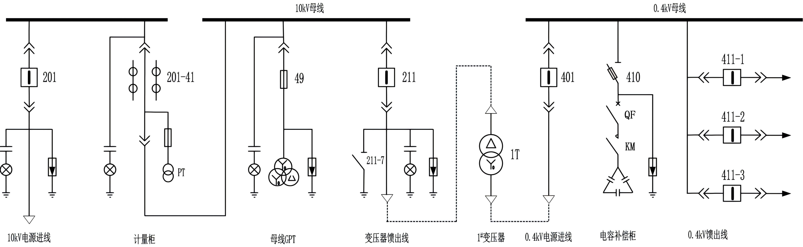

> 本文整理自 **《高压电工作业实操考试题库（2026年版）》科目三：安全操作技术（成套开关柜考位 K31-01 ～ K31-03）**，分值权重为 **40%**，包含双人班组“唱票－复诵－确认－执行”制度及担责规则、高低压开关柜一次系统图、全部评分标准、标准评分票及考生票 1/2/3 填空答案对照。

### 📚 系列导航

1. [考试总览与科目一：安全用具使用（K11-01 ～ K11-04）](/2026/11/27/高压电工实操题库（一）考试总览与科目一安全用具使用/)
2. [科目二：作业现场安全隐患排除（K21-01）](/2026/11/27/高压电工实操题库（二）科目二作业现场安全隐患排除/)
3. **科目三（上）：10/0.4kV 成套开关柜安全操作技术（K31-01 ～ K31-03）**（本文）
4. [科目三（中）：10kV 柱上变压器安全操作技术（K32-01 ～ K32-03）](/2026/11/27/高压电工实操题库（四）科目三柱上变压器安全操作技术/)
5. [科目三（下）：电气设备安装与电路接线（K33-01 ～ K33-05）](/2026/11/27/高压电工实操题库（五）科目三电气设备安装与电路接线/)
6. [科目四：作业现场应急处置实操题库（K41 ～ K44）](/2026/11/27/高压电工实操题库（六）科目四作业现场应急处置实操题库/)

---

## 一、双人班组考试说明与“唱票－复诵－确认－执行”通用规则

*（以下规则同时适用于 K31 成套开关柜考位与 K32 架空线路柱上变压器考位全部 6 道题）*

### 1. 班组配合与计分规则
1. **组队与操作票**：**2 名考生组成一个班组**，在规定时间内互相配合完成考试任务，抽签确定**操作人、监护人**。完善操作票时，**操作人填写操作票，监护人检查操作票，2 人共同确认操作票（允许修改 1 次操作票），签字后提交**。
2. **个人评分项目 vs 班组评分项目**：
   - **个人评分项目**：当考生“安全不合格项”未通过时，仅“安全不合格项”未通过的考生终止考试，成绩计 0 分；出现扣分情况时，扣减相应考生分数。
   - **班组评分项目**：当任意一名考生“安全不合格项”未通过时，**该班组考生均终止考试**，成绩计 0 分；当班组内任意一名考生出现扣分时，同时扣减该班组考生分数。
3. **中途终止与重新分组规则**：考试过程中，当任意一名考生扣分超过 20 分或“安全不合格项”未通过时，该组终止考试；违规考生计 0 分，**扣分未超过 20 分且未涉及“安全不合格项”未通过的另一名考生，重新分组后重新执行考试任务**。
4. 超时未完成全部考核内容的，根据完成项目计分（若未完成部分含“安全不合格项”则计 0 分）；未作答本题或出现人身伤害情况的，计 0 分。

### 2. 倒闸操作监护复诵制度及责任划分标准

操作票中的操作项目必须严格按照 **“唱票 － 复诵 － 确认 － 执行”** 四步流程实施：

| 环节 | 规范操作与纠错口述要求 | 责任划分与“安全不合格项”认定标准 |
| :--- | :--- | :--- |
| **1. 唱票** | 监护人按操作项目顺序清晰、准确朗读操作项目内容。 若监护人唱票错误，操作人不得复诵，应当场告知监护人：“**你唱票内容和操作票不符，请重新核对**”，核对后重新“唱票”。 | （1）监护人唱票错误：操作人未当场告知 → **两人同时担责**；操作人当场告知 → **仅监护人担责**。 （2）监护人唱票正确，操作人当场误报错误 → **仅操作人担责**。 （3）对于仅扣分的操作项目，监护人**连续唱票错误 2 次** → 认定监护人**“安全不合格项”未通过**。 |
| **2. 复诵** | 操作人利用手势指出相应设备，清晰、准确复诵操作项目内容。 若操作人手指设备错误或复诵错误，监护人不得下达许可指令，应当场告知操作人：“**你手指设备或复诵内容和操作票不符，请和我一同核对操作项目内容**”，核对后重新“唱票－复诵”。 | （1）操作人手指或复诵错误：监护人未当场告知 → **两人同时担责**；监护人当场告知 → **仅操作人担责**。 （2）操作人手指及复诵正确，监护人当场误报错误 → **仅监护人担责**。 （3）对于仅扣分的操作项目，操作人**连续复诵错误 2 次** → 认定操作人**“安全不合格项”未通过**。 |
| **3. 确认** | 监护人目视操作人手指设备、确认复诵内容无误后，下达许可指令：“**对，执行**”。 若监护人许可指令错误或不规范，操作人停止操作，当场告知监护人：“**你的指令错误或不规范，请纠正**”，纠正后重新下达许可指令。 | （1）监护人许可指令错误或不规范：操作人未当场告知 → **两人同时担责**；操作人当场告知 → **仅监护人担责**。 （2）监护人许可指令正确，操作人当场误报错误 → **仅操作人担责**。 （3）对于仅扣分的操作项目，监护人**连续确认错误 2 次** → 认定监护人**“安全不合格项”未通过**。 |
| **4. 执行** | 操作人规范执行操作，监护人确认操作到位且无异常后，**在操作项目后方打“√”**。 若操作人执行错误，监护人应立即叫停：未实施实质性误操作或违章操作的，重新执行“唱票－复诵－确认－执行”；已发生实质性误操作或违章操作的，监护人应立即报告事故内容，得到“继续”指令后重新执行流程。 | （1）操作偏差未构成实质性误操作/违章，监护人及时制止 → **仅操作人担责**；已发生实质性误操作/违章，监护人未立即报告 → **两人同时担责**，监护人立即报告 → **仅操作人担责**。 （2）操作人执行正确，监护人当场制止或误报 → **仅监护人担责**。 （3）操作人正确执行后，**监护人未在操作票打“√”** → **仅监护人担责**。 （4）对于仅扣分项目，连续执行错误 2 次 → 相应人员**“安全不合格项”未通过**。 |
| **5. 流程受阻补充** | 因操作人或监护人问题导致某个操作项目无法正常执行“唱票－复诵－确认－执行”流程的，由相应人员担责。 | 对于仅扣分的操作项目，导致 **2 个操作项目**无法正常执行流程的 → 认定相应人员**“安全不合格项”未通过**。 *注：仅扣分的操作项目在监护复诵过程中出现扣分时，仅按考核要点对应“分值”扣分 1 次。* |

---

## 二、高低压开关柜一次系统图（K31 通用附图）

- **10kV 母线侧**：`201`（10kV 电源进线）、`201-41`（计量柜）、`49`（母线 GPT）、`211`（变压器馈出线，带 `211-7` 接地刀闸）→ 连接 `1T`（1#变压器）。
- **0.4kV 母线侧**：`401`（0.4kV 电源进线）、`410`（电容补偿柜 QF/KM）、`411-1 / 411-2 / 411-3`（0.4kV 馈出线）。

---

## 三、030102-K31-01：高压出线柜电缆室照明线路故障排除

- **考试任务**：2 人一组排除 10kV 高压出线柜电缆室照明线路故障（本任务已正确办理工作票或结票）。
- **考试时间**：45 分钟 ｜ **试题分值**：100 分（80 分合格） ｜ **分值权重**：40%

### 1. 评分标准详表

| 考核项目 | 考核内容 | 考核要点 | 评分标准 | 分值或安全不合格项 |
| :--- | :--- | :--- | :--- | :--- |
| **操作前的准备与检查** | 1. 完善操作票 | 抽取操作票，补充（填写）4 项操作项目。操作人填写、监护人检查、2 人共同确认（允许修改 1 次），签字后提交。 | 填写不规范，每项扣 2 分。 填写错误，该班组人员终止考试。 | 8（班组） **安全不合格项（班组）** |
| 〃 | 2. 选择工器具和仪器仪表 | 选择**绝缘手套、绝缘靴**、工频信号发生器、高压验电器、低压验电器、接地线、标示牌，种类、数量满足需要。 | 绝缘手套、绝缘靴任意一项未选择，终止考试。 其余任意一项未选择或数量错误，扣 2 分。 | **安全不合格项（班组）** 2（班组） |
| 〃 | 3. 互检安全防护用品 | 互检**安全帽、工作服、绝缘靴**是否按规范穿戴。 | 任意一人任意一项未穿戴或未规范穿戴，终止考试。 | **安全不合格项（班组）** |
| **10kV 高压开关柜停电** | 4. 倒闸操作执行监护复诵制度 | 按“唱票－复诵－确认－执行”流程实施（详规则见第一节）。 | 按责任划分独立评分。 | ——（个人） |
| 〃 | 5. 倒闸操作安全措施 | 倒闸操作前必须核对设备的名称、编号、运行状态；主回路断路器必须按顺序操作；**倒闸操作过程中必须规范穿戴绝缘手套**。 | 未核对、主回路断路器操作错误或未规范穿戴绝缘手套，终止考试。 | **安全不合格项（班组）** |
| 〃 | 6. 模拟倒闸操作 | 模拟倒闸操作。 | 未模拟操作，扣 10 分。 | 10（班组） |
| 〃 | 7. 倒闸操作（共 25 步） | 1. 退出 410 电容器组。 2. 拉开 411 各出线开关。 3. **检查 411 各出线开关确已拉开。** 4. 拉开 401 进线开关。 5. **检查 401 进线开关确已拉开。** 6. 将 401 进线开关摇至试验位置。 7. 检查 401 进线开关在试验位置。 8. **检查 211 出线带电显示器三相灯亮。** 9. 拉开 211 出线开关。 10. 检查 211 出线开关确已拉开。 11. **检查 211 出线带电显示器三相灯灭。** 12. 将 211 出线开关手车摇至试验位置。 13. 检查 211 出线开关手车在试验位置。 14. 合上 211-7 接地刀闸。 15. 检查 211-7 接地刀闸确已合上。 16. 拉开 211 出线开关储能电源。 17. 拉开 211 出线开关控制电源。 18. 在 211 出线开关操作把手上悬挂“禁止合闸、有人工作”标示牌。 19. 在 211-7 接地刀闸操作把手上悬挂“已接地”标示牌。 20. 在 201 进线柜、201-41 计量柜、49PT 柜周边装设围栏，悬挂“止步，高压危险”标示牌。 21. **在 211 出线柜电缆室门处悬挂“在此工作”标示牌。** 22. **在 1#变压器低压侧验电，确认无电。** 23. **在 1#变压器低压侧挂 1#接地线。** 24. 在 401 进线开关操作把手上悬挂“已接地”标示牌。 25. 在 401 进线开关操作把手上悬挂“禁止合闸、有人工作”标示牌。 | 违反监护复诵制度要求按步扣分（个人评分项目）： • **安全不合格项（终止考试）**：第 **3、5、8、11、22** 步违反监护复诵要求，以及第 **23** 步**地线挂设位置错误**。 • 其余步骤扣分：第1步(3分)、第2步(4分)、第4步(5分)、第6步(4分)、第7步(3分)、第9步(5分)、第10步(4分)、第12步(3分)、第13步(3分)、第14步(5分)、第15步(2分)、第16步(2分)、第17步(2分)、第18步(3分)、第19步(3分)、第20步(3分)、第21步(2分)、第23步违反监护复诵(8分)、第24步(3分)、第25步(3分)。 | 见左栏明细（个人） |
| **高压出线柜电缆室照明线路故障排除** | 8. 故障排除 | 1. **高压验电器经工频信号发生器校验正常后，在高压出线柜电缆室门部位进行验电，确认设备无电。** 2. 确认高压出线柜电缆室照明线路故障点（*注：故障点为照明灯损坏，悬挂“照明灯损坏”标示牌*）。 3. 排除照明线路故障（*注：方式为摘取“照明灯损坏”标示牌，更换照明灯*）。 | 1. 未验电并确认无电，终止考试。 2. 未确认故障点，扣 3 分。 3. 未排除照明线路故障，扣 3 分。 | **安全不合格项（班组）** 3（班组） 3（班组） |
| **场地整理** | 9. 整理场地 | 将工器具放置在指定位置。 | 任意一项未放置在指定位置，扣 4 分。 | 4（班组） |

### 2. 操作票（操作任务：`211 出线 1#变压器由运行转检修`，勾选 `√ 监护操作`）

上表第 7 项的 **1～25 步**即为完整《评分票》标准顺序。三份考生票缺失的 4 个空位及干扰备选项对照如下：

- **考生票 1 缺失项**：
  - 顺序 `4` → **拉开 401 进线开关**
  - 顺序 `5` → **检查 401 进线开关确已拉开**
  - 顺序 `8` → **检查 211 出线带电显示器三相灯亮**
  - 顺序 `11` → **检查 211 出线带电显示器三相灯灭**
  - *（排除干扰项：“拉开 411 出线开关”“检查 411 出线开关确已拉开”）*
- **考生票 2 缺失项**：
  - 顺序 `1` → **退出 410 电容器组**
  - 顺序 `2` → **拉开 411 各出线开关**
  - 顺序 `3` → **检查 411 各出线开关确已拉开**
  - 顺序 `20` → **在 201 进线柜、201-41 计量柜、49PT 柜周围装设围栏，悬挂“止步，高压危险”标示牌**
  - *（排除干扰项：已有的第 4、5 步“拉开 401 进线开关”“检查 401 进线开关确已拉开”）*
- **考生票 3 缺失项**：
  - 顺序 `14` → **合上 211-7 接地刀闸**
  - 顺序 `15` → **检查 211-7 接地刀闸确已合上**
  - 顺序 `22` → **在 1#变压器低压侧验电，确认无电**
  - 顺序 `23` → **在 1#变压器低压侧挂 1#接地线**
  - *（排除干扰项：“在 401 进线开关上口验电，确认无电”“在 401 进线开关变压器侧挂 2#接地线”）*

---

## 四、030102-K31-02：1#变压器低压绕组对地绝缘测试

- **考试任务**：2 人一组完成 1#变压器低压绕组对地绝缘测试（本任务已正确办理工作票或结票）。
- **考试时间**：45 分钟 ｜ **试题分值**：100 分（80 分合格） ｜ **分值权重**：40%

### 1. 与 K31-01 的核心差异与评分标准

本题“准备与检查、监护复诵、倒闸安全措施、模拟倒闸、整理场地”与 `K31-01` 结构一致，**三大关键差异**如下：

1. **步骤 2 选择工器具和仪器仪表**：
   - 需选择：**绝缘手套、绝缘靴、兆欧表**（此三项中**任意一项未选择 → 安全不合格项，终止考试**），以及工频信号发生器、低压验电器、接地线、标示牌（未选或数量错误扣 2 分，注意本题不选高压验电器，多选了兆欧表）。
2. **步骤 7 倒闸操作（共 25 步）**：
   - 第 1～20 步、第 22～25 步及分值/安全不合格项与 `K31-01` **完全相同**！
   - **唯一不同在第 21 步**：`21. 在 1#变压器室低压侧门上悬挂“在此工作”标示牌。`（扣分值同为 2 分；*注：操作票第 19 步原文表述为 `在 211-7 操作把手上悬挂“已接地”标示牌`*）。
3. **步骤 8 绝缘测试（6 分，班组评分项目）**：
   - **考核要点**：**正确取下 1#接地线后**，按规范用**短接线夹将高压绕组、铁芯、夹件对地短接**后，测量变压器低压绕组对地绝缘电阻，记录测量结果并判断设备绝缘状况（*注：**绝缘电阻 ≥ 300MΩ 为合格***）。
   - **评分标准**：
     - 未取下 1#接地线或未按规范测量，扣 **3 分**。
     - 未记录测量结果或测量结果错误或未判断设备绝缘状况或判断错误，扣 **3 分**。

### 2. 操作票（操作任务：`211 出线 1#变压器由运行转检修`，勾选 `√ 监护操作`）

- **考生票 1 缺失项**：
  - 顺序 `4` → **拉开 401 进线开关**
  - 顺序 `5` → **检查 401 进线开关确已拉开**
  - 顺序 `9` → **拉开 211 出线开关**
  - 顺序 `10` → **检查 211 出线开关确已拉开**
  - *（排除干扰项：“拉开 201 出线开关”“检查 201 出线开关确已拉开”）*
- **考生票 2 缺失项**：
  - 顺序 `12` → **将 211 出线开关手车摇至试验位置**
  - 顺序 `13` → **检查 211 出线开关手车在试验位置**
  - 顺序 `20` → **在 201 进线柜、201-41 计量柜、49PT 柜周围装设围栏，悬挂“止步，高压危险”标示牌**
  - 顺序 `21` → **在 1#变压器室低压侧门上悬挂“在此工作”标示牌**
  - *（排除干扰项：把“在此工作”与“止步，高压危险”悬挂位置颠倒的两项）*
- **考生票 3 缺失项**：
  - 顺序 `14` → **合上 211-7 接地刀闸**
  - 顺序 `15` → **检查 211-7 接地刀闸确已合上**
  - 顺序 `18` → **在 211 出线开关操作把手上悬挂“禁止合闸、有人工作”标示牌**
  - 顺序 `19` → **在 211-7 接地刀闸操作把手上悬挂“已接地”标示牌**
  - *（排除干扰项：“拉开 211-7 接地刀闸”“检查 211-7 接地刀闸确已拉开”）*

### 3. 附件 2：变压器低压绕组对地绝缘测试记录表

- **考生信息**：考生 1 姓名/身份证号、考生 2 姓名/身份证号
- **兆欧表参数**：`电压等级（含单位）`、`温度（含单位）`、`湿度（含单位）`
- **被测物**：`干式电力变压器` ｜ **测试内容**：`a、b、c、n-E`（*备注：a、b、c、n 为低压绕组相端*）
- **填写与判定**：`测量值（含单位）` ｜ `□ 绝缘合格` / `□ 绝缘不合格`（≥300MΩ 为合格）

---

## 五、030102-K31-03：10kV 高压开关柜倒闸操作（送电）

- **考试任务**：2 人一组完成 10kV 高压开关柜倒闸操作（操作任务：`211 出线 1#变压器由检修转运行`）。
- **考试时间**：35 分钟 ｜ **试题分值**：100 分（80 分合格） ｜ **分值权重**：40%

### 1. 评分标准详表

| 考核项目 | 考核内容 | 考核要点 | 评分标准 | 分值或安全不合格项 |
| :--- | :--- | :--- | :--- | :--- |
| **操作前的准备与检查** | 1. 完善操作票 | 抽取操作票，补充 4 项操作项目；操作人填写、监护人检查、2 人确认（允许修改 1 次），签字提交。 | 填写不规范每项扣 2 分。 填写错误终止考试。 | 8（班组） **安全不合格项（班组）** |
| 〃 | 2. 选择工器具和仪器仪表 | 根据考试任务选择**绝缘手套、绝缘靴**。 | 任意一项未选择，终止考试。 | **安全不合格项（班组）** |
| 〃 | 3. 互检安全防护用品 | 互检**安全帽、工作服、绝缘靴**是否按规范穿戴。 | 任意一人任意一项未穿戴或未规范穿戴，终止考试。 | **安全不合格项（班组）** |
| **10kV 高压开关柜送电** | 4. 倒闸操作执行监护复诵制度 | 按“唱票－复诵－确认－执行”流程实施。 | 按责任划分独立评分。 | ——（个人） |
| 〃 | 5. 倒闸操作安全措施 | 倒闸前核对设备名称、编号、运行状态；主回路断路器按顺序操作；过程中规范穿戴绝缘手套。 | 未核对、主回路断路器操作错误或未规范穿戴绝缘手套，终止考试。 | **安全不合格项（班组）** |
| 〃 | 6. 模拟倒闸操作 | 模拟倒闸操作。 | 未模拟操作，扣 10 分。 | 10（班组） |
| 〃 | 7. 倒闸操作（共 22 步） | 1. 拆除 1#变压器低压侧 1#接地线。（5分） 2. 取下 401 进线开关操作把手上“已接地”标示牌。（3分） 3. 取下 401 进线开关操作把手上“禁止合闸，有人工作”标示牌。（3分） 4. 检查 401 进线开关在断开位置。（5分） 5. 取下 211 出线开关操作把手上“禁止合闸，有人工作”标示牌。（3分） 6. 拆除 201 进线柜、201-41 计量柜、49PT 柜周围围栏，取下“止步，高压危险”标示牌。（2分） 7. 取下 211-7 接地刀闸操作把手上“已接地”标示牌（*注：操作票印作 `取下 211 出线开关操作把手上“已接地”标示牌`*）。（3分） 8. 合上 211 出线开关控制电源。（3分） 9. 合上 211 出线开关储能电源。（3分） 10. **拉开 211-7 接地刀闸。**（4分；**未先核对 211 出线开关处于断开位置后拉开接地刀闸 → 安全不合格项**） 11. 检查 211-7 接地刀闸确已拉开。（5分） 12. 将 211 出线开关手车摇至工作位置。（3分） 13. 检查 211 出线开关手车在工作位置。（3分） 14. **合上 211 出线开关。**（4分；**未拉开接地刀闸送电 → 安全不合格项**） 15. 检查 211 出线开关确已合上。（4分） 16. 将 401 进线开关摇至工作位置。（3分） 17. 检查 401 进线开关在工作位置。（3分） 18. 合上 401 进线开关。（4分） 19. 检查 401 进线开关确已合上。（4分） 20. 合上 411 各出线开关。（4分） 21. 检查 411 各出线开关确已合上。（3分） 22. 投入 410 电容器组。（4分） | 违反监护复诵制度按括号内分值扣分； ⚠️ **两项恶性误操作直接终止考试（安全不合格项）**： • 第 10 步未先核对 211 出线开关在断开位置就拉接地刀闸； • 第 14 步未拉开接地刀闸送电。 | 见左栏明细（个人） |
| **场地整理** | 8. 整理场地 | 将工器具放置在指定位置。 | 任意一项未放置在指定位置，扣 4 分。 | 4（班组） |

### 2. 操作票（操作任务：`211 出线 1#变压器由检修转运行`，勾选 `√ 监护操作`）

- **考生票 1 缺失项**：
  - 顺序 `2` → **取下 401 进线开关操作把手上“已接地”标示牌**
  - 顺序 `3` → **取下 401 进线开关操作把手上“禁止合闸，有人工作”标示牌**
  - 顺序 `8` → **合上 211 出线开关控制电源**
  - 顺序 `9` → **合上 211 出线开关储能电源**
  - *（排除干扰项：“合上 201 出线开关控制电源”“合上 201 出线开关储能电源”）*
- **考生票 2 缺失项**：
  - 顺序 `1` → **拆除 1#变压器低压侧 1#接地线**
  - 顺序 `4` → **检查 401 进线开关在断开位置**
  - 顺序 `10` → **拉开 211-7 接地刀闸**
  - 顺序 `11` → **检查 211-7 接地刀闸确已拉开**
  - *（排除干扰项：“拆除 411 出线开关变压器侧 1#接地线”“检查 401 进线开关在工作位置”）*
- **考生票 3 缺失项**：
  - 顺序 `12` → **将 211 出线开关手车摇至工作位置**
  - 顺序 `13` → **检查 211 出线开关手车在工作位置**
  - 顺序 `21` → **检查 411 各出线开关确已合上**
  - 顺序 `22` → **投入 410 电容器组**
  - *（排除干扰项：“将 211 出线开关手车摇至试验位置”“检查 211 出线开关手车在试验位置”）*
