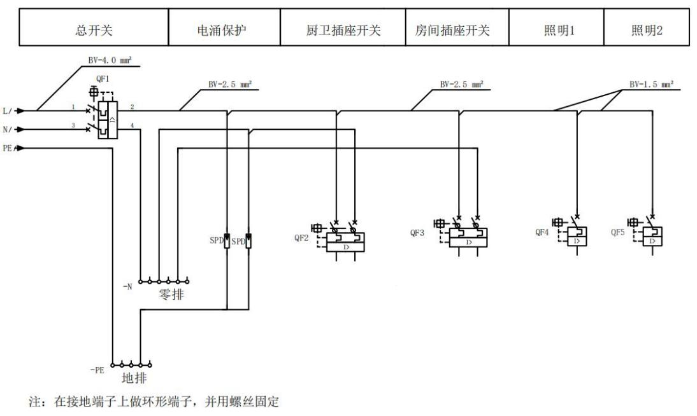
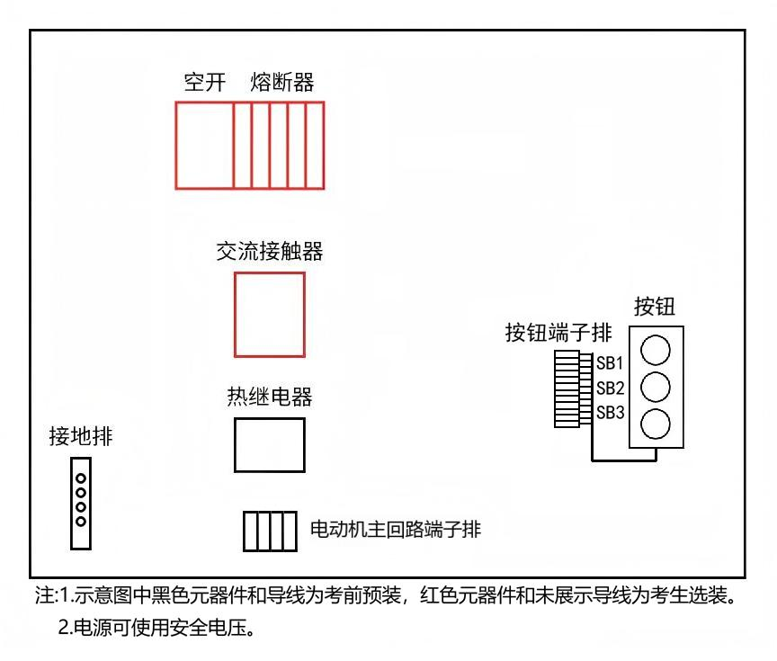

> 本文完整收录 **《高压电工作业实操考试题库（2026年版）》科目三：电气设备安装考位（K33-01 ～ K33-05）**。每道考题均先完整呈现全部原始任务、电路原理图、带网格线的完整评分标准表与操作台元器件布局示意图，最后在文末进行总结归纳。

### 📚 系列导航

1. [考试总览与科目一：安全用具使用（K11-01 ～ K11-04）](/2026/11/27/高压电工实操题库（一）考试总览与科目一安全用具使用/)
2. [科目二：作业现场安全隐患排除（K21-01）](/2026/11/27/高压电工实操题库（二）科目二作业现场安全隐患排除/)
3. [科目三（上）：10/0.4kV 成套开关柜安全操作技术（K31-01 ～ K31-03）](/2026/11/27/高压电工实操题库（三）科目三成套开关柜安全操作技术/)
4. [科目三（中）：10kV 柱上变压器安全操作技术（K32-01 ～ K32-03）](/2026/11/27/高压电工实操题库（四）科目三柱上变压器安全操作技术/)
5. **科目三（下）：电气设备安装与电路接线（K33-01 ～ K33-05）**（本文）
6. [科目四：作业现场应急处置实操题库（K41 ～ K44）](/2026/11/27/高压电工实操题库（六）科目四作业现场应急处置实操题库/)

---

## 一、030102-K33-01：低压配电箱安装接线

### 1. 试题要求与考试说明
- **1. 试题编码**：`030102-K33-01`
- **2. 试题题目**：高压电工作业－电气设备安装考位－低压配电箱安装接线
- **3. 考试任务**：
  1. 在器材摆放架上选择所需电工工具和仪器仪表，根据电路图选择相应元器件及合适的导线。
  2. 在配电箱里安装接地母线（接地母线做环形端子并用螺母紧固），零线排、地线排粘贴标识，安装元器件并规范接线。
  3. 检查电路。
  4. 拆除电路，整理场地。
- **4. 考试时间**：30 分钟
- **5. 试题分值**：100 分，80 分及以上合格。
- **6. 考试说明**：
  1. 在规定时间内完成考试任务。
  2. 考试过程中扣分超过 20 分或“安全不合格项”未通过的，终止考试，本次实操考试成绩计 0 分。
  3. 超时未完成全部考核内容的，根据完成项目计分，如未完成部分有“安全不合格项”的，本次实操考试成绩计 0 分。
  4. 未作答本题的，本次实操考试成绩计 0 分。
  5. 考试过程中出现人身伤害情况的，终止考试，本次实操考试成绩计 0 分。
- **7. 分值权重**：40%
- **8. 评分标准**：见下表

### 2. 电路原理图（030102-K33-01）

### 3. 完整评分标准表（030102-K33-01）

<table class="exam-table">
  <thead>
    <tr>
      <th style="width:12%">考核项目</th>
      <th style="width:16%">考核内容</th>
      <th style="width:32%">考核要点</th>
      <th style="width:24%">评分标准</th>
      <th style="width:11%">分值或安全不合格项</th>
      <th style="width:5%">扣分</th>
    </tr>
  </thead>
  <tbody>
    <tr>
      <td class="col-proj" rowspan="4">操作前准备与检查</td>
      <td class="col-item" rowspan="1">1. 穿戴安全防护用品</td>
      <td rowspan="1">按规范穿戴安全帽、工作服、绝缘鞋进入考位。</td>
      <td>任意一项未穿戴或未按规范穿戴，终止考试。</td>
      <td class="col-score">安全不合格项</td>
      <td class="col-deduct"></td>
    </tr>
    <tr>
      <td class="col-item" rowspan="1">2. 选择工器具和仪器仪表</td>
      <td rowspan="1">正确选择螺丝刀、剥线钳、压接钳、尖嘴钳、扳手、万用表。</td>
      <td>未选择或选择错误，每项扣 1 分。</td>
      <td class="col-score">6</td>
      <td class="col-deduct"></td>
    </tr>
    <tr>
      <td class="col-item" rowspan="1">3. 选择并检测元器件</td>
      <td rowspan="1">根据电路图选择元器件，使用万用表检测所选元器件是否正常。</td>
      <td>未选择或选择错误或未检测，每个扣 1 分。</td>
      <td class="col-score">6</td>
      <td class="col-deduct"></td>
    </tr>
    <tr>
      <td class="col-item" rowspan="1">4. 检查配电箱</td>
      <td rowspan="1">检查配电箱外观有无变形破损，检查箱体内导轨、接地端子、接零端子是否安装牢固。</td>
      <td>未检查，每处扣 1 分。</td>
      <td class="col-score">4</td>
      <td class="col-deduct"></td>
    </tr>
    <tr>
      <td class="col-proj" rowspan="7">安装调试</td>
      <td class="col-item" rowspan="3">5. 连接接地系统</td>
      <td rowspan="3">安装接地母线（环形端子）并用螺母紧固，连接接地排与箱体。</td>
      <td>未做压接环形端子，扣 5 分。</td>
      <td class="col-score">5</td>
      <td class="col-deduct"></td>
    </tr>
    <tr>
      <td>未用螺母紧固，扣 8 分。</td>
      <td class="col-score">8</td>
      <td class="col-deduct"></td>
    </tr>
    <tr>
      <td>接地母线与箱体未可靠连接，扣 10 分。</td>
      <td class="col-score">10</td>
      <td class="col-deduct"></td>
    </tr>
    <tr>
      <td class="col-item" rowspan="1">6. 粘贴标识</td>
      <td rowspan="1">在零线排和地线排处粘贴标识。</td>
      <td>未粘贴，每处扣 2 分。</td>
      <td class="col-score">4</td>
      <td class="col-deduct"></td>
    </tr>
    <tr>
      <td class="col-item" rowspan="2">7. 安装元器件</td>
      <td rowspan="2">根据电路图正确安装断路器、漏电保护器、电涌保护器。</td>
      <td>未正确安装，每个扣 2 分。</td>
      <td class="col-score">8</td>
      <td class="col-deduct"></td>
    </tr>
    <tr>
      <td>安装位置错误，每处扣 2 分。</td>
      <td class="col-score">8</td>
      <td class="col-deduct"></td>
    </tr>
    <tr>
      <td class="col-item" rowspan="1">8. 安装与检测电路</td>
      <td rowspan="1">根据电路图选用正确颜色和线径导线，并规范接线。完成安装后使用万用表检测电路有无短路、断路故障。</td>
      <td>未检测电路，扣 6 分。</td>
      <td class="col-score">6</td>
      <td class="col-deduct"></td>
    </tr>
    <tr>
      <td class="col-proj" rowspan="5">质量核查</td>
      <td class="col-item" rowspan="5">9. 核查安装质量</td>
      <td rowspan="5">根据电路图核查元器件及导线安装情况。</td>
      <td>选用导线颜色或线径错误，每处扣 2 分。</td>
      <td class="col-score">6</td>
      <td class="col-deduct"></td>
    </tr>
    <tr>
      <td>接线出现松动或露铜过长或压绝缘皮，每处扣 2 分。</td>
      <td class="col-score">8</td>
      <td class="col-deduct"></td>
    </tr>
    <tr>
      <td>布线出现飞线，扣 6 分。</td>
      <td class="col-score">6</td>
      <td class="col-deduct"></td>
    </tr>
    <tr>
      <td>出现断路故障，每处扣 5 分。</td>
      <td class="col-score">5</td>
      <td class="col-deduct"></td>
    </tr>
    <tr>
      <td>出现短路故障，终止考试。</td>
      <td class="col-score">安全不合格项</td>
      <td class="col-deduct"></td>
    </tr>
    <tr>
      <td class="col-proj" rowspan="3">场地整理</td>
      <td class="col-item" rowspan="1">10. 拆除电路</td>
      <td rowspan="1">拆除安装的导线、元器件。</td>
      <td>未全部拆除，扣 6 分。</td>
      <td class="col-score">6</td>
      <td class="col-deduct"></td>
    </tr>
    <tr>
      <td class="col-item" rowspan="2">11. 整理场地</td>
      <td rowspan="2">将拆除的导线、元器件、配电箱及工器具放置在指定位置，清理场地。</td>
      <td>任意一项未放置在指定位置，扣 2 分。</td>
      <td class="col-score">2</td>
      <td class="col-deduct"></td>
    </tr>
    <tr>
      <td>未清理场地，扣 2 分。</td>
      <td class="col-score">2</td>
      <td class="col-deduct"></td>
    </tr>
  </tbody>
</table>

---

## 二、030102-K33-02：单相电能表带照明设备接线

### 1. 试题要求与考试说明
- **1. 试题编码**：`030102-K33-02`
- **2. 试题题目**：高压电工作业－电气设备安装考位－单相电能表带照明设备接线
- **3. 考试任务**：
  1. 在器材摆放架上选择所需电工工具和仪器仪表，根据电路图选择缺失的元器件及合适的导线。
  2. 在操作台上安装缺失的元器件，并规范接线，将镇流器通过端子排接入电路（与镇流器连接的灯管为 Ⅱ 类灯具）。
  3. 在电路图指定位置完成导线锡焊连接操作。
  4. 检查并通电调试，只允许调试 2 次。
  5. 拆除电路，整理场地。
- **4. 考试时间**：45 分钟
- **5. 试题分值**：100 分，80 分及以上合格。
- **6. 考试说明**：
  1. 在规定时间内完成考试任务。
  2. 考试过程中扣分超过 20 分或“安全不合格项”未通过的，终止考试，本次实操考试成绩计 0 分。
  3. 超时未完成全部考核内容的，根据完成项目计分，如未完成部分有“安全不合格项”的，本次实操考试成绩计 0 分。
  4. 未作答本题的，本次实操考试成绩计 0 分。
  5. 考试过程中出现人身伤害情况的，终止考试，本次实操考试成绩计 0 分。
- **7. 分值权重**：40%
- **8. 评分标准**：见下表

### 2. 电路原理图（030102-K33-02）

### 3. 完整评分标准表（030102-K33-02）

<table class="exam-table">
  <thead>
    <tr>
      <th style="width:12%">考核项目</th>
      <th style="width:16%">考核内容</th>
      <th style="width:32%">考核要点</th>
      <th style="width:24%">评分标准</th>
      <th style="width:11%">分值或安全不合格项</th>
      <th style="width:5%">扣分</th>
    </tr>
  </thead>
  <tbody>
    <tr>
      <td class="col-proj" rowspan="4">操作前准备与检查</td>
      <td class="col-item" rowspan="1">1. 穿戴安全防护用品</td>
      <td rowspan="1">按规范穿戴安全帽、工作服、绝缘鞋进入考位。</td>
      <td>任意一项未穿戴或未按规范穿戴，终止考试。</td>
      <td class="col-score">安全不合格项</td>
      <td class="col-deduct"></td>
    </tr>
    <tr>
      <td class="col-item" rowspan="1">2. 选择工器具和仪器仪表</td>
      <td rowspan="1">正确选择螺丝刀、剥线钳、尖嘴钳、绝缘胶布、万用表、低压验电笔、电烙铁（含焊锡丝、松香）。</td>
      <td>未选择或选择错误，每项扣 1 分。</td>
      <td class="col-score">5</td>
      <td class="col-deduct"></td>
    </tr>
    <tr>
      <td class="col-item" rowspan="1">3. 确认安装条件</td>
      <td rowspan="1">确认操作台电源开关断开，验电并悬挂“禁止合闸，有人工作”标示牌。</td>
      <td>未确认操作台电源开关断开状态或未验电或未悬挂标示牌，终止考试。</td>
      <td class="col-score">安全不合格项</td>
      <td class="col-deduct"></td>
    </tr>
    <tr>
      <td class="col-item" rowspan="1">4. 选择并检测元器件</td>
      <td rowspan="1">根据电路图选择元器件，使用万用表检测所选元器件是否正常。</td>
      <td>未选择或选择错误或未检测，每个扣 1 分。</td>
      <td class="col-score">5</td>
      <td class="col-deduct"></td>
    </tr>
    <tr>
      <td class="col-proj" rowspan="12">安装调试</td>
      <td class="col-item" rowspan="2">5. 安装与检测电路</td>
      <td rowspan="2">根据电路图和设备功率，选用正确颜色和线径导线完成安装，将镇流器通过端子排接入电路。完成安装后使用万用表检测电路。</td>
      <td>未接接地线，扣 5 分。</td>
      <td class="col-score">5</td>
      <td class="col-deduct"></td>
    </tr>
    <tr>
      <td>未检测电路，扣 2 分。</td>
      <td class="col-score">2</td>
      <td class="col-deduct"></td>
    </tr>
    <tr>
      <td class="col-item" rowspan="3">6. 电路送电</td>
      <td rowspan="3">申请送电后，按操作台电源开关、线路总断路器、各支路断路器顺序送电。</td>
      <td>未申请即送电调试，扣 3 分。</td>
      <td class="col-score">3</td>
      <td class="col-deduct"></td>
    </tr>
    <tr>
      <td>送电顺序错误，扣 5 分。</td>
      <td class="col-score">5</td>
      <td class="col-deduct"></td>
    </tr>
    <tr>
      <td>送电过程中出现短路故障，终止考试。</td>
      <td class="col-score">安全不合格项</td>
      <td class="col-deduct"></td>
    </tr>
    <tr>
      <td class="col-item" rowspan="5">7. 调试与核查电路功能</td>
      <td rowspan="5">按规范对电路进行检查、测试、维修等调试，其中维修（含接线）必须在断电情况下进行，根据情况悬挂或拆除“禁止合闸，有人工作”标示牌。只允许调试电路 2 次，即首次通电后电路功能不正常，进行第 1 次调试；再次通电后电路功能仍不正常，进行第 2 次调试。完成调试后申请核查电路功能。</td>
      <td>调试电路过程中出现短路故障或未断电维修（含接线）或未正确使用标示牌或调试电路超过 2 次或核查电路时出现短路故障，终止考试。</td>
      <td class="col-score">安全不合格项</td>
      <td class="col-deduct"></td>
    </tr>
    <tr>
      <td>核查电路时出现单相电能表功能不正常，扣 5 分。</td>
      <td class="col-score">5</td>
      <td class="col-deduct"></td>
    </tr>
    <tr>
      <td>核查电路时出现双控灯电路功能不正常，扣 10 分。</td>
      <td class="col-score">10</td>
      <td class="col-deduct"></td>
    </tr>
    <tr>
      <td>核查电路时出现日光灯电路功能不正常，扣 10 分。</td>
      <td class="col-score">10</td>
      <td class="col-deduct"></td>
    </tr>
    <tr>
      <td>核查电路时出现插座电路功能不正常，扣 5 分。</td>
      <td class="col-score">5</td>
      <td class="col-deduct"></td>
    </tr>
    <tr>
      <td class="col-item" rowspan="2">8. 电路断电</td>
      <td rowspan="2">按设备开关、各支路断路器、线路总断路器、操作台电源开关顺序断电。</td>
      <td>断电顺序错误，扣 5 分。</td>
      <td class="col-score">5</td>
      <td class="col-deduct"></td>
    </tr>
    <tr>
      <td>未断电即进行下一步操作，终止考试。</td>
      <td class="col-score">安全不合格项</td>
      <td class="col-deduct"></td>
    </tr>
    <tr>
      <td class="col-proj" rowspan="6">质量核查</td>
      <td class="col-item" rowspan="6">9. 核查安装质量</td>
      <td rowspan="6">根据电路图核查元器件及导线安装情况（含使用电烙铁在指定位置完成导线锡焊连接操作）。</td>
      <td>元器件安装不规范，每处扣 2 分。</td>
      <td class="col-score">6</td>
      <td class="col-deduct"></td>
    </tr>
    <tr>
      <td>选用导线颜色或线径错误，每处扣 2 分。</td>
      <td class="col-score">6</td>
      <td class="col-deduct"></td>
    </tr>
    <tr>
      <td>接线出现松动或露铜过长或压绝缘皮，每处扣 2 分。</td>
      <td class="col-score">6</td>
      <td class="col-deduct"></td>
    </tr>
    <tr>
      <td>布线出现飞线，每处扣 2 分。</td>
      <td class="col-score">6</td>
      <td class="col-deduct"></td>
    </tr>
    <tr>
      <td>未进行锡焊连接操作或锡焊连接不规范，扣分 6 分。</td>
      <td class="col-score">6</td>
      <td class="col-deduct"></td>
    </tr>
    <tr>
      <td>非指定位置使用端子排接线或锡焊连接处未进行绝缘处理，终止考试。</td>
      <td class="col-score">安全不合格项</td>
      <td class="col-deduct"></td>
    </tr>
    <tr>
      <td class="col-proj" rowspan="3">场地整理</td>
      <td class="col-item" rowspan="1">10. 拆除电路</td>
      <td rowspan="1">拆除安装的导线、元器件。</td>
      <td>未全部拆除，扣 6 分。</td>
      <td class="col-score">6</td>
      <td class="col-deduct"></td>
    </tr>
    <tr>
      <td class="col-item" rowspan="2">11. 整理场地</td>
      <td rowspan="2">将拆除的导线、剩余导线、元器件、标示牌及工器具放置在指定位置，清理场地。</td>
      <td>任意一项未放置在指定位置，扣 2 分。</td>
      <td class="col-score">2</td>
      <td class="col-deduct"></td>
    </tr>
    <tr>
      <td>未清理场地，扣 2 分。</td>
      <td class="col-score">2</td>
      <td class="col-deduct"></td>
    </tr>
  </tbody>
</table>

### 4. 附件：操作台元器件布局示意图（030102-K33-02）

---

## 三、030102-K33-03：三相异步电动机单向连续运转电路接线（带点动控制）

### 1. 试题要求与考试说明
- **1. 试题编码**：`030102-K33-03`
- **2. 试题题目**：高压电工作业－电气设备安装考位-三相异步电动机单向连续运转电路接线（带点动控制）
- **3. 考试任务**：
  1. 在器材摆放架上选择所需电工工具和仪器仪表，根据电路图选择缺失的元器件及合适的导线。
  2. 在操作台上安装缺失的元器件，并规范接线，将电动机主回路（U、V、W、PE）、按钮控制线通过端子排接入电路。
  3. 在电路图指定位置完成导线一字型（平接）绞合连接操作。
  4. 检查并通电调试，只允许调试 2 次。
  5. 拆除电路，整理场地。
- **4. 考试时间**：45 分钟
- **5. 试题分值**：100 分，80 分及以上合格。
- **6. 考试说明**：
  1. 在规定时间内完成考试任务。
  2. 考试过程中扣分超过 20 分或“安全不合格项”未通过的，终止考试，本次实操考试成绩计 0 分。
  3. 超时未完成全部考核内容的，根据完成项目计分，如未完成部分有“安全不合格项”的，本次实操考试成绩计 0 分。
  4. 未作答本题的，本次实操考试成绩计 0 分。
  5. 考试过程中出现人身伤害情况的，终止考试，本次实操考试成绩计 0 分。
- **7. 分值权重**：40%
- **8. 评分标准**：见下表

### 2. 电路原理图（030102-K33-03）

### 3. 完整评分标准表（030102-K33-03）

<table class="exam-table">
  <thead>
    <tr>
      <th style="width:12%">考核项目</th>
      <th style="width:16%">考核内容</th>
      <th style="width:32%">考核要点</th>
      <th style="width:24%">评分标准</th>
      <th style="width:11%">分值或安全不合格项</th>
      <th style="width:5%">扣分</th>
    </tr>
  </thead>
  <tbody>
    <tr>
      <td class="col-proj" rowspan="4">操作前准备与检查</td>
      <td class="col-item" rowspan="1">1. 穿戴安全防护用品</td>
      <td rowspan="1">按规范穿戴安全帽、工作服、绝缘鞋进入考位。</td>
      <td>任意一项未穿戴或未按规范穿戴，终止考试。</td>
      <td class="col-score">安全不合格项</td>
      <td class="col-deduct"></td>
    </tr>
    <tr>
      <td class="col-item" rowspan="1">2. 选择工器具和仪器仪表</td>
      <td rowspan="1">正确选择螺丝刀、剥线钳、尖嘴钳、绝缘胶布、万用表、低压验电笔。</td>
      <td>未选择或选择错误，每项扣 1 分。</td>
      <td class="col-score">5</td>
      <td class="col-deduct"></td>
    </tr>
    <tr>
      <td class="col-item" rowspan="1">3. 确认安装条件</td>
      <td rowspan="1">确认操作台电源开关断开，验电并悬挂“禁止合闸，有人工作”标示牌。</td>
      <td>未确认操作台电源开关断开状态或未验电或未悬挂标示牌，终止考试。</td>
      <td class="col-score">安全不合格项</td>
      <td class="col-deduct"></td>
    </tr>
    <tr>
      <td class="col-item" rowspan="1">4. 选择并检测元器件</td>
      <td rowspan="1">根据电路图选择元器件，使用万用表检测所选元器件是否正常。</td>
      <td>未选择或选择错误或未检测，每个扣 1 分。</td>
      <td class="col-score">5</td>
      <td class="col-deduct"></td>
    </tr>
    <tr>
      <td class="col-proj" rowspan="12">安装调试</td>
      <td class="col-item" rowspan="3">5. 安装与检测电路</td>
      <td rowspan="3">根据电路图和电动机功率，选用正确颜色和线径导线完成安装，将电动机主回路（U、V、W、PE）、按钮控制线通过端子排接入电路。完成安装后使用万用表检测电路。</td>
      <td>未接接地线，扣 5 分。</td>
      <td class="col-score">5</td>
      <td class="col-deduct"></td>
    </tr>
    <tr>
      <td>未检测主电路，扣 1 分。</td>
      <td class="col-score">1</td>
      <td class="col-deduct"></td>
    </tr>
    <tr>
      <td>未检测控制电路，扣 1 分。</td>
      <td class="col-score">1</td>
      <td class="col-deduct"></td>
    </tr>
    <tr>
      <td class="col-item" rowspan="3">6. 电路送电</td>
      <td rowspan="3">申请送电后，按操作台电源开关、线路断路器顺序送电。</td>
      <td>未申请即送电调试，扣 3 分。</td>
      <td class="col-score">3</td>
      <td class="col-deduct"></td>
    </tr>
    <tr>
      <td>送电顺序错误，扣 5 分。</td>
      <td class="col-score">5</td>
      <td class="col-deduct"></td>
    </tr>
    <tr>
      <td>送电过程中出现短路故障，终止考试。</td>
      <td class="col-score">安全不合格项</td>
      <td class="col-deduct"></td>
    </tr>
    <tr>
      <td class="col-item" rowspan="4">7. 调试与核查电路功能</td>
      <td rowspan="4">按规范对电路进行检查、测试、维修等调试，其中维修（含接线）必须在断电情况下进行，根据情况悬挂或拆除“禁止合闸，有人工作”标示牌。只允许调试电路 2 次，即首次通电后电路功能不正常，进行第 1 次调试；再次通电后电路功能仍不正常，进行第 2 次调试。完成调试后申请核查电路功能。</td>
      <td>调试电路过程中出现短路故障或未断电维修（含接线）或未正确使用标示牌或调试电路超过 2 次或核查电路时出现短路故障，终止考试。</td>
      <td class="col-score">安全不合格项</td>
      <td class="col-deduct"></td>
    </tr>
    <tr>
      <td>核查电路时出现点动运行不正常，扣 10 分。</td>
      <td class="col-score">10</td>
      <td class="col-deduct"></td>
    </tr>
    <tr>
      <td>核查电路时出现连续运行不正常，扣 10 分。</td>
      <td class="col-score">10</td>
      <td class="col-deduct"></td>
    </tr>
    <tr>
      <td>核查电路时出现停止运行不正常，扣 10 分。</td>
      <td class="col-score">10</td>
      <td class="col-deduct"></td>
    </tr>
    <tr>
      <td class="col-item" rowspan="2">8. 电路断电</td>
      <td rowspan="2">按设备开关（按钮）、线路断路器、操作台电源开关顺序断电。</td>
      <td>断电顺序错误，扣 5 分。</td>
      <td class="col-score">5</td>
      <td class="col-deduct"></td>
    </tr>
    <tr>
      <td>未断电即进行下一步操作，终止考试。</td>
      <td class="col-score">安全不合格项</td>
      <td class="col-deduct"></td>
    </tr>
    <tr>
      <td class="col-proj" rowspan="6">质量核查</td>
      <td class="col-item" rowspan="6">9. 核查安装质量</td>
      <td rowspan="6">根据电路图核查元器件及导线安装情况（含在指定位置完成导线一字型（平接）绞合连接操作）。</td>
      <td>元器件安装不规范，每处扣 2 分。</td>
      <td class="col-score">6</td>
      <td class="col-deduct"></td>
    </tr>
    <tr>
      <td>选用导线颜色或线径错误，每处扣 2 分。</td>
      <td class="col-score">6</td>
      <td class="col-deduct"></td>
    </tr>
    <tr>
      <td>接线出现松动或露铜过长或压绝缘皮，每处扣 2 分。</td>
      <td class="col-score">6</td>
      <td class="col-deduct"></td>
    </tr>
    <tr>
      <td>布线出现飞线，每处扣 2 分。</td>
      <td class="col-score">6</td>
      <td class="col-deduct"></td>
    </tr>
    <tr>
      <td>未进行绞合连接操作或绞合连接不规范，扣 6 分。</td>
      <td class="col-score">6</td>
      <td class="col-deduct"></td>
    </tr>
    <tr>
      <td>非指定位置使用端子排接线或一字型绞合连接处未进行绝缘处理，终止考试。</td>
      <td class="col-score">安全不合格项</td>
      <td class="col-deduct"></td>
    </tr>
    <tr>
      <td class="col-proj" rowspan="3">场地整理</td>
      <td class="col-item" rowspan="1">10. 拆除电路</td>
      <td rowspan="1">拆除安装的导线、元器件。</td>
      <td>未全部拆除，扣 6 分。</td>
      <td class="col-score">6</td>
      <td class="col-deduct"></td>
    </tr>
    <tr>
      <td class="col-item" rowspan="2">11. 整理场地</td>
      <td rowspan="2">将拆除的导线、剩余导线、元器件、标示牌及工器具放置在指定位置，清理场地。</td>
      <td>任意一项未放置在指定位置，扣 2 分。</td>
      <td class="col-score">2</td>
      <td class="col-deduct"></td>
    </tr>
    <tr>
      <td>未清理场地，扣 2 分。</td>
      <td class="col-score">2</td>
      <td class="col-deduct"></td>
    </tr>
  </tbody>
</table>

### 4. 附件：操作台元器件布局示意图（030102-K33-03）

---

## 四、030102-K33-04：带熔断器（断路器）、仪表、电流互感器的三相异步电动机电路接线

### 1. 试题要求与考试说明
- **1. 试题编码**：`030102-K33-04`
- **2. 试题题目**：高压电工作业－电气设备安装考位－带熔断器（断路器）、仪表、电流互感器的三相异步电动机电路接线
- **3. 考试任务**：
  1. 在器材摆放架上选择所需电工工具和仪器仪表，根据电路图选择缺失的元器件及合适的导线。
  2. 在操作台上安装缺失的元器件，并规范接线，将电动机主回路（U、V、W、PE）、按钮控制线通过端子排接入电路。
  3. 在电路图指定位置完成导线 T 字型绞合连接操作。
  4. 检查并通电调试，只允许调试 2 次。
  5. 拆除电路，整理场地。
- **4. 考试时间**：50 分钟
- **5. 试题分值**：100 分，80 分及以上合格。
- **6. 考试说明**：
  1. 在规定时间内完成考试任务。
  2. 考试过程中扣分超过 20 分或“安全不合格项”未通过的，终止考试，本次实操考试成绩计 0 分。
  3. 超时未完成全部考核内容的，根据完成项目计分，如未完成部分有“安全不合格项”的，本次实操考试成绩计 0 分。
  4. 未作答本题的，本次实操考试成绩计 0 分。
  5. 考试过程中出现人身伤害情况的，终止考试，本次实操考试成绩计 0 分。
- **7. 分值权重**：40%
- **8. 评分标准**：见下表

### 2. 电路原理图（030102-K33-04）

### 3. 完整评分标准表（030102-K33-04）

<table class="exam-table">
  <thead>
    <tr>
      <th style="width:12%">考核项目</th>
      <th style="width:16%">考核内容</th>
      <th style="width:32%">考核要点</th>
      <th style="width:24%">评分标准</th>
      <th style="width:11%">分值或安全不合格项</th>
      <th style="width:5%">扣分</th>
    </tr>
  </thead>
  <tbody>
    <tr>
      <td class="col-proj" rowspan="4">操作前准备与检查</td>
      <td class="col-item" rowspan="1">1. 穿戴安全防护用品</td>
      <td rowspan="1">按规范穿戴安全帽、工作服、绝缘鞋进入考位。</td>
      <td>任意一项未穿戴或未按规范穿戴，终止考试。</td>
      <td class="col-score">安全不合格项</td>
      <td class="col-deduct"></td>
    </tr>
    <tr>
      <td class="col-item" rowspan="1">2. 选择工器具和仪器仪表</td>
      <td rowspan="1">正确选择螺丝刀、剥线钳、尖嘴钳、电工刀、绝缘胶布、万用表、低压验电笔。</td>
      <td>未选择或选择错误，每项扣 1 分。</td>
      <td class="col-score">5</td>
      <td class="col-deduct"></td>
    </tr>
    <tr>
      <td class="col-item" rowspan="1">3. 确认安装条件</td>
      <td rowspan="1">确认操作台电源开关断开，验电并悬挂“禁止合闸，有人工作”标示牌。</td>
      <td>未确认操作台电源开关断开状态或未验电或未悬挂标示牌，终止考试。</td>
      <td class="col-score">安全不合格项</td>
      <td class="col-deduct"></td>
    </tr>
    <tr>
      <td class="col-item" rowspan="1">4. 选择并检测元器件</td>
      <td rowspan="1">根据电路图选择元器件，使用万用表检测所选元器件是否正常。</td>
      <td>未选择或选择错误或未检测，每个扣 1 分。</td>
      <td class="col-score">5</td>
      <td class="col-deduct"></td>
    </tr>
    <tr>
      <td class="col-proj" rowspan="12">安装调试</td>
      <td class="col-item" rowspan="3">5. 安装与检测电路</td>
      <td rowspan="3">根据电路图和电动机功率，选用正确颜色和线径导线完成安装，将电动机主回路（U、V、W、PE）、按钮控制线通过端子排接入电路。完成安装后使用万用表检测电路。</td>
      <td>未接接地线，扣 5 分。</td>
      <td class="col-score">5</td>
      <td class="col-deduct"></td>
    </tr>
    <tr>
      <td>未检测主电路，扣 1 分。</td>
      <td class="col-score">1</td>
      <td class="col-deduct"></td>
    </tr>
    <tr>
      <td>未检测控制电路，扣 1 分。</td>
      <td class="col-score">1</td>
      <td class="col-deduct"></td>
    </tr>
    <tr>
      <td class="col-item" rowspan="3">6. 电路送电</td>
      <td rowspan="3">申请送电后，按操作台电源开关、线路断路器顺序送电。</td>
      <td>未申请即送电调试，扣 3 分。</td>
      <td class="col-score">3</td>
      <td class="col-deduct"></td>
    </tr>
    <tr>
      <td>送电顺序错误，扣 5 分。</td>
      <td class="col-score">5</td>
      <td class="col-deduct"></td>
    </tr>
    <tr>
      <td>送电过程中出现短路故障，终止考试。</td>
      <td class="col-score">安全不合格项</td>
      <td class="col-deduct"></td>
    </tr>
    <tr>
      <td class="col-item" rowspan="4">7. 调试与核查电路功能</td>
      <td rowspan="4">按规范对电路进行检查、测试、维修等调试，其中维修（含接线）必须在断电情况下进行，根据情况悬挂或拆除“禁止合闸，有人工作”标示牌。只允许调试电路 2 次，即首次通电后电路功能不正常，进行第 1 次调试；再次通电后电路功能仍不正常，进行第 2 次调试。完成调试后申请核查电路功能。</td>
      <td>调试电路过程中出现短路故障或未断电维修（含接线）或未正确使用标示牌或调试电路超过 2 次或核查电路时出现短路故障，终止考试。</td>
      <td class="col-score">安全不合格项</td>
      <td class="col-deduct"></td>
    </tr>
    <tr>
      <td>核查电路时出现仪表显示不正常，扣 10 分。</td>
      <td class="col-score">10</td>
      <td class="col-deduct"></td>
    </tr>
    <tr>
      <td>核查电路时出现启动运行不正常，扣 10 分。</td>
      <td class="col-score">10</td>
      <td class="col-deduct"></td>
    </tr>
    <tr>
      <td>核查电路时出现停止运行不正常，扣 10 分。</td>
      <td class="col-score">10</td>
      <td class="col-deduct"></td>
    </tr>
    <tr>
      <td class="col-item" rowspan="2">8. 电路断电</td>
      <td rowspan="2">按设备开关（按钮）、线路断路器、操作台电源开关顺序断电。</td>
      <td>断电顺序错误，扣 5 分。</td>
      <td class="col-score">5</td>
      <td class="col-deduct"></td>
    </tr>
    <tr>
      <td>未断电即进行下一步操作，终止考试。</td>
      <td class="col-score">安全不合格项</td>
      <td class="col-deduct"></td>
    </tr>
    <tr>
      <td class="col-proj" rowspan="6">质量核查</td>
      <td class="col-item" rowspan="6">9. 核查安装质量</td>
      <td rowspan="6">根据电路图核查元器件及导线安装情况（含在指定位置完成导线 T 字型绞合连接操作）。</td>
      <td>元器件安装不规范，每处扣 2 分。</td>
      <td class="col-score">6</td>
      <td class="col-deduct"></td>
    </tr>
    <tr>
      <td>选用导线颜色或线径错误，每处扣 2 分。</td>
      <td class="col-score">6</td>
      <td class="col-deduct"></td>
    </tr>
    <tr>
      <td>接线出现松动或露铜过长或压绝缘皮，每处扣 2 分。</td>
      <td class="col-score">6</td>
      <td class="col-deduct"></td>
    </tr>
    <tr>
      <td>布线出现飞线，每处扣 2 分。</td>
      <td class="col-score">6</td>
      <td class="col-deduct"></td>
    </tr>
    <tr>
      <td>未进行绞合连接操作或绞合连接不规范，扣 6 分。</td>
      <td class="col-score">6</td>
      <td class="col-deduct"></td>
    </tr>
    <tr>
      <td>非指定位置使用端子排接线或 T 字型绞合连接处未进行绝缘处理，终止考试。</td>
      <td class="col-score">安全不合格项</td>
      <td class="col-deduct"></td>
    </tr>
    <tr>
      <td class="col-proj" rowspan="3">场地整理</td>
      <td class="col-item" rowspan="1">10. 拆除电路</td>
      <td rowspan="1">拆除安装的导线、元器件。</td>
      <td>未全部拆除，扣 6 分。</td>
      <td class="col-score">6</td>
      <td class="col-deduct"></td>
    </tr>
    <tr>
      <td class="col-item" rowspan="2">11. 整理场地</td>
      <td rowspan="2">将拆除的导线、剩余导线、元器件、标示牌及工器具放置在指定位置，清理场地。</td>
      <td>任意一项未放置在指定位置，扣 2 分。</td>
      <td class="col-score">2</td>
      <td class="col-deduct"></td>
    </tr>
    <tr>
      <td>未清理场地，扣 2 分。</td>
      <td class="col-score">2</td>
      <td class="col-deduct"></td>
    </tr>
  </tbody>
</table>

### 4. 附件：操作台元器件布局示意图（030102-K33-04）

---

## 五、030102-K33-05：三相异步电动机正反转运行电路接线

### 1. 试题要求与考试说明
- **1. 试题编码**：`030102-K33-05`
- **2. 试题题目**：高压电工作业－电气设备安装考位-三相异步电动机正反转运行电路接线
- **3. 考试任务**：
  1. 在器材摆放架上选择所需电工工具和仪器仪表，根据电路图选择缺失的元器件及合适的导线。
  2. 在操作台上安装缺失的元器件，并规范接线，将电动机主回路（U、V、W、PE）、按钮控制线通过端子排接入电路。
  3. 检查并通电调试，只允许调试 2 次。
  4. 拆除电路，整理场地。
- **4. 考试时间**：50 分钟
- **5. 试题分值**：100 分，80 分及以上合格。
- **6. 考试说明**：
  1. 在规定时间内完成考试任务。
  2. 考试过程中扣分超过 20 分或“安全不合格项”未通过的，终止考试，本次实操考试成绩计 0 分。
  3. 超时未完成全部考核内容的，根据完成项目计分，如未完成部分有“安全不合格项”的，本次实操考试成绩计 0 分。
  4. 未作答本题的，本次实操考试成绩计 0 分。
  5. 考试过程中出现人身伤害情况的，终止考试，本次实操考试成绩计 0 分。
- **7. 分值权重**：40%
- **8. 评分标准**：见下表

### 2. 电路原理图（030102-K33-05）

### 3. 完整评分标准表（030102-K33-05）

<table class="exam-table">
  <thead>
    <tr>
      <th style="width:12%">考核项目</th>
      <th style="width:16%">考核内容</th>
      <th style="width:32%">考核要点</th>
      <th style="width:24%">评分标准</th>
      <th style="width:11%">分值或安全不合格项</th>
      <th style="width:5%">扣分</th>
    </tr>
  </thead>
  <tbody>
    <tr>
      <td class="col-proj" rowspan="4">操作前准备与检查</td>
      <td class="col-item" rowspan="1">1. 穿戴安全防护用品</td>
      <td rowspan="1">按规范穿戴安全帽、工作服、绝缘鞋进入考位。</td>
      <td>任意一项未穿戴或未按规范穿戴，终止考试。</td>
      <td class="col-score">安全不合格项</td>
      <td class="col-deduct"></td>
    </tr>
    <tr>
      <td class="col-item" rowspan="1">2. 选择工器具和仪器仪表</td>
      <td rowspan="1">正确选择螺丝刀、剥线钳、尖嘴钳、绝缘胶布、万用表、低压验电笔。</td>
      <td>未选择或选择错误，每项扣 1 分。</td>
      <td class="col-score">5</td>
      <td class="col-deduct"></td>
    </tr>
    <tr>
      <td class="col-item" rowspan="1">3. 确认安装条件</td>
      <td rowspan="1">确认操作台电源开关断开，验电并悬挂“禁止合闸，有人工作”标示牌。</td>
      <td>未确认操作台电源开关断开状态或未验电或未悬挂标示牌，终止考试。</td>
      <td class="col-score">安全不合格项</td>
      <td class="col-deduct"></td>
    </tr>
    <tr>
      <td class="col-item" rowspan="1">4. 选择并检测元器件</td>
      <td rowspan="1">根据电路图选择元器件，使用万用表检测所选元器件是否正常。</td>
      <td>未选择或选择错误或未检测，每个扣 1 分。</td>
      <td class="col-score">5</td>
      <td class="col-deduct"></td>
    </tr>
    <tr>
      <td class="col-proj" rowspan="12">安装调试</td>
      <td class="col-item" rowspan="3">5. 安装与检测电路</td>
      <td rowspan="3">根据电路图和电动机功率，选用正确颜色和线径导线完成安装，将电动机主回路（U、V、W、PE）、按钮控制线通过端子排接入电路。完成安装后使用万用表检测电路。</td>
      <td>未接接地线，扣 5 分。</td>
      <td class="col-score">5</td>
      <td class="col-deduct"></td>
    </tr>
    <tr>
      <td>未检测主电路，扣 1 分。</td>
      <td class="col-score">1</td>
      <td class="col-deduct"></td>
    </tr>
    <tr>
      <td>未检测控制电路，扣 1 分。</td>
      <td class="col-score">1</td>
      <td class="col-deduct"></td>
    </tr>
    <tr>
      <td class="col-item" rowspan="3">6. 电路送电</td>
      <td rowspan="3">申请送电后，按操作台电源开关、线路断路器顺序送电。</td>
      <td>未申请即送电调试，扣 3 分。</td>
      <td class="col-score">3</td>
      <td class="col-deduct"></td>
    </tr>
    <tr>
      <td>送电顺序错误，扣 5 分。</td>
      <td class="col-score">5</td>
      <td class="col-deduct"></td>
    </tr>
    <tr>
      <td>送电过程中出现短路故障，终止考试。</td>
      <td class="col-score">安全不合格项</td>
      <td class="col-deduct"></td>
    </tr>
    <tr>
      <td class="col-item" rowspan="4">7. 调试与核查电路功能</td>
      <td rowspan="4">按规范对电路进行检查、测试、维修等调试，其中维修（含接线）必须在断电情况下进行，根据情况悬挂或拆除“禁止合闸，有人工作”标示牌。只允许调试电路 2 次，即首次通电后电路功能不正常，进行第 1 次调试；再次通电后电路功能仍不正常，进行第 2 次调试。完成调试后申请核查电路功能。</td>
      <td>调试电路过程中出现短路故障或未断电维修（含接线）或未正确使用标示牌或调试电路超过 2 次或核查电路时出现短路故障，终止考试。</td>
      <td class="col-score">安全不合格项</td>
      <td class="col-deduct"></td>
    </tr>
    <tr>
      <td>核查电路时出现正转运行不正常，扣 10 分。</td>
      <td class="col-score">10</td>
      <td class="col-deduct"></td>
    </tr>
    <tr>
      <td>核查电路时出现反转运行不正常，扣 10 分。</td>
      <td class="col-score">10</td>
      <td class="col-deduct"></td>
    </tr>
    <tr>
      <td>核查电路时出现停止运行不正常，扣 10 分。</td>
      <td class="col-score">10</td>
      <td class="col-deduct"></td>
    </tr>
    <tr>
      <td class="col-item" rowspan="2">8. 电路断电</td>
      <td rowspan="2">按设备开关（按钮）、线路断路器、操作台电源开关顺序断电。</td>
      <td>断电顺序错误，扣 5 分。</td>
      <td class="col-score">5</td>
      <td class="col-deduct"></td>
    </tr>
    <tr>
      <td>未断电即进行下一步操作，终止考试。</td>
      <td class="col-score">安全不合格项</td>
      <td class="col-deduct"></td>
    </tr>
    <tr>
      <td class="col-proj" rowspan="5">质量核查</td>
      <td class="col-item" rowspan="5">9. 核查安装质量</td>
      <td rowspan="5">根据电路图核查元器件及导线安装情况。</td>
      <td>元器件安装不规范，每处扣 2 分。</td>
      <td class="col-score">8</td>
      <td class="col-deduct"></td>
    </tr>
    <tr>
      <td>选用导线颜色或线径错误，每处扣 2 分。</td>
      <td class="col-score">8</td>
      <td class="col-deduct"></td>
    </tr>
    <tr>
      <td>接线出现松动或露铜过长或压绝缘皮，每处扣 2 分。</td>
      <td class="col-score">8</td>
      <td class="col-deduct"></td>
    </tr>
    <tr>
      <td>布线出现飞线，每处扣 2 分。</td>
      <td class="col-score">6</td>
      <td class="col-deduct"></td>
    </tr>
    <tr>
      <td>非指定位置使用端子排接线，终止考试。</td>
      <td class="col-score">安全不合格项</td>
      <td class="col-deduct"></td>
    </tr>
    <tr>
      <td class="col-proj" rowspan="3">场地整理</td>
      <td class="col-item" rowspan="1">10. 拆除电路</td>
      <td rowspan="1">拆除安装的导线、元器件。</td>
      <td>未全部拆除，扣 6 分。</td>
      <td class="col-score">6</td>
      <td class="col-deduct"></td>
    </tr>
    <tr>
      <td class="col-item" rowspan="2">11. 整理场地</td>
      <td rowspan="2">将拆除的导线、剩余导线、元器件、标示牌及工器具放置在指定位置，清理场地。</td>
      <td>任意一项未放置在指定位置，扣 2 分。</td>
      <td class="col-score">2</td>
      <td class="col-deduct"></td>
    </tr>
    <tr>
      <td>未清理场地，扣 2 分。</td>
      <td class="col-score">2</td>
      <td class="col-deduct"></td>
    </tr>
  </tbody>
</table>

### 4. 附件：操作台元器件布局示意图（030102-K33-05）

---

## 📌 六、科目三（电气设备安装考位 K33）总结归纳

### 1. 五道接线题核心要素对比速查表

<table class="exam-table">
  <thead>
    <tr>
      <th>试题编码</th>
      <th>考试时间</th>
      <th>专属必带工具</th>
      <th>特殊连接工艺</th>
      <th>通电功能核查项（共 30 分）</th>
    </tr>
  </thead>
  <tbody>
    <tr>
      <td><strong>K33-01 低压配电箱</strong></td>
      <td>30 分钟</td>
      <td>压接钳、扳手（无绝缘胶布、无低压验电笔）</td>
      <td>接地母线压接<strong>环形端子</strong>+螺母紧固；零排/地排贴标识</td>
      <td>不通电调试，用万用表检测无短路、断路</td>
    </tr>
    <tr>
      <td><strong>K33-02 单相电能表照明</strong></td>
      <td>45 分钟</td>
      <td><strong>电烙铁（含焊锡丝、松香）</strong></td>
      <td>镇流器经端子排接入；指定位置<strong>导线锡焊连接</strong>并做绝缘包扎</td>
      <td>电能表（5分）+ 双控灯（10分）+ 日光灯（10分）+ 插座（5分）</td>
    </tr>
    <tr>
      <td><strong>K33-03 电机连续+点动</strong></td>
      <td>45 分钟</td>
      <td>常规 6 件套（螺丝刀、剥线钳、尖嘴钳、胶布、万用表、验电笔）</td>
      <td>指定位置<strong>一字型（平接）绞合连接</strong>并做绝缘包扎</td>
      <td>点动运行（10分）+ 连续运行（10分）+ 停止运行（10分）</td>
    </tr>
    <tr>
      <td><strong>K33-04 电机+电流表+CT</strong></td>
      <td>50 分钟</td>
      <td>常规 6 件套 + <strong>电工刀</strong></td>
      <td>指定位置<strong>T 字型绞合连接</strong>并做绝缘包扎；CT 二次侧接地</td>
      <td>仪表显示（10分）+ 启动运行（10分）+ 停止运行（10分）</td>
    </tr>
    <tr>
      <td><strong>K33-05 电机正反转</strong></td>
      <td>50 分钟</td>
      <td>常规 6 件套</td>
      <td>无导线绞合/锡焊项；双接触器 KM1/KM2 电气互锁+主回路换相</td>
      <td>正转运行（10分）+ 反转运行（10分）+ 停止运行（10分）</td>
    </tr>
  </tbody>
</table>

### 2. 操作台接线通用保命铁律（K33-02 ～ K33-05）

1. **穿戴防护进考位**：规范穿戴 **安全帽 + 工作服 + 绝缘鞋**（注意此处是绝缘鞋，而 K21/K31/K32 是绝缘靴），缺一即终止考试。
2. **接线前“三步确认”缺一不可（安全不合格项）**：① 确认操作台电源开关处于断开状态 → ② 低压验电笔验电 → ③ 悬挂“**禁止合闸，有人工作**”标示牌。
3. **送断电顺序严格对称**：
   - **送电（先申请，由源到荷）**：先向考评员申请送电 → 操作台电源开关 → 线路（总）断路器 → 各支路断路器。
   - **断电（由荷到源，未断电严禁下一步）**：设备开关（按钮）→ 各支路断路器 → 线路（总）断路器 → 操作台电源开关。
4. **严禁短路、严禁带电改线、严禁乱接端子排（全部一票否决）**：
   - 接线完送电前**务必先用万用表蜂鸣/电阻档测主回路与控制回路有无短路**；
   - 调试最多允许 **2 次**，每次排查改线必须先按顺序断电并重新挂上“禁止合闸，有人工作”标示牌；
   - 锡焊处（K33-02）、一字型绞合处（K33-03）、T 字型绞合处（K33-04）**必须用绝缘胶布做好绝缘处理**，且严禁在非指定位置借用端子排过渡接线！
