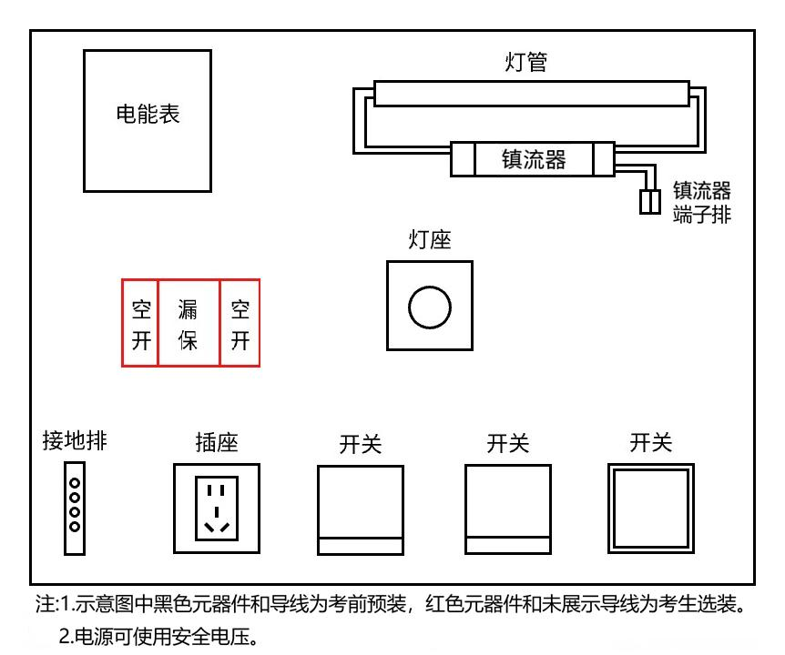
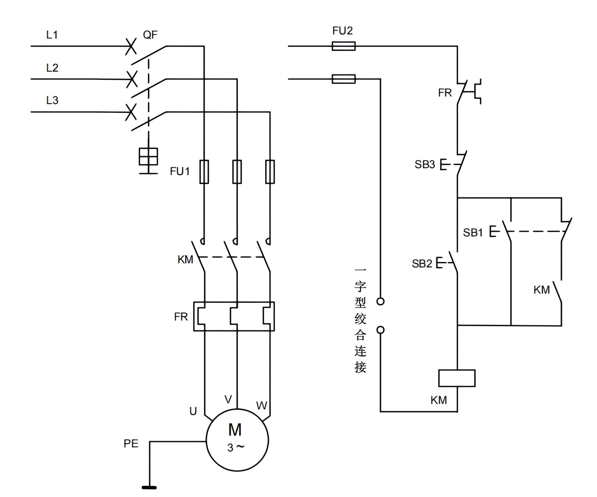
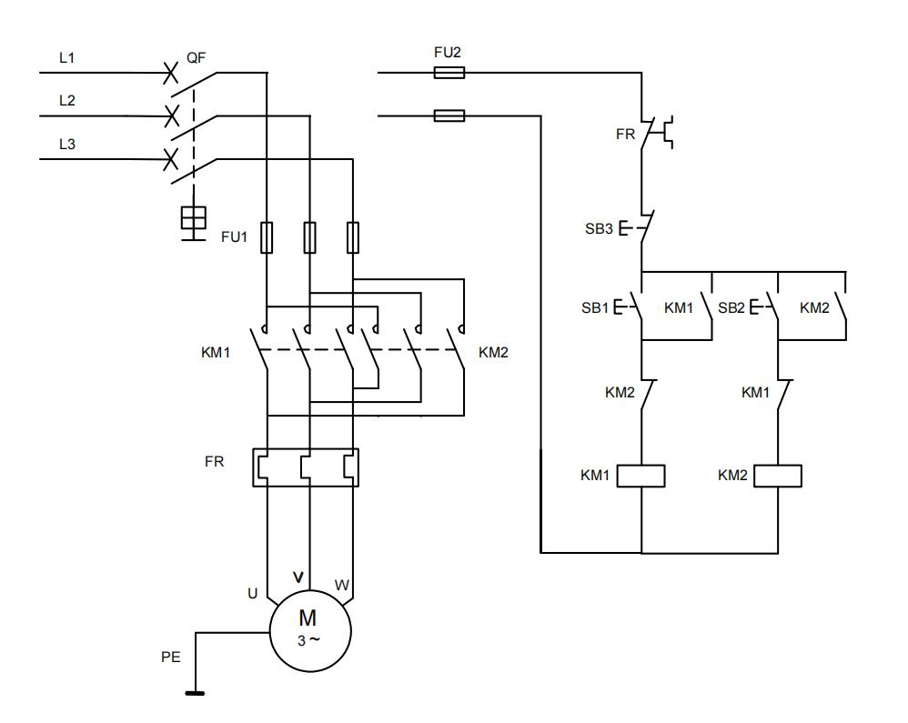
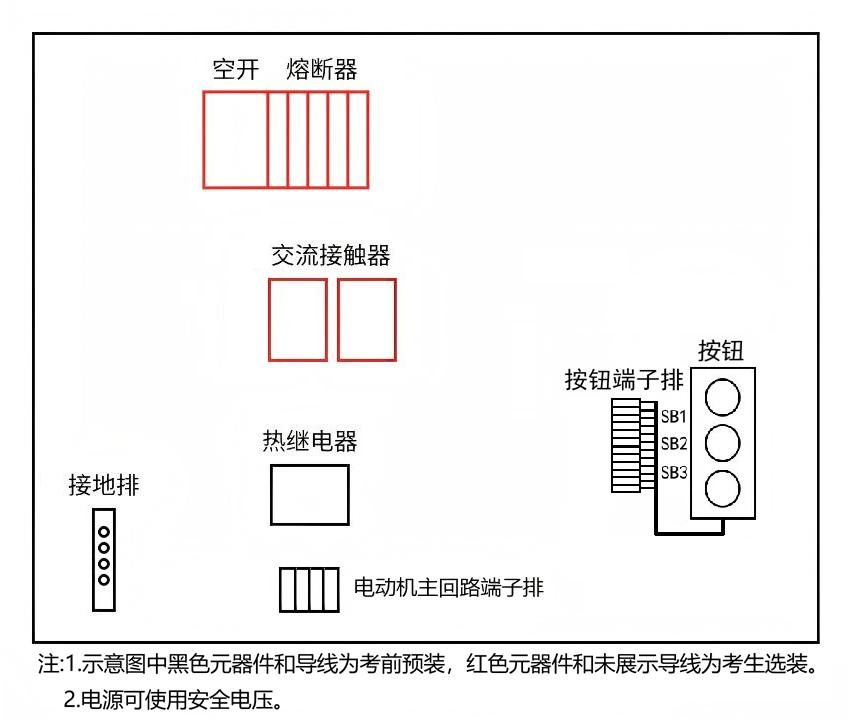

> 本文完整收录 **《高压电工作业实操考试题库（2026年版）》科目三：电气设备安装考位（K33-01 ～ K33-05）**，并融合现场培训手写笔记中的**工具及选装元器件精确数量、万用表检测元器件方法、端子逐步走线口诀、CT 二次接地及橄榄形绝缘包扎规范**。每道考题先呈现完整原始步骤与表格，最后在文末进行总结归纳。

### 📚 系列导航

1. [考试总览与科目一：安全用具使用（K11-01 ～ K11-04）](/2026/11/27/高压电工实操题库（一）考试总览与科目一安全用具使用/)
2. [科目二：作业现场安全隐患排除（K21-01）](/2026/11/27/高压电工实操题库（二）科目二作业现场安全隐患排除/)
3. [科目三（上）：10/0.4kV 成套开关柜安全操作技术（K31-01 ～ K31-03）](/2026/11/27/高压电工实操题库（三）科目三成套开关柜安全操作技术/)
4. [科目三（中）：10kV 柱上变压器安全操作技术（K32-01 ～ K32-03）](/2026/11/27/高压电工实操题库（四）科目三柱上变压器安全操作技术/)
5. **科目三（下）：电气设备安装与电路接线（K33-01 ～ K33-05）**（本文）
6. [科目四：作业现场应急处置实操题库（K41 ～ K44）](/2026/11/27/高压电工实操题库（六）科目四作业现场应急处置实操题库/)

---

## 一、030102-K33-01：低压配电箱安装接线

### 1. 试题要求与考试说明
- **1. 试题编码**：`030102-K33-01`
- **2. 试题题目**：高压电工作业－电气设备安装考位－低压配电箱安装接线
- **3. 考试任务**：
  1. 在器材摆放架上选择所需电工工具和仪器仪表，根据电路图选择相应元器件及合适的导线。
  2. 在配电箱里安装接地母线（接地母线做环形端子并用螺母紧固），零线排、地线排粘贴标识，安装元器件并规范接线。
  3. 检查电路。
  4. 拆除电路，整理场地。
- **4. 考试时间**：30 分钟
- **5. 试题分值**：100 分，80 分及以上合格。
- **6. 考试说明**：
  1. 在规定时间内完成考试任务。
  2. 考试过程中扣分超过 20 分或“安全不合格项”未通过的，终止考试，本次实操考试成绩计 0 分。
  3. 超时未完成全部考核内容的，根据完成项目计分，如未完成部分有“安全不合格项”的，本次实操考试成绩计 0 分。
  4. 未作答本题的，本次实操考试成绩计 0 分。
  5. 考试过程中出现人身伤害情况的，终止考试，本次实操考试成绩计 0 分。
- **7. 分值权重**：40%
- **8. 评分标准**：见下表

### 2. 电路原理图（030102-K33-01）

### 3. 完整评分标准表（030102-K33-01）

<table class="exam-table">
  <thead>
    <tr>
      <th style="width:12%">考核项目</th>
      <th style="width:16%">考核内容</th>
      <th style="width:32%">考核要点</th>
      <th style="width:24%">评分标准</th>
      <th style="width:11%">分值或安全不合格项</th>
      <th style="width:5%">扣分</th>
    </tr>
  </thead>
  <tbody>
    <tr>
      <td class="col-proj" rowspan="4">操作前准备与检查</td>
      <td class="col-item" rowspan="1">1. 穿戴安全防护用品</td>
      <td rowspan="1">按规范穿戴安全帽、工作服、绝缘鞋进入考位。</td>
      <td>任意一项未穿戴或未按规范穿戴，终止考试。</td>
      <td class="col-score">安全不合格项</td>
      <td class="col-deduct"></td>
    </tr>
    <tr>
      <td class="col-item" rowspan="1">2. 选择工器具和仪器仪表</td>
      <td rowspan="1">正确选择螺丝刀、剥线钳、压接钳、尖嘴钳、扳手、万用表。</td>
      <td>未选择或选择错误，每项扣 1 分。</td>
      <td class="col-score">6</td>
      <td class="col-deduct"></td>
    </tr>
    <tr>
      <td class="col-item" rowspan="1">3. 选择并检测元器件</td>
      <td rowspan="1">根据电路图选择元器件，使用万用表检测所选元器件是否正常。</td>
      <td>未选择或选择错误或未检测，每个扣 1 分。</td>
      <td class="col-score">6</td>
      <td class="col-deduct"></td>
    </tr>
    <tr>
      <td class="col-item" rowspan="1">4. 检查配电箱</td>
      <td rowspan="1">检查配电箱外观有无变形破损，检查箱体内导轨、接地端子、接零端子是否安装牢固。</td>
      <td>未检查，每处扣 1 分。</td>
      <td class="col-score">4</td>
      <td class="col-deduct"></td>
    </tr>
    <tr>
      <td class="col-proj" rowspan="7">安装调试</td>
      <td class="col-item" rowspan="3">5. 连接接地系统</td>
      <td rowspan="3">安装接地母线（环形端子）并用螺母紧固，连接接地排与箱体。</td>
      <td>未做压接环形端子，扣 5 分。</td>
      <td class="col-score">5</td>
      <td class="col-deduct"></td>
    </tr>
    <tr>
      <td>未用螺母紧固，扣 8 分。</td>
      <td class="col-score">8</td>
      <td class="col-deduct"></td>
    </tr>
    <tr>
      <td>接地母线与箱体未可靠连接，扣 10 分。</td>
      <td class="col-score">10</td>
      <td class="col-deduct"></td>
    </tr>
    <tr>
      <td class="col-item" rowspan="1">6. 粘贴标识</td>
      <td rowspan="1">在零线排和地线排处粘贴标识。</td>
      <td>未粘贴，每处扣 2 分。</td>
      <td class="col-score">4</td>
      <td class="col-deduct"></td>
    </tr>
    <tr>
      <td class="col-item" rowspan="2">7. 安装元器件</td>
      <td rowspan="2">根据电路图正确安装断路器、漏电保护器、电涌保护器。</td>
      <td>未正确安装，每个扣 2 分。</td>
      <td class="col-score">8</td>
      <td class="col-deduct"></td>
    </tr>
    <tr>
      <td>安装位置错误，每处扣 2 分。</td>
      <td class="col-score">8</td>
      <td class="col-deduct"></td>
    </tr>
    <tr>
      <td class="col-item" rowspan="1">8. 安装与检测电路</td>
      <td rowspan="1">根据电路图选用正确颜色和线径导线，并规范接线。完成安装后使用万用表检测电路有无短路、断路故障。</td>
      <td>未检测电路，扣 6 分。</td>
      <td class="col-score">6</td>
      <td class="col-deduct"></td>
    </tr>
    <tr>
      <td class="col-proj" rowspan="5">质量核查</td>
      <td class="col-item" rowspan="5">9. 核查安装质量</td>
      <td rowspan="5">根据电路图核查元器件及导线安装情况。</td>
      <td>选用导线颜色或线径错误，每处扣 2 分。</td>
      <td class="col-score">6</td>
      <td class="col-deduct"></td>
    </tr>
    <tr>
      <td>接线出现松动或露铜过长或压绝缘皮，每处扣 2 分。</td>
      <td class="col-score">8</td>
      <td class="col-deduct"></td>
    </tr>
    <tr>
      <td>布线出现飞线，扣 6 分。</td>
      <td class="col-score">6</td>
      <td class="col-deduct"></td>
    </tr>
    <tr>
      <td>出现断路故障，每处扣 5 分。</td>
      <td class="col-score">5</td>
      <td class="col-deduct"></td>
    </tr>
    <tr>
      <td>出现短路故障，终止考试。</td>
      <td class="col-score">安全不合格项</td>
      <td class="col-deduct"></td>
    </tr>
    <tr>
      <td class="col-proj" rowspan="3">场地整理</td>
      <td class="col-item" rowspan="1">10. 拆除电路</td>
      <td rowspan="1">拆除安装的导线、元器件。</td>
      <td>未全部拆除，扣 6 分。</td>
      <td class="col-score">6</td>
      <td class="col-deduct"></td>
    </tr>
    <tr>
      <td class="col-item" rowspan="2">11. 整理场地</td>
      <td rowspan="2">将拆除的导线、元器件、配电箱及工器具放置在指定位置，清理场地。</td>
      <td>任意一项未放置在指定位置，扣 2 分。</td>
      <td class="col-score">2</td>
      <td class="col-deduct"></td>
    </tr>
    <tr>
      <td>未清理场地，扣 2 分。</td>
      <td class="col-score">2</td>
      <td class="col-deduct"></td>
    </tr>
  </tbody>
</table>

### 4. 培训实操笔记补充：K33-01 工具与元器件数量、检查及配线细节

<table class="exam-table">
  <thead>
    <tr>
      <th style="width:22%">工具 / 元器件名称</th>
      <th style="width:12%">精确数量</th>
      <th style="width:66%">具体检查方法与配电箱接线实操细节（培训笔记）</th>
    </tr>
  </thead>
  <tbody>
    <tr>
      <td><strong>个人防护与电工工具</strong> （螺丝刀、剥线钳、压接钳、尖嘴钳、扳手、万用表）</td>
      <td>共 6 件工具 （各 1 件）</td>
      <td>• 穿戴安全帽 <code>1顶</code>、工作服 <code>1套</code>、<strong>绝缘鞋 <code>1双</code></strong>进考位。 • <strong>万用表自检</strong>：调至蜂鸣档短接表笔听蜂鸣声确认仪表完好。 • <strong>压接钳与扳手</strong>：专门用于压接接地母线环形端子及紧固箱体接地螺母（切勿漏拿）。</td>
    </tr>
    <tr>
      <td><strong>选装元器件外形快速辨识</strong> （QF1～QF5 + SPD）</td>
      <td style="text-align:center;font-weight:600">共 6 个模块</td>
      <td>1. <strong>总开关 <code>QF1</code>（<code>1 个</code>）</strong>：宽度<strong>中等</strong>（2P 断路器）； 2. <strong>电涌保护器 <code>SPD</code>（<code>1 个</code>）</strong>：浪涌模块； 3. <strong>插座开关 <code>QF2、QF3</code>（<code>2 个</code>）</strong>：<strong>宽的</strong>（带漏电保护测试按钮的漏电断路器）； 4. <strong>照明开关 <code>QF4、QF5</code>（<code>2 个</code>）</strong>：<strong>细的/窄体</strong>（单极断路器）。 • 安装前均用万用表蜂鸣档测通断完好性，并检查配电箱导轨、零排、地排牢固无变形。</td>
    </tr>
    <tr>
      <td><strong>导线颜色与线径规范</strong></td>
      <td>按图配线</td>
      <td>• 颜色铁律：<strong>火线（L）→ 红色</strong>；<strong>零线（N）→ 蓝色</strong>；<strong>保护地线（PE）→ 黄绿双色</strong>。 • 线径对应：总开关进线 <code>BV-4.0mm²</code>，电涌与插座回路 <code>BV-2.5mm²</code>，照明回路 <code>BV-1.5mm²</code>；零线排（-N）与地线排（-PE）切记贴好标识！</td>
    </tr>
  </tbody>
</table>

---

## 二、030102-K33-02：单相电能表带照明设备接线

### 1. 试题要求与考试说明
- **1. 试题编码**：`030102-K33-02`
- **2. 试题题目**：高压电工作业－电气设备安装考位－单相电能表带照明设备接线
- **3. 考试任务**：
  1. 在器材摆放架上选择所需电工工具和仪器仪表，根据电路图选择缺失的元器件及合适的导线。
  2. 在操作台上安装缺失的元器件，并规范接线，将镇流器通过端子排接入电路（与镇流器连接的灯管为 Ⅱ 类灯具）。
  3. 在电路图指定位置完成导线锡焊连接操作。
  4. 检查并通电调试，只允许调试 2 次。
  5. 拆除电路，整理场地。
- **4. 考试时间**：45 分钟
- **5. 试题分值**：100 分，80 分及以上合格。
- **6. 考试说明**：
  1. 在规定时间内完成考试任务。
  2. 考试过程中扣分超过 20 分或“安全不合格项”未通过的，终止考试，本次实操考试成绩计 0 分。
  3. 超时未完成全部考核内容的，根据完成项目计分，如未完成部分有“安全不合格项”的，本次实操考试成绩计 0 分。
  4. 未作答本题的，本次实操考试成绩计 0 分。
  5. 考试过程中出现人身伤害情况的，终止考试，本次实操考试成绩计 0 分。
- **7. 分值权重**：40%
- **8. 评分标准**：见下表

### 2. 电路原理图（030102-K33-02）

### 3. 完整评分标准表（030102-K33-02）

<table class="exam-table">
  <thead>
    <tr>
      <th style="width:12%">考核项目</th>
      <th style="width:16%">考核内容</th>
      <th style="width:32%">考核要点</th>
      <th style="width:24%">评分标准</th>
      <th style="width:11%">分值或安全不合格项</th>
      <th style="width:5%">扣分</th>
    </tr>
  </thead>
  <tbody>
    <tr>
      <td class="col-proj" rowspan="4">操作前准备与检查</td>
      <td class="col-item" rowspan="1">1. 穿戴安全防护用品</td>
      <td rowspan="1">按规范穿戴安全帽、工作服、绝缘鞋进入考位。</td>
      <td>任意一项未穿戴或未按规范穿戴，终止考试。</td>
      <td class="col-score">安全不合格项</td>
      <td class="col-deduct"></td>
    </tr>
    <tr>
      <td class="col-item" rowspan="1">2. 选择工器具和仪器仪表</td>
      <td rowspan="1">正确选择螺丝刀、剥线钳、尖嘴钳、绝缘胶布、万用表、低压验电笔、电烙铁（含焊锡丝、松香）。</td>
      <td>未选择或选择错误，每项扣 1 分。</td>
      <td class="col-score">5</td>
      <td class="col-deduct"></td>
    </tr>
    <tr>
      <td class="col-item" rowspan="1">3. 确认安装条件</td>
      <td rowspan="1">确认操作台电源开关断开，验电并悬挂“禁止合闸，有人工作”标示牌。</td>
      <td>未确认操作台电源开关断开状态或未验电或未悬挂标示牌，终止考试。</td>
      <td class="col-score">安全不合格项</td>
      <td class="col-deduct"></td>
    </tr>
    <tr>
      <td class="col-item" rowspan="1">4. 选择并检测元器件</td>
      <td rowspan="1">根据电路图选择元器件，使用万用表检测所选元器件是否正常。</td>
      <td>未选择或选择错误或未检测，每个扣 1 分。</td>
      <td class="col-score">5</td>
      <td class="col-deduct"></td>
    </tr>
    <tr>
      <td class="col-proj" rowspan="12">安装调试</td>
      <td class="col-item" rowspan="2">5. 安装与检测电路</td>
      <td rowspan="2">根据电路图和设备功率，选用正确颜色和线径导线完成安装，将镇流器通过端子排接入电路。完成安装后使用万用表检测电路。</td>
      <td>未接接地线，扣 5 分。</td>
      <td class="col-score">5</td>
      <td class="col-deduct"></td>
    </tr>
    <tr>
      <td>未检测电路，扣 2 分。</td>
      <td class="col-score">2</td>
      <td class="col-deduct"></td>
    </tr>
    <tr>
      <td class="col-item" rowspan="3">6. 电路送电</td>
      <td rowspan="3">申请送电后，按操作台电源开关、线路总断路器、各支路断路器顺序送电。</td>
      <td>未申请即送电调试，扣 3 分。</td>
      <td class="col-score">3</td>
      <td class="col-deduct"></td>
    </tr>
    <tr>
      <td>送电顺序错误，扣 5 分。</td>
      <td class="col-score">5</td>
      <td class="col-deduct"></td>
    </tr>
    <tr>
      <td>送电过程中出现短路故障，终止考试。</td>
      <td class="col-score">安全不合格项</td>
      <td class="col-deduct"></td>
    </tr>
    <tr>
      <td class="col-item" rowspan="5">7. 调试与核查电路功能</td>
      <td rowspan="5">按规范对电路进行检查、测试、维修等调试，其中维修（含接线）必须在断电情况下进行，根据情况悬挂或拆除“禁止合闸，有人工作”标示牌。只允许调试电路 2 次，即首次通电后电路功能不正常，进行第 1 次调试；再次通电后电路功能仍不正常，进行第 2 次调试。完成调试后申请核查电路功能。</td>
      <td>调试电路过程中出现短路故障或未断电维修（含接线）或未正确使用标示牌或调试电路超过 2 次或核查电路时出现短路故障，终止考试。</td>
      <td class="col-score">安全不合格项</td>
      <td class="col-deduct"></td>
    </tr>
    <tr>
      <td>核查电路时出现单相电能表功能不正常，扣 5 分。</td>
      <td class="col-score">5</td>
      <td class="col-deduct"></td>
    </tr>
    <tr>
      <td>核查电路时出现双控灯电路功能不正常，扣 10 分。</td>
      <td class="col-score">10</td>
      <td class="col-deduct"></td>
    </tr>
    <tr>
      <td>核查电路时出现日光灯电路功能不正常，扣 10 分。</td>
      <td class="col-score">10</td>
      <td class="col-deduct"></td>
    </tr>
    <tr>
      <td>核查电路时出现插座电路功能不正常，扣 5 分。</td>
      <td class="col-score">5</td>
      <td class="col-deduct"></td>
    </tr>
    <tr>
      <td class="col-item" rowspan="2">8. 电路断电</td>
      <td rowspan="2">按设备开关、各支路断路器、线路总断路器、操作台电源开关顺序断电。</td>
      <td>断电顺序错误，扣 5 分。</td>
      <td class="col-score">5</td>
      <td class="col-deduct"></td>
    </tr>
    <tr>
      <td>未断电即进行下一步操作，终止考试。</td>
      <td class="col-score">安全不合格项</td>
      <td class="col-deduct"></td>
    </tr>
    <tr>
      <td class="col-proj" rowspan="6">质量核查</td>
      <td class="col-item" rowspan="6">9. 核查安装质量</td>
      <td rowspan="6">根据电路图核查元器件及导线安装情况（含使用电烙铁在指定位置完成导线锡焊连接操作）。</td>
      <td>元器件安装不规范，每处扣 2 分。</td>
      <td class="col-score">6</td>
      <td class="col-deduct"></td>
    </tr>
    <tr>
      <td>选用导线颜色或线径错误，每处扣 2 分。</td>
      <td class="col-score">6</td>
      <td class="col-deduct"></td>
    </tr>
    <tr>
      <td>接线出现松动或露铜过长或压绝缘皮，每处扣 2 分。</td>
      <td class="col-score">6</td>
      <td class="col-deduct"></td>
    </tr>
    <tr>
      <td>布线出现飞线，每处扣 2 分。</td>
      <td class="col-score">6</td>
      <td class="col-deduct"></td>
    </tr>
    <tr>
      <td>未进行锡焊连接操作或锡焊连接不规范，扣分 6 分。</td>
      <td class="col-score">6</td>
      <td class="col-deduct"></td>
    </tr>
    <tr>
      <td>非指定位置使用端子排接线或锡焊连接处未进行绝缘处理，终止考试。</td>
      <td class="col-score">安全不合格项</td>
      <td class="col-deduct"></td>
    </tr>
    <tr>
      <td class="col-proj" rowspan="3">场地整理</td>
      <td class="col-item" rowspan="1">10. 拆除电路</td>
      <td rowspan="1">拆除安装的导线、元器件。</td>
      <td>未全部拆除，扣 6 分。</td>
      <td class="col-score">6</td>
      <td class="col-deduct"></td>
    </tr>
    <tr>
      <td class="col-item" rowspan="2">11. 整理场地</td>
      <td rowspan="2">将拆除的导线、剩余导线、元器件、标示牌及工器具放置在指定位置，清理场地。</td>
      <td>任意一项未放置在指定位置，扣 2 分。</td>
      <td class="col-score">2</td>
      <td class="col-deduct"></td>
    </tr>
    <tr>
      <td>未清理场地，扣 2 分。</td>
      <td class="col-score">2</td>
      <td class="col-deduct"></td>
    </tr>
  </tbody>
</table>

### 4. 附件：操作台元器件布局示意图（030102-K33-02）

### 5. 培训实操笔记补充：K33-02 工具/元器件数量与 8 步接线口诀

<table class="exam-table">
  <thead>
    <tr>
      <th style="width:22%">工具 / 元器件名称</th>
      <th style="width:12%">精确数量</th>
      <th style="width:66%">具体检查方法与 8 步端子接线口诀（培训笔记）</th>
    </tr>
  </thead>
  <tbody>
    <tr>
      <td><strong>电工工具与仪表</strong></td>
      <td>共 7 项</td>
      <td>• 螺丝刀（一字/十字）、剥线钳、尖嘴钳、绝缘胶布 <code>1卷</code>、万用表 <code>1块</code>、低压验电笔 <code>1支</code>、<strong>电烙铁 <code>1把</code>（含焊锡丝、松香）</strong>。 • 接线前<strong>先确认电源断开、低压验电笔验电、挂“禁止合闸，有人工作”标示牌 <code>1块</code></strong>！</td>
    </tr>
    <tr>
      <td><strong>选装元器件与漏保识别</strong></td>
      <td style="text-align:center;font-weight:600">空开 2 个 漏保 1 个</td>
      <td>• 左起依次安装：<strong><code>QF1</code>（空开）— <code>QF2</code>（漏保）— <code>QF3</code>（空开）</strong>；电路图中触点带圆圈/脱扣钩符号的即为漏电保护器 <code>QF2</code>；装前用万用表蜂鸣档检测通断正常。</td>
    </tr>
    <tr>
      <td><strong>8 步端子配线口诀</strong></td>
      <td>实战走线</td>
      <td>1. <strong>电能表（1、3 进电源，2、4 出总闸）</strong>：<code>2号出(火) → QF1 L进(左)</code>，<code>4号出(零) → QF1 N进(右)</code>； 2. <code>QF1 L/N出 → QF2 L/N进</code>； 3. <code>QF1 L/N出 → QF3 L/N进</code>； 4. <strong>插座支路</strong>：<code>QF2 L/N出 → 插座 L/N</code>，<code>插座 PE → 接地排</code>； 5. <strong>照明火线</strong>：<code>QF3 L出 → 双控 S1 的 L（公共端）</code>，并分接至 <code>日光灯开关 S3 的 L</code>； 6. <strong>零线锡焊点（重点）</strong>：<code>QF3 N出</code> 引至<strong>镇流器端子排 N</strong> 与 <strong>灯座 EL 的 N</strong> 分支处，<strong>先绞接再用烙铁蘸松香焊锡搪锡，冷却后用绝缘胶布严密包扎 3 层以上（橄榄形）</strong>； 7. <strong>日光灯控制</strong>：<code>S3 出线 → 镇流器端子排火线端</code>； 8. <strong>双控灯连线</strong>：<code>S1 的 L1 ↔ S2 的 L1</code> 短接，<code>S1 的 L2 ↔ S2 的 L2</code> 短接，火出 <code>S2 的 L → 灯座 EL 火线端</code>。</td>
    </tr>
  </tbody>
</table>

---

## 三、030102-K33-03：三相异步电动机单向连续运转电路接线（带点动控制）

### 1. 试题要求与考试说明
- **1. 试题编码**：`030102-K33-03`
- **2. 试题题目**：高压电工作业－电气设备安装考位-三相异步电动机单向连续运转电路接线（带点动控制）
- **3. 考试任务**：
  1. 在器材摆放架上选择所需电工工具和仪器仪表，根据电路图选择缺失的元器件及合适的导线。
  2. 在操作台上安装缺失的元器件，并规范接线，将电动机主回路（U、V、W、PE）、按钮控制线通过端子排接入电路。
  3. 在电路图指定位置完成导线一字型（平接）绞合连接操作。
  4. 检查并通电调试，只允许调试 2 次。
  5. 拆除电路，整理场地。
- **4. 考试时间**：45 分钟
- **5. 试题分值**：100 分，80 分及以上合格。
- **6. 考试说明**：
  1. 在规定时间内完成考试任务。
  2. 考试过程中扣分超过 20 分或“安全不合格项”未通过的，终止考试，本次实操考试成绩计 0 分。
  3. 超时未完成全部考核内容的，根据完成项目计分，如未完成部分有“安全不合格项”的，本次实操考试成绩计 0 分。
  4. 未作答本题的，本次实操考试成绩计 0 分。
  5. 考试过程中出现人身伤害情况的，终止考试，本次实操考试成绩计 0 分。
- **7. 分值权重**：40%
- **8. 评分标准**：见下表

### 2. 电路原理图（030102-K33-03）

### 3. 完整评分标准表（030102-K33-03）

<table class="exam-table">
  <thead>
    <tr>
      <th style="width:12%">考核项目</th>
      <th style="width:16%">考核内容</th>
      <th style="width:32%">考核要点</th>
      <th style="width:24%">评分标准</th>
      <th style="width:11%">分值或安全不合格项</th>
      <th style="width:5%">扣分</th>
    </tr>
  </thead>
  <tbody>
    <tr>
      <td class="col-proj" rowspan="4">操作前准备与检查</td>
      <td class="col-item" rowspan="1">1. 穿戴安全防护用品</td>
      <td rowspan="1">按规范穿戴安全帽、工作服、绝缘鞋进入考位。</td>
      <td>任意一项未穿戴或未按规范穿戴，终止考试。</td>
      <td class="col-score">安全不合格项</td>
      <td class="col-deduct"></td>
    </tr>
    <tr>
      <td class="col-item" rowspan="1">2. 选择工器具和仪器仪表</td>
      <td rowspan="1">正确选择螺丝刀、剥线钳、尖嘴钳、绝缘胶布、万用表、低压验电笔。</td>
      <td>未选择或选择错误，每项扣 1 分。</td>
      <td class="col-score">5</td>
      <td class="col-deduct"></td>
    </tr>
    <tr>
      <td class="col-item" rowspan="1">3. 确认安装条件</td>
      <td rowspan="1">确认操作台电源开关断开，验电并悬挂“禁止合闸，有人工作”标示牌。</td>
      <td>未确认操作台电源开关断开状态或未验电或未悬挂标示牌，终止考试。</td>
      <td class="col-score">安全不合格项</td>
      <td class="col-deduct"></td>
    </tr>
    <tr>
      <td class="col-item" rowspan="1">4. 选择并检测元器件</td>
      <td rowspan="1">根据电路图选择元器件，使用万用表检测所选元器件是否正常。</td>
      <td>未选择或选择错误或未检测，每个扣 1 分。</td>
      <td class="col-score">5</td>
      <td class="col-deduct"></td>
    </tr>
    <tr>
      <td class="col-proj" rowspan="12">安装调试</td>
      <td class="col-item" rowspan="3">5. 安装与检测电路</td>
      <td rowspan="3">根据电路图和电动机功率，选用正确颜色和线径导线完成安装，将电动机主回路（U、V、W、PE）、按钮控制线通过端子排接入电路。完成安装后使用万用表检测电路。</td>
      <td>未接接地线，扣 5 分。</td>
      <td class="col-score">5</td>
      <td class="col-deduct"></td>
    </tr>
    <tr>
      <td>未检测主电路，扣 1 分。</td>
      <td class="col-score">1</td>
      <td class="col-deduct"></td>
    </tr>
    <tr>
      <td>未检测控制电路，扣 1 分。</td>
      <td class="col-score">1</td>
      <td class="col-deduct"></td>
    </tr>
    <tr>
      <td class="col-item" rowspan="3">6. 电路送电</td>
      <td rowspan="3">申请送电后，按操作台电源开关、线路断路器顺序送电。</td>
      <td>未申请即送电调试，扣 3 分。</td>
      <td class="col-score">3</td>
      <td class="col-deduct"></td>
    </tr>
    <tr>
      <td>送电顺序错误，扣 5 分。</td>
      <td class="col-score">5</td>
      <td class="col-deduct"></td>
    </tr>
    <tr>
      <td>送电过程中出现短路故障，终止考试。</td>
      <td class="col-score">安全不合格项</td>
      <td class="col-deduct"></td>
    </tr>
    <tr>
      <td class="col-item" rowspan="4">7. 调试与核查电路功能</td>
      <td rowspan="4">按规范对电路进行检查、测试、维修等调试，其中维修（含接线）必须在断电情况下进行，根据情况悬挂或拆除“禁止合闸，有人工作”标示牌。只允许调试电路 2 次，即首次通电后电路功能不正常，进行第 1 次调试；再次通电后电路功能仍不正常，进行第 2 次调试。完成调试后申请核查电路功能。</td>
      <td>调试电路过程中出现短路故障或未断电维修（含接线）或未正确使用标示牌或调试电路超过 2 次或核查电路时出现短路故障，终止考试。</td>
      <td class="col-score">安全不合格项</td>
      <td class="col-deduct"></td>
    </tr>
    <tr>
      <td>核查电路时出现点动运行不正常，扣 10 分。</td>
      <td class="col-score">10</td>
      <td class="col-deduct"></td>
    </tr>
    <tr>
      <td>核查电路时出现连续运行不正常，扣 10 分。</td>
      <td class="col-score">10</td>
      <td class="col-deduct"></td>
    </tr>
    <tr>
      <td>核查电路时出现停止运行不正常，扣 10 分。</td>
      <td class="col-score">10</td>
      <td class="col-deduct"></td>
    </tr>
    <tr>
      <td class="col-item" rowspan="2">8. 电路断电</td>
      <td rowspan="2">按设备开关（按钮）、线路断路器、操作台电源开关顺序断电。</td>
      <td>断电顺序错误，扣 5 分。</td>
      <td class="col-score">5</td>
      <td class="col-deduct"></td>
    </tr>
    <tr>
      <td>未断电即进行下一步操作，终止考试。</td>
      <td class="col-score">安全不合格项</td>
      <td class="col-deduct"></td>
    </tr>
    <tr>
      <td class="col-proj" rowspan="6">质量核查</td>
      <td class="col-item" rowspan="6">9. 核查安装质量</td>
      <td rowspan="6">根据电路图核查元器件及导线安装情况（含在指定位置完成导线一字型（平接）绞合连接操作）。</td>
      <td>元器件安装不规范，每处扣 2 分。</td>
      <td class="col-score">6</td>
      <td class="col-deduct"></td>
    </tr>
    <tr>
      <td>选用导线颜色或线径错误，每处扣 2 分。</td>
      <td class="col-score">6</td>
      <td class="col-deduct"></td>
    </tr>
    <tr>
      <td>接线出现松动或露铜过长或压绝缘皮，每处扣 2 分。</td>
      <td class="col-score">6</td>
      <td class="col-deduct"></td>
    </tr>
    <tr>
      <td>布线出现飞线，每处扣 2 分。</td>
      <td class="col-score">6</td>
      <td class="col-deduct"></td>
    </tr>
    <tr>
      <td>未进行绞合连接操作或绞合连接不规范，扣 6 分。</td>
      <td class="col-score">6</td>
      <td class="col-deduct"></td>
    </tr>
    <tr>
      <td>非指定位置使用端子排接线或一字型绞合连接处未进行绝缘处理，终止考试。</td>
      <td class="col-score">安全不合格项</td>
      <td class="col-deduct"></td>
    </tr>
    <tr>
      <td class="col-proj" rowspan="3">场地整理</td>
      <td class="col-item" rowspan="1">10. 拆除电路</td>
      <td rowspan="1">拆除安装的导线、元器件。</td>
      <td>未全部拆除，扣 6 分。</td>
      <td class="col-score">6</td>
      <td class="col-deduct"></td>
    </tr>
    <tr>
      <td class="col-item" rowspan="2">11. 整理场地</td>
      <td rowspan="2">将拆除的导线、剩余导线、元器件、标示牌及工器具放置在指定位置，清理场地。</td>
      <td>任意一项未放置在指定位置，扣 2 分。</td>
      <td class="col-score">2</td>
      <td class="col-deduct"></td>
    </tr>
    <tr>
      <td>未清理场地，扣 2 分。</td>
      <td class="col-score">2</td>
      <td class="col-deduct"></td>
    </tr>
  </tbody>
</table>

### 4. 附件：操作台元器件布局示意图（030102-K33-03）

### 5. 培训实操笔记补充：K33-03 工具/元器件数量、万用表检测与一字包扎规范

<table class="exam-table">
  <thead>
    <tr>
      <th style="width:22%">工具 / 元器件名称</th>
      <th style="width:14%">精确数量</th>
      <th style="width:64%">元器件万用表检测方法与配线包扎细节（培训笔记）</th>
    </tr>
  </thead>
  <tbody>
    <tr>
      <td><strong>电工工具与仪表</strong></td>
      <td>共 6 项</td>
      <td>• 螺丝刀（一字/十字）、剥线钳、尖嘴钳、绝缘胶布 <code>1卷</code>、万用表 <code>1块</code>、低压验电笔 <code>1支</code>（外加“禁止合闸，有人工作”牌 <code>1块</code>）。</td>
    </tr>
    <tr>
      <td><strong>选装元器件及万用表检测</strong></td>
      <td style="text-align:center;font-weight:600">3P 空开 1 个 熔断器 5 个 交流接触器 1 个</td>
      <td>• <strong>3P 空开（<code>1个</code>）</strong>：蜂鸣档测三相上下端，合闸响、分闸不响。 • <strong>熔断器（<code>5个</code>：主回路 FU1×3 + 控制 FU2×2）</strong>：装芯后蜂鸣档测上下端导通响。 • <strong>KM 交流接触器（<code>1个</code>）</strong>：① <strong>线圈 <code>A1-A2</code> 调电阻档测阻值</strong>（不可用蜂鸣档判短路）；② 主触点 <code>L1/L2/L3</code> 与辅助常开触点：常态不响，<strong>手动摁下接触器衔铁时蜂鸣响</strong>。 • <strong>按钮端子排</strong>：接线前先用万用表蜂鸣档测通断，确认每只按钮的常闭端与常开端！</td>
    </tr>
    <tr>
      <td><strong>一字型绞合与橄榄形包扎规范</strong></td>
      <td>必考工艺细节</td>
      <td>• 在控制回路 <code>FU2 出 ──→ KM 线圈</code> 指定干线上完成<strong>导线一字型（平接）绞合连接</strong>。 • <strong>绝缘胶布包扎要求</strong>：缠绕 3 层以上，包成<strong>“两头细、中间粗”的纺锤/橄榄形</strong>，确保<strong>绝缘强度不低于原导线绝缘强度</strong>，连接处机械强度不低于原导线的 80%～90%（未包绝缘直接 0 分！）。</td>
    </tr>
  </tbody>
</table>

---

## 四、030102-K33-04：带熔断器（断路器）、仪表、电流互感器的三相异步电动机电路接线

### 1. 试题要求与考试说明
- **1. 试题编码**：`030102-K33-04`
- **2. 试题题目**：高压电工作业－电气设备安装考位－带熔断器（断路器）、仪表、电流互感器的三相异步电动机电路接线
- **3. 考试任务**：
  1. 在器材摆放架上选择所需电工工具和仪器仪表，根据电路图选择缺失的元器件及合适的导线。
  2. 在操作台上安装缺失的元器件，并规范接线，将电动机主回路（U、V、W、PE）、按钮控制线通过端子排接入电路。
  3. 在电路图指定位置完成导线 T 字型绞合连接操作。
  4. 检查并通电调试，只允许调试 2 次。
  5. 拆除电路，整理场地。
- **4. 考试时间**：50 分钟
- **5. 试题分值**：100 分，80 分及以上合格。
- **6. 考试说明**：
  1. 在规定时间内完成考试任务。
  2. 考试过程中扣分超过 20 分或“安全不合格项”未通过的，终止考试，本次实操考试成绩计 0 分。
  3. 超时未完成全部考核内容的，根据完成项目计分，如未完成部分有“安全不合格项”的，本次实操考试成绩计 0 分。
  4. 未作答本题的，本次实操考试成绩计 0 分。
  5. 考试过程中出现人身伤害情况的，终止考试，本次实操考试成绩计 0 分。
- **7. 分值权重**：40%
- **8. 评分标准**：见下表

### 2. 电路原理图（030102-K33-04）

### 3. 完整评分标准表（030102-K33-04）

<table class="exam-table">
  <thead>
    <tr>
      <th style="width:12%">考核项目</th>
      <th style="width:16%">考核内容</th>
      <th style="width:32%">考核要点</th>
      <th style="width:24%">评分标准</th>
      <th style="width:11%">分值或安全不合格项</th>
      <th style="width:5%">扣分</th>
    </tr>
  </thead>
  <tbody>
    <tr>
      <td class="col-proj" rowspan="4">操作前准备与检查</td>
      <td class="col-item" rowspan="1">1. 穿戴安全防护用品</td>
      <td rowspan="1">按规范穿戴安全帽、工作服、绝缘鞋进入考位。</td>
      <td>任意一项未穿戴或未按规范穿戴，终止考试。</td>
      <td class="col-score">安全不合格项</td>
      <td class="col-deduct"></td>
    </tr>
    <tr>
      <td class="col-item" rowspan="1">2. 选择工器具和仪器仪表</td>
      <td rowspan="1">正确选择螺丝刀、剥线钳、尖嘴钳、电工刀、绝缘胶布、万用表、低压验电笔。</td>
      <td>未选择或选择错误，每项扣 1 分。</td>
      <td class="col-score">5</td>
      <td class="col-deduct"></td>
    </tr>
    <tr>
      <td class="col-item" rowspan="1">3. 确认安装条件</td>
      <td rowspan="1">确认操作台电源开关断开，验电并悬挂“禁止合闸，有人工作”标示牌。</td>
      <td>未确认操作台电源开关断开状态或未验电或未悬挂标示牌，终止考试。</td>
      <td class="col-score">安全不合格项</td>
      <td class="col-deduct"></td>
    </tr>
    <tr>
      <td class="col-item" rowspan="1">4. 选择并检测元器件</td>
      <td rowspan="1">根据电路图选择元器件，使用万用表检测所选元器件是否正常。</td>
      <td>未选择或选择错误或未检测，每个扣 1 分。</td>
      <td class="col-score">5</td>
      <td class="col-deduct"></td>
    </tr>
    <tr>
      <td class="col-proj" rowspan="12">安装调试</td>
      <td class="col-item" rowspan="3">5. 安装与检测电路</td>
      <td rowspan="3">根据电路图和电动机功率，选用正确颜色和线径导线完成安装，将电动机主回路（U、V、W、PE）、按钮控制线通过端子排接入电路。完成安装后使用万用表检测电路。</td>
      <td>未接接地线，扣 5 分。</td>
      <td class="col-score">5</td>
      <td class="col-deduct"></td>
    </tr>
    <tr>
      <td>未检测主电路，扣 1 分。</td>
      <td class="col-score">1</td>
      <td class="col-deduct"></td>
    </tr>
    <tr>
      <td>未检测控制电路，扣 1 分。</td>
      <td class="col-score">1</td>
      <td class="col-deduct"></td>
    </tr>
    <tr>
      <td class="col-item" rowspan="3">6. 电路送电</td>
      <td rowspan="3">申请送电后，按操作台电源开关、线路断路器顺序送电。</td>
      <td>未申请即送电调试，扣 3 分。</td>
      <td class="col-score">3</td>
      <td class="col-deduct"></td>
    </tr>
    <tr>
      <td>送电顺序错误，扣 5 分。</td>
      <td class="col-score">5</td>
      <td class="col-deduct"></td>
    </tr>
    <tr>
      <td>送电过程中出现短路故障，终止考试。</td>
      <td class="col-score">安全不合格项</td>
      <td class="col-deduct"></td>
    </tr>
    <tr>
      <td class="col-item" rowspan="4">7. 调试与核查电路功能</td>
      <td rowspan="4">按规范对电路进行检查、测试、维修等调试，其中维修（含接线）必须在断电情况下进行，根据情况悬挂或拆除“禁止合闸，有人工作”标示牌。只允许调试电路 2 次，即首次通电后电路功能不正常，进行第 1 次调试；再次通电后电路功能仍不正常，进行第 2 次调试。完成调试后申请核查电路功能。</td>
      <td>调试电路过程中出现短路故障或未断电维修（含接线）或未正确使用标示牌或调试电路超过 2 次或核查电路时出现短路故障，终止考试。</td>
      <td class="col-score">安全不合格项</td>
      <td class="col-deduct"></td>
    </tr>
    <tr>
      <td>核查电路时出现仪表显示不正常，扣 10 分。</td>
      <td class="col-score">10</td>
      <td class="col-deduct"></td>
    </tr>
    <tr>
      <td>核查电路时出现启动运行不正常，扣 10 分。</td>
      <td class="col-score">10</td>
      <td class="col-deduct"></td>
    </tr>
    <tr>
      <td>核查电路时出现停止运行不正常，扣 10 分。</td>
      <td class="col-score">10</td>
      <td class="col-deduct"></td>
    </tr>
    <tr>
      <td class="col-item" rowspan="2">8. 电路断电</td>
      <td rowspan="2">按设备开关（按钮）、线路断路器、操作台电源开关顺序断电。</td>
      <td>断电顺序错误，扣 5 分。</td>
      <td class="col-score">5</td>
      <td class="col-deduct"></td>
    </tr>
    <tr>
      <td>未断电即进行下一步操作，终止考试。</td>
      <td class="col-score">安全不合格项</td>
      <td class="col-deduct"></td>
    </tr>
    <tr>
      <td class="col-proj" rowspan="6">质量核查</td>
      <td class="col-item" rowspan="6">9. 核查安装质量</td>
      <td rowspan="6">根据电路图核查元器件及导线安装情况（含在指定位置完成导线 T 字型绞合连接操作）。</td>
      <td>元器件安装不规范，每处扣 2 分。</td>
      <td class="col-score">6</td>
      <td class="col-deduct"></td>
    </tr>
    <tr>
      <td>选用导线颜色或线径错误，每处扣 2 分。</td>
      <td class="col-score">6</td>
      <td class="col-deduct"></td>
    </tr>
    <tr>
      <td>接线出现松动或露铜过长或压绝缘皮，每处扣 2 分。</td>
      <td class="col-score">6</td>
      <td class="col-deduct"></td>
    </tr>
    <tr>
      <td>布线出现飞线，每处扣 2 分。</td>
      <td class="col-score">6</td>
      <td class="col-deduct"></td>
    </tr>
    <tr>
      <td>未进行绞合连接操作或绞合连接不规范，扣 6 分。</td>
      <td class="col-score">6</td>
      <td class="col-deduct"></td>
    </tr>
    <tr>
      <td>非指定位置使用端子排接线或 T 字型绞合连接处未进行绝缘处理，终止考试。</td>
      <td class="col-score">安全不合格项</td>
      <td class="col-deduct"></td>
    </tr>
    <tr>
      <td class="col-proj" rowspan="3">场地整理</td>
      <td class="col-item" rowspan="1">10. 拆除电路</td>
      <td rowspan="1">拆除安装的导线、元器件。</td>
      <td>未全部拆除，扣 6 分。</td>
      <td class="col-score">6</td>
      <td class="col-deduct"></td>
    </tr>
    <tr>
      <td class="col-item" rowspan="2">11. 整理场地</td>
      <td rowspan="2">将拆除的导线、剩余导线、元器件、标示牌及工器具放置在指定位置，清理场地。</td>
      <td>任意一项未放置在指定位置，扣 2 分。</td>
      <td class="col-score">2</td>
      <td class="col-deduct"></td>
    </tr>
    <tr>
      <td>未清理场地，扣 2 分。</td>
      <td class="col-score">2</td>
      <td class="col-deduct"></td>
    </tr>
  </tbody>
</table>

### 4. 附件：操作台元器件布局示意图（030102-K33-04）

### 5. 培训实操笔记补充：K33-04 工具/元器件数量、CT 二次接地与控制 5 线法

<table class="exam-table">
  <thead>
    <tr>
      <th style="width:22%">工具 / 元器件名称</th>
      <th style="width:14%">精确数量</th>
      <th style="width:64%">电流互感器二次接地与主/控回路走线秘籍（培训笔记）</th>
    </tr>
  </thead>
  <tbody>
    <tr>
      <td><strong>电工工具与仪表</strong></td>
      <td>共 7 项</td>
      <td>• 螺丝刀（一、十字）、剥线钳、尖嘴钳、<strong>电工刀 <code>1把</code>（本题专属必选，削剖 T 字型绝缘皮用）</strong>、绝缘胶布 <code>1卷</code>（绑缠 3 圈以上）、万用表 <code>1块</code>、低压验电笔 <code>1支</code>。</td>
    </tr>
    <tr>
      <td><strong>选装元器件数量</strong></td>
      <td style="text-align:center;font-weight:600">3P 空开 1 个 熔断器 5 个 交流接触器 1 个</td>
      <td>• 空开 <code>1个</code> + 熔断器 <code>5个</code>（主回路 3 个 + 控制 2 个）+ 交流接触器 <code>1个</code>；装前用万用表逐个检测空开通断、熔芯导通、接触器线圈阻值及触点摁压通断。</td>
    </tr>
    <tr>
      <td><strong>主回路与电流互感器（CT）二次接线</strong></td>
      <td>核心防错点</td>
      <td>• <strong>主回路</strong>：空开负荷侧引<strong>黄、绿、红</strong> 3 股进主熔断器 <code>FU1</code> 电源端（同时从黄、绿两相分引 2 股进控制熔断器 <code>FU2</code>）→ <code>FU1</code> 出 → <code>KM</code> 上主触点 <code>L1/L2/L3</code> → 穿心过三只电流互感器进热继电器 <code>FR</code> → 电机主回路端子排 <code>U/V/W</code>（及 <code>PE</code> 接地）。 • <strong>CT 二次侧接地铁律</strong>：三只电流互感器的 <code>S1、S2</code> 分别对应接三块电流表两端；<strong>三个 <code>S2</code> 端子必须在下方并联短接后，引至左下接地排（黄螺母）可靠接地</strong>！</td>
    </tr>
    <tr>
      <td><strong>控制回路 5 线法与 T 字绞合</strong></td>
      <td>面板走线定位</td>
      <td>• <code>⓪线</code>：<code>FU2(左) → KM A1</code>； • <code>①线</code>：<code>FU2(右) → FR 95</code>； • <code>②线</code>：<code>FR 96 → SB2 常闭进（红停止按钮）</code>； • <code>③线</code>：<code>SB2 常闭出 → SB1 常开进（绿启动按钮）</code>，<strong>在此干线上用刀剖皮完成 T 字型绞合分支引向 <code>KM 辅助常开进</code>，并用绝缘胶布严密包扎</strong>； • <code>④线</code>：<code>SB1 常开出</code> 与 <code>KM 辅助常开出</code> 汇合接 <code>KM A2</code>。</td>
    </tr>
  </tbody>
</table>

---

## 五、030102-K33-05：三相异步电动机正反转运行电路接线

### 1. 试题要求与考试说明
- **1. 试题编码**：`030102-K33-05`
- **2. 试题题目**：高压电工作业－电气设备安装考位-三相异步电动机正反转运行电路接线
- **3. 考试任务**：
  1. 在器材摆放架上选择所需电工工具和仪器仪表，根据电路图选择缺失的元器件及合适的导线。
  2. 在操作台上安装缺失的元器件，并规范接线，将电动机主回路（U、V、W、PE）、按钮控制线通过端子排接入电路。
  3. 检查并通电调试，只允许调试 2 次。
  4. 拆除电路，整理场地。
- **4. 考试时间**：50 分钟
- **5. 试题分值**：100 分，80 分及以上合格。
- **6. 考试说明**：
  1. 在规定时间内完成考试任务。
  2. 考试过程中扣分超过 20 分或“安全不合格项”未通过的，终止考试，本次实操考试成绩计 0 分。
  3. 超时未完成全部考核内容的，根据完成项目计分，如未完成部分有“安全不合格项”的，本次实操考试成绩计 0 分。
  4. 未作答本题的，本次实操考试成绩计 0 分。
  5. 考试过程中出现人身伤害情况的，终止考试，本次实操考试成绩计 0 分。
- **7. 分值权重**：40%
- **8. 评分标准**：见下表

### 2. 电路原理图（030102-K33-05）

### 3. 完整评分标准表（030102-K33-05）

<table class="exam-table">
  <thead>
    <tr>
      <th style="width:12%">考核项目</th>
      <th style="width:16%">考核内容</th>
      <th style="width:32%">考核要点</th>
      <th style="width:24%">评分标准</th>
      <th style="width:11%">分值或安全不合格项</th>
      <th style="width:5%">扣分</th>
    </tr>
  </thead>
  <tbody>
    <tr>
      <td class="col-proj" rowspan="4">操作前准备与检查</td>
      <td class="col-item" rowspan="1">1. 穿戴安全防护用品</td>
      <td rowspan="1">按规范穿戴安全帽、工作服、绝缘鞋进入考位。</td>
      <td>任意一项未穿戴或未按规范穿戴，终止考试。</td>
      <td class="col-score">安全不合格项</td>
      <td class="col-deduct"></td>
    </tr>
    <tr>
      <td class="col-item" rowspan="1">2. 选择工器具和仪器仪表</td>
      <td rowspan="1">正确选择螺丝刀、剥线钳、尖嘴钳、绝缘胶布、万用表、低压验电笔。</td>
      <td>未选择或选择错误，每项扣 1 分。</td>
      <td class="col-score">5</td>
      <td class="col-deduct"></td>
    </tr>
    <tr>
      <td class="col-item" rowspan="1">3. 确认安装条件</td>
      <td rowspan="1">确认操作台电源开关断开，验电并悬挂“禁止合闸，有人工作”标示牌。</td>
      <td>未确认操作台电源开关断开状态或未验电或未悬挂标示牌，终止考试。</td>
      <td class="col-score">安全不合格项</td>
      <td class="col-deduct"></td>
    </tr>
    <tr>
      <td class="col-item" rowspan="1">4. 选择并检测元器件</td>
      <td rowspan="1">根据电路图选择元器件，使用万用表检测所选元器件是否正常。</td>
      <td>未选择或选择错误或未检测，每个扣 1 分。</td>
      <td class="col-score">5</td>
      <td class="col-deduct"></td>
    </tr>
    <tr>
      <td class="col-proj" rowspan="12">安装调试</td>
      <td class="col-item" rowspan="3">5. 安装与检测电路</td>
      <td rowspan="3">根据电路图和电动机功率，选用正确颜色和线径导线完成安装，将电动机主回路（U、V、W、PE）、按钮控制线通过端子排接入电路。完成安装后使用万用表检测电路。</td>
      <td>未接接地线，扣 5 分。</td>
      <td class="col-score">5</td>
      <td class="col-deduct"></td>
    </tr>
    <tr>
      <td>未检测主电路，扣 1 分。</td>
      <td class="col-score">1</td>
      <td class="col-deduct"></td>
    </tr>
    <tr>
      <td>未检测控制电路，扣 1 分。</td>
      <td class="col-score">1</td>
      <td class="col-deduct"></td>
    </tr>
    <tr>
      <td class="col-item" rowspan="3">6. 电路送电</td>
      <td rowspan="3">申请送电后，按操作台电源开关、线路断路器顺序送电。</td>
      <td>未申请即送电调试，扣 3 分。</td>
      <td class="col-score">3</td>
      <td class="col-deduct"></td>
    </tr>
    <tr>
      <td>送电顺序错误，扣 5 分。</td>
      <td class="col-score">5</td>
      <td class="col-deduct"></td>
    </tr>
    <tr>
      <td>送电过程中出现短路故障，终止考试。</td>
      <td class="col-score">安全不合格项</td>
      <td class="col-deduct"></td>
    </tr>
    <tr>
      <td class="col-item" rowspan="4">7. 调试与核查电路功能</td>
      <td rowspan="4">按规范对电路进行检查、测试、维修等调试，其中维修（含接线）必须在断电情况下进行，根据情况悬挂或拆除“禁止合闸，有人工作”标示牌。只允许调试电路 2 次，即首次通电后电路功能不正常，进行第 1 次调试；再次通电后电路功能仍不正常，进行第 2 次调试。完成调试后申请核查电路功能。</td>
      <td>调试电路过程中出现短路故障或未断电维修（含接线）或未正确使用标示牌或调试电路超过 2 次或核查电路时出现短路故障，终止考试。</td>
      <td class="col-score">安全不合格项</td>
      <td class="col-deduct"></td>
    </tr>
    <tr>
      <td>核查电路时出现正转运行不正常，扣 10 分。</td>
      <td class="col-score">10</td>
      <td class="col-deduct"></td>
    </tr>
    <tr>
      <td>核查电路时出现反转运行不正常，扣 10 分。</td>
      <td class="col-score">10</td>
      <td class="col-deduct"></td>
    </tr>
    <tr>
      <td>核查电路时出现停止运行不正常，扣 10 分。</td>
      <td class="col-score">10</td>
      <td class="col-deduct"></td>
    </tr>
    <tr>
      <td class="col-item" rowspan="2">8. 电路断电</td>
      <td rowspan="2">按设备开关（按钮）、线路断路器、操作台电源开关顺序断电。</td>
      <td>断电顺序错误，扣 5 分。</td>
      <td class="col-score">5</td>
      <td class="col-deduct"></td>
    </tr>
    <tr>
      <td>未断电即进行下一步操作，终止考试。</td>
      <td class="col-score">安全不合格项</td>
      <td class="col-deduct"></td>
    </tr>
    <tr>
      <td class="col-proj" rowspan="5">质量核查</td>
      <td class="col-item" rowspan="5">9. 核查安装质量</td>
      <td rowspan="5">根据电路图核查元器件及导线安装情况。</td>
      <td>元器件安装不规范，每处扣 2 分。</td>
      <td class="col-score">8</td>
      <td class="col-deduct"></td>
    </tr>
    <tr>
      <td>选用导线颜色或线径错误，每处扣 2 分。</td>
      <td class="col-score">8</td>
      <td class="col-deduct"></td>
    </tr>
    <tr>
      <td>接线出现松动或露铜过长或压绝缘皮，每处扣 2 分。</td>
      <td class="col-score">8</td>
      <td class="col-deduct"></td>
    </tr>
    <tr>
      <td>布线出现飞线，每处扣 2 分。</td>
      <td class="col-score">6</td>
      <td class="col-deduct"></td>
    </tr>
    <tr>
      <td>非指定位置使用端子排接线，终止考试。</td>
      <td class="col-score">安全不合格项</td>
      <td class="col-deduct"></td>
    </tr>
    <tr>
      <td class="col-proj" rowspan="3">场地整理</td>
      <td class="col-item" rowspan="1">10. 拆除电路</td>
      <td rowspan="1">拆除安装的导线、元器件。</td>
      <td>未全部拆除，扣 6 分。</td>
      <td class="col-score">6</td>
      <td class="col-deduct"></td>
    </tr>
    <tr>
      <td class="col-item" rowspan="2">11. 整理场地</td>
      <td rowspan="2">将拆除的导线、剩余导线、元器件、标示牌及工器具放置在指定位置，清理场地。</td>
      <td>任意一项未放置在指定位置，扣 2 分。</td>
      <td class="col-score">2</td>
      <td class="col-deduct"></td>
    </tr>
    <tr>
      <td>未清理场地，扣 2 分。</td>
      <td class="col-score">2</td>
      <td class="col-deduct"></td>
    </tr>
  </tbody>
</table>

### 4. 附件：操作台元器件布局示意图（030102-K33-05）

### 5. 培训实操笔记补充：K33-05 工具/元器件数量、主回路换相与控制互锁走线

<table class="exam-table">
  <thead>
    <tr>
      <th style="width:22%">工具 / 元器件名称</th>
      <th style="width:14%">精确数量</th>
      <th style="width:64%">主回路换相与控制回路互锁端子配线口诀（培训笔记）</th>
    </tr>
  </thead>
  <tbody>
    <tr>
      <td><strong>电工工具与选装元器件</strong></td>
      <td style="text-align:center;font-weight:600">工具 6 项 空开 1 个 熔断器 5 个 <strong>接触器 2 个</strong></td>
      <td>• 工具：螺丝刀、剥线钳、尖嘴钳、绝缘胶布、万用表、低压验电笔。 • 选装元器件：3P 空开 <code>1个</code>、熔断器 <code>5个</code>（左 <code>FU1</code> 3个 + 右 <code>FU2</code> 2个）、<strong>交流接触器 <code>2个</code>（左 <code>KM1</code>、右 <code>KM2</code>）</strong>，装前用万用表检测完好（包括 <code>KM1/KM2</code> 的常开与<strong>常闭辅助触点</strong>！）。</td>
    </tr>
    <tr>
      <td><strong>主回路调相口诀（上同下换）</strong></td>
      <td>L1 与 L3 对调</td>
      <td>• <code>L1(黄)/L2(绿)/L3(红) → FU1(左黄/中绿/右红) → KM1 主进(黄绿红)</code>； • <strong>上端同相并接</strong>：<code>KM1 主进(黄绿红) ──→ KM2 主进(黄绿红)</code>； • <strong>下端换相并接（左接右、中接中、右接左）</strong>：<code>KM2 主出左(红) → KM1 主出右(红)</code>，<code>KM2 主出中(绿) → KM1 主出中(绿)</code>，<code>KM2 主出右(黄) → KM1 主出左(黄)</code>；再由 <code>KM1 主出 → FR 进 → 电机端子排 U/V/W</code>（及 <code>PE</code> 接地）。</td>
    </tr>
    <tr>
      <td><strong>控制回路接触器互锁 7 步走线</strong></td>
      <td>防短路联锁</td>
      <td>1. <code>FU2(左) → KM1 A2 → KM2 A2</code>（线圈 A2 共接）； 2. <code>FU2(右) → FR 95</code>，<code>FR 96 → SB3 常闭进（停止）</code>； 3. <code>SB3 常闭出 → SB1 常开进 → SB2 常开进</code>（同时并至 <code>KM1 常开进</code>、<code>KM2 常开进</code>）； 4. <strong>正转自锁与互锁</strong>：<code>SB1 常开出</code>（与 <code>KM1 常开出</code> 并接）<code>──→ KM2 常闭进</code>，<code>KM2 常闭出 ──→ KM1 A1</code>； 5. <strong>反转自锁与互锁</strong>：<code>SB2 常开出</code>（与 <code>KM2 常开出</code> 并接）<code>──→ KM1 常闭进</code>，<code>KM1 常闭出 ──→ KM2 A1</code>。</td>
    </tr>
  </tbody>
</table>

---

## 📌 六、科目三（电气设备安装考位 K33）总结归纳

### 1. 五道接线题工具、元器件数量与工艺对比速查表

<table class="exam-table">
  <thead>
    <tr>
      <th>试题编码</th>
      <th>限时</th>
      <th>工具数量与专属工具</th>
      <th>选装元器件精确数量</th>
      <th>特殊工艺与核查功能（30分）</th>
    </tr>
  </thead>
  <tbody>
    <tr>
      <td><strong>K33-01 低压配电箱</strong></td>
      <td>30 分钟</td>
      <td>6 项：螺丝刀、剥线钳、<strong>压接钳、扳手</strong>、尖嘴钳、万用表</td>
      <td>总开 QF1(中) <code>1</code> + SPD <code>1</code> + 漏保 QF2/3(宽) <code>2</code> + 照明 QF4/5(细) <code>2</code></td>
      <td>接地母线压接<strong>环形端子</strong>+螺母紧固；零/地排贴标；万用表测通断</td>
    </tr>
    <tr>
      <td><strong>K33-02 单相电能表</strong></td>
      <td>45 分钟</td>
      <td>7 项：常规 + <strong>电烙铁（焊锡丝、松香）</strong></td>
      <td>空开 <code>2个</code>（QF1/QF3）+ 漏保 <code>1个</code>（QF2）</td>
      <td>零线分支<strong>锡焊连接</strong>+橄榄形包胶布；查电表(5)+双控灯(10)+日光灯(10)+插座(5)</td>
    </tr>
    <tr>
      <td><strong>K33-03 连续+点动</strong></td>
      <td>45 分钟</td>
      <td>6 项：螺丝刀、剥线钳、尖嘴钳、胶布、万用表、验电笔</td>
      <td>3P空开 <code>1个</code> + 熔断器 <code>5个</code> + 接触器 KM <code>1个</code></td>
      <td><strong>一字型平接绞合</strong>+橄榄形包胶布；查点动(10)+连续(10)+停止(10)</td>
    </tr>
    <tr>
      <td><strong>K33-04 仪表+CT电机</strong></td>
      <td>50 分钟</td>
      <td>7 项：常规 6 项 + <strong>电工刀 1把</strong></td>
      <td>3P空开 <code>1个</code> + 熔断器 <code>5个</code> + 接触器 KM <code>1个</code></td>
      <td><strong>T 字型绞合</strong>+包胶布；<strong>三个 CT 的 S2 短接接地</strong>；查仪表(10)+启动(10)+停止(10)</td>
    </tr>
    <tr>
      <td><strong>K33-05 电机正反转</strong></td>
      <td>50 分钟</td>
      <td>6 项：常规 6 项</td>
      <td>3P空开 <code>1个</code> + 熔断器 <code>5个</code> + <strong>接触器 KM1/KM2 <code>2个</code></strong></td>
      <td>主回路<strong>上同下换相</strong>，控制回路<strong>常闭互锁</strong>；查正转(10)+反转(10)+停止(10)</td>
    </tr>
  </tbody>
</table>

### 2. 元器件万用表检测方法与安全铁律总结

1. **万用表测元器件口诀**：
   - **空开 / 熔断器 / 按钮**：调**蜂鸣档**测通断（按钮接线前必测哪对是红常闭、哪对是绿常开）；
   - **交流接触器 KM**：**线圈 `A1-A2` 必须调 `Ω` 电阻档测阻值**；主触点与常开辅助触点用蜂鸣档**摁下衔铁响、松开不响**（常闭辅助触点相反）。
2. **拉闸停电！验电！挂牌！（安全不合格项）**：K33-02～05 动手前必须先确认操作台断电 → 低压验电笔验电 → 挂“禁止合闸，有人工作”牌；送电前务必用万用表测主/控回路无短路！
3. **绝缘包扎与端子排红线**：锡焊、一字绞合、T 字绞合处必须缠绕绝缘胶布 3 层以上呈**“两头细、中间粗”橄榄形**（绝缘强度不低于原导线），严禁在非指定位置借用端子排接线！
