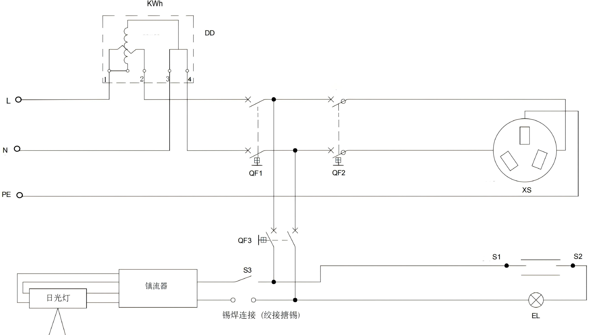
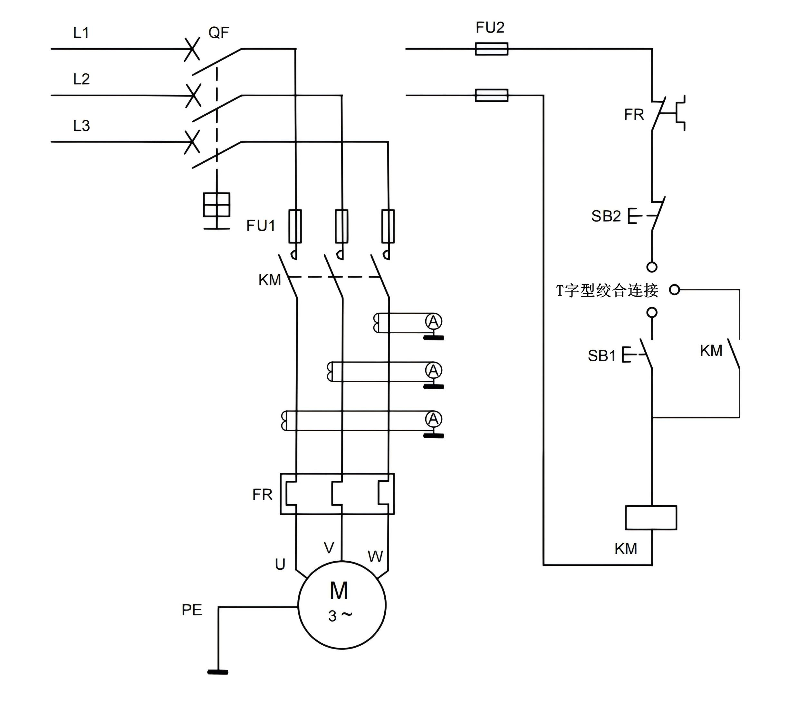
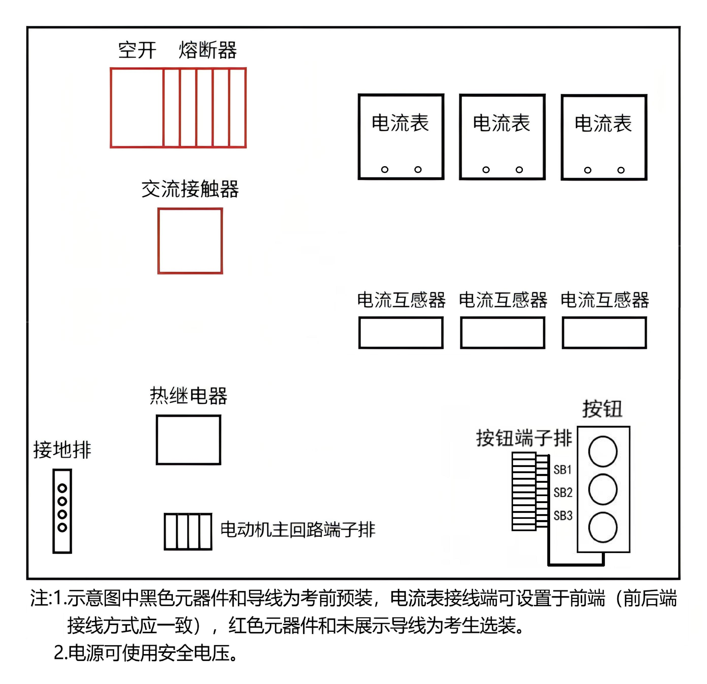

> 本文整理自 **《高压电工作业实操考试题库（2026年版）》科目三：安全操作技术（电气设备安装考位 K33-01 ～ K33-05）**，分值权重为 **40%**，完整收录 5 道接线实操题的考试任务、高清电路原理图、操作台元器件布局示意图及评分标准表。

### 📚 系列导航

1. [考试总览与科目一：安全用具使用（K11-01 ～ K11-04）](/2026/11/27/高压电工实操题库（一）考试总览与科目一安全用具使用/)
2. [科目二：作业现场安全隐患排除（K21-01）](/2026/11/27/高压电工实操题库（二）科目二作业现场安全隐患排除/)
3. [科目三（上）：10/0.4kV 成套开关柜安全操作技术（K31-01 ～ K31-03）](/2026/11/27/高压电工实操题库（三）科目三成套开关柜安全操作技术/)
4. [科目三（中）：10kV 柱上变压器安全操作技术（K32-01 ～ K32-03）](/2026/11/27/高压电工实操题库（四）科目三柱上变压器安全操作技术/)
5. **科目三（下）：电气设备安装与电路接线（K33-01 ～ K33-05）**（本文）
6. [科目四：作业现场应急处置实操题库（K41 ～ K44）](/2026/11/27/高压电工实操题库（六）科目四作业现场应急处置实操题库/)

---

## 通用考试说明（K33-01 ～ K33-05 均适用）

- **试题分值**：满分 100 分，80 分及以上合格；**分值权重**：40%。
- **计分与终止规则**：
  1. 在规定时间内完成考试任务（K33-01 为 30 分钟；K33-02、K33-03 为 45 分钟；K33-04、K33-05 为 50 分钟）。
  2. 考试过程中**扣分超过 20 分**或**“安全不合格项”未通过**的，终止考试，成绩计 0 分。
  3. 超时未完成全部考核内容的，根据完成项目计分，如未完成部分有“安全不合格项”的，成绩计 0 分。
  4. 未作答本题或出现人身伤害情况的，终止考试，成绩计 0 分。
- **操作台布局图统一说明**（K33-02 ～ K33-05）：
  1. 示意图中**黑色元器件和导线为考前预装**，**红色元器件和未展示导线为考生选装**。
  2. 电源可使用安全电压。

---

## 一、030102-K33-01：低压配电箱安装接线

- **考试时间**：30 分钟
- **考试任务**：
  1. 在器材摆放架上选择所需电工工具和仪器仪表，根据电路图选择相应元器件及合适的导线。
  2. 在配电箱里安装接地母线（**接地母线做环形端子并用螺母紧固**），零线排、地线排粘贴标识，安装元器件并规范接线。
  3. 检查电路。
  4. 拆除电路，整理场地。

### 1. 电路原理图

### 2. 评分标准详表

| 考核项目 | 考核内容 | 考核要点 | 评分标准 | 分值或安全不合格项 |
| :--- | :--- | :--- | :--- | :--- |
| **操作前准备与检查** | 1. 穿戴安全防护用品 | 按规范穿戴**安全帽、工作服、绝缘鞋**进入考位。 | 任意一项未穿戴或未按规范穿戴，终止考试。 | **安全不合格项** |
| 〃 | 2. 选择工器具和仪器仪表 | 正确选择**螺丝刀、剥线钳、压接钳、尖嘴钳、扳手、万用表**。 | 未选择或选择错误，每项扣 1 分。 | 6 |
| 〃 | 3. 选择并检测元器件 | 根据电路图选择元器件，使用万用表检测所选元器件是否正常。 | 未选择或选择错误或未检测，每个扣 1 分。 | 6 |
| 〃 | 4. 检查配电箱 | 检查配电箱外观有无变形破损，检查箱体内导轨、接地端子、接零端子是否安装牢固。 | 未检查，每处扣 1 分。 | 4 |
| **安装调试** | 5. 连接接地系统 | 安装接地母线（环形端子）并用螺母紧固，连接接地排与箱体。 | 未做压接环形端子，扣 5 分。 未用螺母紧固，扣 8 分。 接地母线与箱体未可靠连接，扣 10 分。 | 5 8 10 |
| 〃 | 6. 粘贴标识 | 在零线排和地线排处粘贴标识。 | 未粘贴，每处扣 2 分。 | 4 |
| 〃 | 7. 安装元器件 | 根据电路图正确安装断路器、漏电保护器、电涌保护器。 | 未正确安装，每个扣 2 分。 安装位置错误，每处扣 2 分。 | 8 8 |
| 〃 | 8. 安装与检测电路 | 根据电路图选用正确颜色和线径导线（总开关 `BV-4.0mm²`、插座回路 `BV-2.5mm²`、照明回路 `BV-1.5mm²`），并规范接线。完成安装后使用万用表检测电路有无短路、断路故障。 | 未检测电路，扣 6 分。 | 6 |
| **质量核查** | 9. 核查安装质量 | 根据电路图核查元器件及导线安装情况。 | 选用导线颜色或线径错误，每处扣 2 分。 接线出现松动或露铜过长或压绝缘皮，每处扣 2 分。 布线出现飞线，扣 6 分。 出现断路故障，每处扣 5 分。 **出现短路故障，终止考试。** | 6 8 6 5 **安全不合格项** |
| **场地整理** | 10. 拆除电路 | 拆除安装的导线、元器件。 | 未全部拆除，扣 6 分。 | 6 |
| 〃 | 11. 整理场地 | 将拆除的导线、元器件、配电箱及工器具放置在指定位置，清理场地。 | 任意一项未放置在指定位置，扣 2 分。 未清理场地，扣 2 分。 | 2 2 |

---

## 二、030102-K33-02：单相电能表带照明设备接线

- **考试时间**：45 分钟
- **考试任务**：
  1. 在器材摆放架上选择所需电工工具和仪器仪表，根据电路图选择缺失的元器件及合适的导线。
  2. 在操作台上安装缺失的元器件，并规范接线，**将镇流器通过端子排接入电路**（与镇流器连接的灯管为 Ⅱ 类灯具）。
  3. 在电路图指定位置完成**导线锡焊连接操作**（绞接搪锡）。
  4. 检查并通电调试，**只允许调试 2 次**。
  5. 拆除电路，整理场地。

### 1. 电路原理图与操作台元器件布局示意图

### 2. 评分标准详表

| 考核项目 | 考核内容 | 考核要点 | 评分标准 | 分值或安全不合格项 |
| :--- | :--- | :--- | :--- | :--- |
| **操作前准备与检查** | 1. 穿戴安全防护用品 | 按规范穿戴**安全帽、工作服、绝缘鞋**进入考位。 | 任意一项未穿戴或未规范穿戴，终止考试。 | **安全不合格项** |
| 〃 | 2. 选择工器具和仪器仪表 | 正确选择**螺丝刀、剥线钳、尖嘴钳、绝缘胶布、万用表、低压验电笔、电烙铁（含焊锡丝、松香）**。 | 未选择或选择错误，每项扣 1 分。 | 5 |
| 〃 | 3. 确认安装条件 | **确认操作台电源开关断开，验电并悬挂“禁止合闸，有人工作”标示牌。** | 未确认操作台电源开关断开状态或未验电或未悬挂标示牌，终止考试。 | **安全不合格项** |
| 〃 | 4. 选择并检测元器件 | 根据电路图选择元器件，使用万用表检测所选元器件是否正常。 | 未选择或选择错误或未检测，每个扣 1 分。 | 5 |
| **安装调试** | 5. 安装与检测电路 | 根据电路图和设备功率，选用正确颜色和线径导线完成安装，将镇流器通过端子排接入电路。完成安装后使用万用表检测电路。 | 未接接地线，扣 5 分。 未检测电路，扣 2 分。 | 5 2 |
| 〃 | 6. 电路送电 | 申请送电后，按**操作台电源开关 → 线路总断路器 → 各支路断路器**顺序送电。 | 未申请即送电调试，扣 3 分。 送电顺序错误，扣 5 分。 **送电过程中出现短路故障，终止考试。** | 3 5 **安全不合格项** |
| 〃 | 7. 调试与核查电路功能 | 按规范检查、测试、维修（维修含接线**必须在断电情况下进行**，按情况悬挂或拆除标示牌）。只允许调试电路 2 次，完成调试后申请核查电路功能。 | **调试过程中出现短路故障、未断电维修（含接线）、未正确使用标示牌、调试超过 2 次、核查时出现短路故障 → 终止考试。** 单相电能表功能不正常，扣 5 分。 双控灯电路功能不正常，扣 10 分。 日光灯电路功能不正常，扣 10 分。 插座电路功能不正常，扣 5 分。 | **安全不合格项** 5 10 10 5 |
| 〃 | 8. 电路断电 | 按**设备开关 → 各支路断路器 → 线路总断路器 → 操作台电源开关**顺序断电。 | 断电顺序错误，扣 5 分。 **未断电即进行下一步操作，终止考试。** | 5 **安全不合格项** |
| **质量核查** | 9. 核查安装质量 | 根据电路图核查元器件及导线安装情况（含使用电烙铁在指定位置完成导线锡焊连接操作）。 | 元器件安装不规范，每处扣 2 分（6分）。 选用导线颜色或线径错误，每处扣 2 分（6分）。 接线松动、露铜过长或压绝缘皮，每处扣 2 分（6分）。 布线出现飞线，每处扣 2 分（6分）。 未进行锡焊连接操作或锡焊不规范，扣 6 分。 **非指定位置使用端子排接线或锡焊连接处未进行绝缘处理，终止考试。** | 6 / 6 / 6 / 6 / 6 **安全不合格项** |
| **场地整理** | 10～11. 拆除与整理 | 拆除安装的导线、元器件（未全拆扣 6 分）；将导线、元器件、标示牌及工器具放回指定位置（扣 2 分），清理场地（扣 2 分）。 | 按项扣分。 | 6 + 2 + 2 |

---

## 三、030102-K33-03：三相异步电动机单向连续运转电路接线（带点动控制）

- **考试时间**：45 分钟
- **考试任务**：
  1. 在器材摆放架上选择所需电工工具和仪器仪表，根据电路图选择缺失的元器件及合适的导线。
  2. 在操作台上安装缺失的元器件，并规范接线，将**电动机主回路（U、V、W、PE）、按钮控制线通过端子排接入电路**。
  3. 在电路图指定位置完成**导线一字型（平接）绞合连接**操作。
  4. 检查并通电调试，**只允许调试 2 次**。
  5. 拆除电路，整理场地。

### 1. 电路原理图与操作台元器件布局示意图

### 2. 评分标准详表

| 考核项目 | 考核内容 | 考核要点 | 评分标准 | 分值或安全不合格项 |
| :--- | :--- | :--- | :--- | :--- |
| **操作前准备与检查** | 1. 穿戴安全防护用品 | 按规范穿戴**安全帽、工作服、绝缘鞋**进入考位。 | 任意一项未穿戴或未规范穿戴，终止考试。 | **安全不合格项** |
| 〃 | 2. 选择工器具和仪器仪表 | 正确选择**螺丝刀、剥线钳、尖嘴钳、绝缘胶布、万用表、低压验电笔**。 | 未选择或选择错误，每项扣 1 分。 | 5 |
| 〃 | 3. 确认安装条件 | 确认操作台电源开关断开，验电并悬挂“禁止合闸，有人工作”标示牌。 | 未确认断开、未验电或未挂牌，终止考试。 | **安全不合格项** |
| 〃 | 4. 选择并检测元器件 | 根据电路图选择元器件（空开、熔断器、交流接触器），用万用表检测是否正常。 | 未选、选错或未检测，每个扣 1 分。 | 5 |
| **安装调试** | 5. 安装与检测电路 | 选用正确颜色和线径导线完成安装，主回路（U、V、W、PE）、按钮控制线通过端子排接入电路。完成后使用万用表检测电路。 | 未接接地线，扣 5 分。 未检测主电路，扣 1 分。 未检测控制电路，扣 1 分。 | 5 1 1 |
| 〃 | 6. 电路送电 | 申请送电后，按**操作台电源开关 → 线路断路器**顺序送电。 | 未申请即送电扣 3 分；送电顺序错误扣 5 分；**送电出现短路故障 → 终止考试**。 | 3 / 5 / **安全不合格项** |
| 〃 | 7. 调试与核查电路功能 | 断电维修并正确使用标示牌，最多调试 2 次，完成后申请核查电路功能。 | **短路、未断电维修、标示牌错误、调试超 2 次 → 终止考试。** **点动运行**不正常，扣 10 分。 **连续运行**不正常，扣 10 分。 **停止运行**不正常，扣 10 分。 | **安全不合格项** 10 10 10 |
| 〃 | 8. 电路断电 | 按**设备开关（按钮）→ 线路断路器 → 操作台电源开关**顺序断电。 | 断电顺序错误扣 5 分；**未断电即进行下一步操作 → 终止考试**。 | 5 / **安全不合格项** |
| **质量核查** | 9. 核查安装质量 | 核查元器件及导线安装情况（含指定位置完成**一字型平接绞合连接**操作）。 | 元器件安装不规范每处扣2分(6分)；导线颜色/线径错误每处扣2分(6分)；松动/露铜/压皮每处扣2分(6分)；飞线每处扣2分(6分)；未绞合或绞合不规范扣 6 分。 **非指定位置使用端子排接线或一字型绞合连接处未进行绝缘处理 → 终止考试。** | 6×5 **安全不合格项** |
| **场地整理** | 10～11. 拆除与整理 | 拆除导线、元器件（6分）；放回指定位置（2分），清理场地（2分）。 | 按项扣分。 | 6 + 2 + 2 |

---

## 四、030102-K33-04：带熔断器（断路器）、仪表、电流互感器的三相异步电动机电路接线

- **考试时间**：50 分钟
- **考试任务**：
  1. 在器材摆放架上选择所需电工工具和仪器仪表，根据电路图选择缺失的元器件及合适的导线。
  2. 在操作台上安装缺失的元器件，并规范接线，将电动机主回路（U、V、W、PE）、按钮控制线通过端子排接入电路（*注意电流互感器二次侧一端必须可靠接地*）。
  3. 在电路图指定位置完成**导线 T 字型绞合连接**操作。
  4. 检查并通电调试，**只允许调试 2 次**。
  5. 拆除电路，整理场地。

### 1. 电路原理图与操作台元器件布局示意图

### 2. 评分标准详表（与 K33-03 对照）

本题流程与 `K33-03` 基本一致，核心差异在以下 4 处：

1. **步骤 2 选择工器具（5 分）**：比 K33-03 多一项 **电工刀**（即：螺丝刀、剥线钳、尖嘴钳、**电工刀**、绝缘胶布、万用表、低压验电笔，漏选/选错每项扣 1 分）。
2. **步骤 7 核查电路功能（各 10 分，共 30 分）**：
   - **仪表显示**不正常，扣 **10 分**；
   - **启动运行**不正常，扣 **10 分**；
   - **停止运行**不正常，扣 **10 分**。
3. **步骤 9 核查安装质量**：
   - 在指定位置完成导线 **T 字型绞合连接**操作（未进行或不规范扣 6 分）。
   - ⚠️ **安全不合格项**：**非指定位置使用端子排接线或 T 字型绞合连接处未进行绝缘处理，终止考试**。
4. 其余穿戴防护、验电挂牌、主/控电路检测、送断电顺序、拆除整理评分标准与 `K33-03` 完全相同。

---

## 五、030102-K33-05：三相异步电动机正反转运行电路接线

- **考试时间**：50 分钟
- **考试任务**：
  1. 在器材摆放架上选择所需电工工具和仪器仪表，根据电路图选择缺失的元器件及合适的导线。
  2. 在操作台上安装缺失的元器件（含两个交流接触器 `KM1`、`KM2` 及接触器联锁回路），并规范接线，将电动机主回路（U、V、W、PE）、按钮控制线通过端子排接入电路。
  3. 检查并通电调试，**只允许调试 2 次**。
  4. 拆除电路，整理场地。

### 1. 电路原理图与操作台元器件布局示意图

### 2. 评分标准详表（与 K33-03 对照）

本题无导线绞合/锡焊项，与 `K33-03` 的差异如下：

1. **步骤 2 选择工器具（5 分）**：螺丝刀、剥线钳、尖嘴钳、绝缘胶布、万用表、低压验电笔（漏选/选错每项扣 1 分）。
2. **步骤 7 核查电路功能（各 10 分，共 30 分）**：
   - **正转运行**不正常，扣 **10 分**；
   - **反转运行**不正常，扣 **10 分**；
   - **停止运行**不正常，扣 **10 分**。
3. **步骤 9 核查安装质量（共 30 分 + 安全不合格项）**：
   - 元器件安装不规范，每处扣 2 分（最高 **8 分**）；
   - 选用导线颜色或线径错误，每处扣 2 分（最高 **8 分**）；
   - 接线出现松动或露铜过长或压绝缘皮，每处扣 2 分（最高 **8 分**）；
   - 布线出现飞线，每处扣 2 分（最高 **6 分**）；
   - ⚠️ **安全不合格项**：**非指定位置使用端子排接线，终止考试**。
4. 其余穿戴防护、验电挂牌、主/控电路检测、送断电顺序、拆除整理评分标准与 `K33-03` 完全相同。
