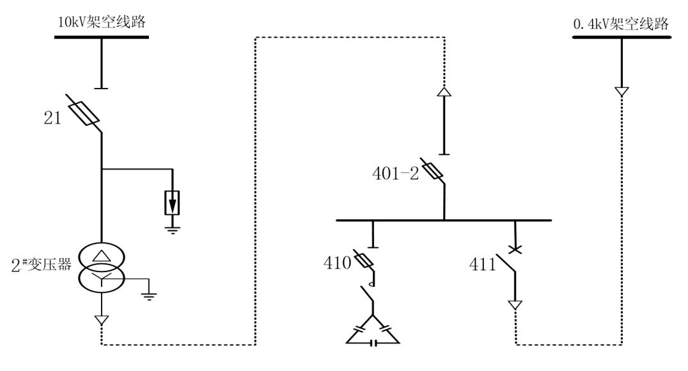

> 本文完整收录 **《高压电工作业实操考试题库（2026年版）》科目三：10/0.4kV 变配电系统（架空线路 / 10kV 柱上 2#变压器）考位（K32-01 ～ K32-03）**。每道考题均先完整呈现全部原始步骤、带网格线的完整评分标准表、一次系统图与全部考生票/评分票，最后在文末进行总结归纳。

### 📚 系列导航

1. [考试总览与科目一：安全用具使用（K11-01 ～ K11-04）](/2026/11/27/高压电工实操题库（一）考试总览与科目一安全用具使用/)
2. [科目二：作业现场安全隐患排除（K21-01）](/2026/11/27/高压电工实操题库（二）科目二作业现场安全隐患排除/)
3. [科目三（上）：10/0.4kV 成套开关柜安全操作技术（K31-01 ～ K31-03）](/2026/11/27/高压电工实操题库（三）科目三成套开关柜安全操作技术/)
4. **科目三（中）：10kV 柱上变压器安全操作技术（K32-01 ～ K32-03）**（本文）
5. [科目三（下）：电气设备安装与电路接线（K33-01 ～ K33-05）](/2026/11/27/高压电工实操题库（五）科目三电气设备安装与电路接线/)
6. [科目四：作业现场应急处置实操题库（K41 ～ K44）](/2026/11/27/高压电工实操题库（六）科目四作业现场应急处置实操题库/)

---

## 一、030102-K32-01：10kV 柱上 2#变压器跌落式熔断器故障处理

### 1. 试题要求与考试说明
- **1. 试题编码**：`030102-K32-01`
- **2. 试题题目**：高压电工作业-10/0.4kV 变配电系统（架空线路）－10kV 柱上 2#变压器跌落式熔断器故障处理
- **3. 考试任务**：2 人一组完成 10kV 柱上 2#变压器跌落式熔断器单相载熔件跌落（熔断件熔体熔断）故障处理（本任务已正确办理工作票或结票）。
- **4. 考试时间**：35 分钟
- **5. 试题分值**：100 分，80 分及以上合格。
- **6. 考试说明**：
  1. 2 名考生组成一个班组，在规定时间内互相配合完成考试任务，抽签确定操作人、监护人。完善操作票时，操作人填写操作票，监护人检查操作票，2 人共同确认操作票（允许修改 1 次操作票），签字后提交。
  2. 考核内容分为个人评分项目和班组评分项目。在个人评分的项目中，当考生“安全不合格项”未通过时，仅“安全不合格项”未通过的考生终止考试，本次实操考试成绩计 0 分；当考生出现扣分情况时，根据情况扣减相应考生分数。在班组评分项目中，当任意一名考生“安全不合格项”未通过时，该班组考生终止考试，本次实操考试成绩计 0 分；当班组内任意一名考生出现“扣分”情况时，同时扣减该班组考生分数。
  3. 在考试过程中，当任意一名考生扣分超过 20 分或“安全不合格项”未通过时，该组考生终止考试，扣分超过 20 分或“安全不合格项”未通过的考生，本次实操考试成绩计 0 分；扣分未超过 20 分或未涉及“安全不合格项”未通过的考生，重新分组后重新执行考试任务。
  4. 超时未完成全部考核内容的，根据完成项目计分，如未完成部分有“安全不合格项”的，本次实操考试成绩计 0 分。
  5. 未作答本题的，本次实操考试成绩计 0 分。
  6. 考试过程中出现人身伤害情况的，该组考生终止考试，本次实操考试成绩计 0 分。
- **7. 分值权重**：40%
- **8. 评分标准**：见下表

### 2. 完整评分标准表（030102-K32-01）

<table class="exam-table">
  <thead>
    <tr>
      <th style="width:12%">考核项目</th>
      <th style="width:16%">考核内容</th>
      <th style="width:32%">考核要点</th>
      <th style="width:24%">评分标准</th>
      <th style="width:11%">分值或安全不合格项</th>
      <th style="width:5%">扣分</th>
    </tr>
  </thead>
  <tbody>
    <tr>
      <td class="col-proj" rowspan="5">操作前的准备与检查</td>
      <td class="col-item" rowspan="2">1. 完善操作票</td>
      <td rowspan="2">抽取操作票，根据考试任务完善操作票内容，补充（填写）4 项操作项目。操作人填写操作票，监护人检查操作票，2 人共同确认操作票（允许修改 1 次操作票），签字后提交。</td>
      <td>提交的操作票填写不规范，每项扣 2 分。</td>
      <td class="col-score">8 （班组评分项目）</td>
      <td class="col-deduct"></td>
    </tr>
    <tr>
      <td>提交的操作票填写错误，该班组人员终止考试。</td>
      <td class="col-score">安全不合格项 （班组评分项目）</td>
      <td class="col-deduct"></td>
    </tr>
    <tr>
      <td class="col-item" rowspan="2">2. 选择工器具和仪器仪表</td>
      <td rowspan="2">根据考试任务选择绝缘手套、绝缘靴、防护眼镜、绝缘操作杆、标示牌，工器具的种类、数量满足作业需要。</td>
      <td>绝缘手套、绝缘靴、防护眼镜中任意一项未选择，该班组人员终止考试。</td>
      <td class="col-score">安全不合格项 （班组评分项目）</td>
      <td class="col-deduct"></td>
    </tr>
    <tr>
      <td>绝缘操作杆、标示牌中任意一项未选择或所需数量选择错误，扣 2 分。</td>
      <td class="col-score">2 （班组评分项目）</td>
      <td class="col-deduct"></td>
    </tr>
    <tr>
      <td class="col-item" rowspan="1">3. 互检安全防护用品</td>
      <td rowspan="1">互检安全帽、工作服、绝缘靴是否按规范穿戴。</td>
      <td>任意一人出现任意一项未穿戴或未按规范穿戴，该班组人员终止考试。</td>
      <td class="col-score">安全不合格项 （班组评分项目）</td>
      <td class="col-deduct"></td>
    </tr>
    <tr>
      <td class="col-proj" rowspan="26">10kV 柱上变压器跌落式熔断器故障处理</td>
      <td class="col-item" rowspan="1">4. 倒闸操作执行监护复诵制度</td>
      <td rowspan="1">倒闸操作执行监护复诵制度，操作票中的操作项目按照“唱票－复诵－确认－执行”流程实施，各环节要求如下： <strong>1. 唱票</strong>：监护人应按操作项目顺序清晰、准确朗读操作项目内容。如监护人唱票错误，操作人不得复诵，应当场告知监护人“你唱票内容和操作票不符，请重新核对”。核对后重新“唱票”。 <strong>2. 复诵</strong>：操作人利用手势指出相应设备，清晰、准确复诵操作项目内容。操作人手指设备错误或复诵错误，监护人不得下达许可指令，应当场告知操作人“你手指设备或复诵内容和操作票不符，请和我一同核对操作项目内容”。核对后重新“唱票－复诵”。 <strong>3. 确认</strong>：监护人目视操作人手指设备、确认复诵内容无误后，下达许可指令“对，执行”。监护人下达的许可指令错误或不规范，操作人停止操作，当场告知监护人“你的指令错误或不规范，请纠正”。纠正后重新下达许可指令。 <strong>4. 执行</strong>：操作人规范执行操作，监护人确认操作到位且无异常后，在操作项目后方打“√”。操作人执行错误，监护人应立即叫停作业，如操作人未实施实质性误操作或违章操作，应重新执行“唱票－复诵－确认－执行”流程；如操作人已发生实质性误操作或违章操作，监护人应立即报告事故内容，得到“继续”指令后，应重新执行“唱票－复诵－确认－执行”流程。</td>
      <td>操作票中操作项目与考核要点对应的步骤，在执行“唱票－复诵－确认－执行”过程中对监护人、操作人进行独立评分，对执行过程出错承担责任的人员，按考核要点对应“分值”扣分或“安全不合格项”未通过，责任划分规则及特殊情况认定“安全不合格项”未通过情形如下： <strong>1. 唱票</strong>：（1）监护人唱票内容错误，如操作人未当场告知，则操作人、监护人同时担责；如操作人当场告知，仅监护人担责。（2）监护人唱票内容正确，如操作人当场告知错误，仅操作人担责。（3）对于仅扣分的操作项目，如监护人连续唱票错误 2 次，认定监护人“安全不合格项”未通过。 <strong>2. 复诵</strong>：（1）操作人手指设备错误或复诵内容错误，如监护人未当场告知，则操作人、监护人同时担责；如监护人当场告知，仅操作人担责。（2）操作人手指设备及复诵内容均正确，如监护人当场告知错误，仅监护人担责。（3）对于仅扣分的操作项目，如操作人连续复诵错误 2 次，认定操作人“安全不合格项”未通过。 <strong>3. 确认</strong>：（1）监护人下达的许可指令错误或不规范，如操作人未当场告知，则操作人、监护人同时担责；如操作人当场告知，仅监护人担责。（2）监护人下达的许可指令正确，如操作人当场告知错误，仅操作人担责。（3）对于仅扣分的操作项目，如监护人连续确认错误 2 次，认定监护人“安全不合格项”未通过。 <strong>4. 执行</strong>：（1）操作人执行时出现操作偏差但未实施实质性误操作或违章操作，如监护人及时制止并中止违章动作，仅操作人担责。操作人已发生实质性误操作或违章操作，如监护人未立即报告，则操作人、监护人同时担责；如监护人立即报告，仅操作人担责。（2）操作人执行操作正确，如监护人当场制止或报告操作错误，仅监护人担责。（3）操作人正确执行后，如监护人未在操作票打“√”，仅监护人担责。（4）对于仅扣分的操作项目，如操作人或监护人连续执行错误 2 次，认定相应人员“安全不合格项”未通过。 <strong>5.</strong> 因操作人或监护人问题导致某个操作项目无法正常执行“唱票－复诵－确认－执行”流程的，根据情况由相应人员担责。对于仅扣分的操作项目，因操作人或监护人问题导致 2 个操作项目无法正常执行“唱票－复诵－确认－执行”流程的，认定相应人员“安全不合格项”未通过。 注：对于仅扣分的操作项目，在执行监护复诵制度过程中，当操作人或监护人出现扣分情况时，仅按考核要点对应“分值”扣分 1 次。</td>
      <td class="col-score">—— （个人评分项目）</td>
      <td class="col-deduct"></td>
    </tr>
    <tr>
      <td class="col-item" rowspan="1">5. 倒闸操作安全措施</td>
      <td rowspan="1">停电、送电倒闸操作前必须核对设备的名称、编号、运行状态；倒闸操作过程中必须规范穿戴绝缘手套、防护眼镜。</td>
      <td>停电、送电倒闸操作前未核对的或倒闸操作过程中未规范穿戴绝缘手套、防护眼镜的，该班组人员终止考试。</td>
      <td class="col-score">安全不合格项 （班组评分项目）</td>
      <td class="col-deduct"></td>
    </tr>
    <tr>
      <td class="col-item" rowspan="9">6. 停电倒闸操作</td>
      <td rowspan="1">1. 在 10kV 柱上 2#变压器周围装设工作区域围栏，悬挂“止步，高压危险”“在此工作”标示牌。</td>
      <td>违反监护复诵制度要求，扣 4 分。</td>
      <td class="col-score">4 （个人评分项目）</td>
      <td class="col-deduct"></td>
    </tr>
    <tr>
      <td rowspan="1">2. 退出 410 电容器组。</td>
      <td>违反监护复诵制度要求，扣 4 分。</td>
      <td class="col-score">4 （个人评分项目）</td>
      <td class="col-deduct"></td>
    </tr>
    <tr>
      <td rowspan="1">3. 拉开 411 出线开关。</td>
      <td>违反监护复诵制度要求，扣 4 分。</td>
      <td class="col-score">4 （个人评分项目）</td>
      <td class="col-deduct"></td>
    </tr>
    <tr>
      <td rowspan="1">4. 检查 411 出线开关确已拉开。</td>
      <td>违反监护复诵制度要求，终止考试。</td>
      <td class="col-score">安全不合格项 （个人评分项目）</td>
      <td class="col-deduct"></td>
    </tr>
    <tr>
      <td rowspan="1">5. 拉开 401-2 进线刀闸。</td>
      <td>违反监护复诵制度要求，扣 5 分。</td>
      <td class="col-score">5 （个人评分项目）</td>
      <td class="col-deduct"></td>
    </tr>
    <tr>
      <td rowspan="1">6. 检查 401-2 进线刀闸确已拉开。</td>
      <td>违反监护复诵制度要求，扣 5 分。</td>
      <td class="col-score">5 （个人评分项目）</td>
      <td class="col-deduct"></td>
    </tr>
    <tr>
      <td rowspan="2">7. 拉开 10kV 柱上 2#变压器高压侧跌落式熔断器。</td>
      <td>违反监护复诵制度要求或执行时操作不规范，扣 10 分。</td>
      <td class="col-score">10 （个人评分项目）</td>
      <td class="col-deduct"></td>
    </tr>
    <tr>
      <td>执行时操作顺序错误，终止考试。</td>
      <td class="col-score">安全不合格项 （个人评分项目）</td>
      <td class="col-deduct"></td>
    </tr>
    <tr>
      <td rowspan="1">8. 检查 10kV 柱上 2#变压器高压侧跌落式熔断器确已拉开。</td>
      <td>违反监护复诵制度要求，扣 4 分。</td>
      <td class="col-score">4 （个人评分项目）</td>
      <td class="col-deduct"></td>
    </tr>
    <tr>
      <td class="col-item" rowspan="2">7. 处理故障</td>
      <td rowspan="1">1. 使用绝缘操作杆取下故障载熔件，处理载熔件故障。 载熔件故障处理方法：正确更换熔断件或选择与故障载熔件同规格、同型号的新载熔件（已预装完好熔断件）。</td>
      <td>未取下故障载熔件或未正确处理载熔件故障，扣 4 分。</td>
      <td class="col-score">4 （班组评分项目）</td>
      <td class="col-deduct"></td>
    </tr>
    <tr>
      <td rowspan="1">2. 使用绝缘操作杆安装载熔件。</td>
      <td>未安装载熔件，扣 4 分。</td>
      <td class="col-score">4 （班组评分项目）</td>
      <td class="col-deduct"></td>
    </tr>
    <tr>
      <td class="col-item" rowspan="13">8. 送电倒闸操作</td>
      <td rowspan="1">1. 检查 401-2 进线刀闸在断开位置。</td>
      <td>违反监护复诵制度要求，终止考试。</td>
      <td class="col-score">安全不合格项 （个人评分项目）</td>
      <td class="col-deduct"></td>
    </tr>
    <tr>
      <td rowspan="2">2. 合上 10kV 柱上 2#变压器高压侧跌落式熔断器。</td>
      <td>违反监护复诵制度要求或执行时操作不规范，扣 10 分。</td>
      <td class="col-score">10 （个人评分项目）</td>
      <td class="col-deduct"></td>
    </tr>
    <tr>
      <td>执行时操作顺序错误，终止考试。</td>
      <td class="col-score">安全不合格项 （个人评分项目）</td>
      <td class="col-deduct"></td>
    </tr>
    <tr>
      <td rowspan="1">3. 检查 10kV 柱上 2#变压器高压侧跌落式熔断器确已合上。</td>
      <td>违反监护复诵制度要求，扣 4 分。</td>
      <td class="col-score">4 （个人评分项目）</td>
      <td class="col-deduct"></td>
    </tr>
    <tr>
      <td rowspan="1">4. 检查 10kV 柱上 2#变压器运行正常。</td>
      <td>违反监护复诵制度要求，扣 4 分。</td>
      <td class="col-score">4 （个人评分项目）</td>
      <td class="col-deduct"></td>
    </tr>
    <tr>
      <td rowspan="1">5. 检查 10kV 柱上 2#变压器低压侧三相电压正常。</td>
      <td>违反监护复诵制度要求，扣 4 分。</td>
      <td class="col-score">4 （个人评分项目）</td>
      <td class="col-deduct"></td>
    </tr>
    <tr>
      <td rowspan="1">6. 检查 411 出线开关在断开位置。</td>
      <td>违反监护复诵制度要求，终止考试。</td>
      <td class="col-score">安全不合格项 （个人评分项目）</td>
      <td class="col-deduct"></td>
    </tr>
    <tr>
      <td rowspan="1">7. 合上 401-2 进线刀闸。</td>
      <td>违反监护复诵制度要求，扣 4 分。</td>
      <td class="col-score">4 （个人评分项目）</td>
      <td class="col-deduct"></td>
    </tr>
    <tr>
      <td rowspan="1">8. 检查 401-2 进线刀闸确已合上。</td>
      <td>违反监护复诵制度要求，扣 4 分。</td>
      <td class="col-score">4 （个人评分项目）</td>
      <td class="col-deduct"></td>
    </tr>
    <tr>
      <td rowspan="1">9. 合上 411 出线开关。</td>
      <td>违反监护复诵制度要求，扣 4 分。</td>
      <td class="col-score">4 （个人评分项目）</td>
      <td class="col-deduct"></td>
    </tr>
    <tr>
      <td rowspan="1">10. 检查 411 出线开关确已合上。</td>
      <td>违反监护复诵制度要求，扣 3 分。</td>
      <td class="col-score">3 （个人评分项目）</td>
      <td class="col-deduct"></td>
    </tr>
    <tr>
      <td rowspan="1">11. 投入 410 电容器组。</td>
      <td>违反监护复诵制度要求，扣 3 分。</td>
      <td class="col-score">3 （个人评分项目）</td>
      <td class="col-deduct"></td>
    </tr>
    <tr>
      <td rowspan="1">12. 取下 10kV 柱上 2#变压器工作区域围栏上“止步，高压危险”“在此工作”标示牌，拆除围栏。</td>
      <td>违反监护复诵制度要求，扣 2 分。</td>
      <td class="col-score">2 （个人评分项目）</td>
      <td class="col-deduct"></td>
    </tr>
    <tr>
      <td class="col-proj" rowspan="1">场地整理</td>
      <td class="col-item" rowspan="1">9. 整理场地</td>
      <td rowspan="1">将工器具放置在指定位置。</td>
      <td>任意一项未放置在指定位置，扣 4 分。</td>
      <td class="col-score">4 （班组评分项目）</td>
      <td class="col-deduct"></td>
    </tr>
  </tbody>
</table>

### 3. 附件 1：10kV 柱上 2#变压器一次系统图

### 4. 附件 2：10kV 柱上 2#变压器跌落式熔断器故障处理操作票（考生票及评分票）

<table class="exam-table">
  <thead>
    <tr><th colspan="6">030102-K32-01 10kV 柱上 2#变压器跌落式熔断器故障处理（运行转检修考生票 1）</th></tr>
  </thead>
  <tbody>
    <tr><td><strong>单位</strong></td><td colspan="2">&nbsp;</td><td><strong>编号</strong></td><td colspan="2">&nbsp;</td></tr>
    <tr><td><strong>发令人</strong></td><td>&nbsp;</td><td><strong>受令人</strong></td><td>&nbsp;</td><td><strong>发令时间</strong></td><td>年 月 日 时 分</td></tr>
    <tr><td><strong>操作开始时间</strong></td><td colspan="2">年 月 日 时 分</td><td><strong>操作结束时间</strong></td><td colspan="2">年 月 日 时 分</td></tr>
    <tr><td colspan="3" style="text-align:center">（ &nbsp; ）监护操作</td><td colspan="3" style="text-align:center">（ &nbsp; ）单人操作</td></tr>
    <tr><td colspan="6"><strong>操作任务</strong>：10kV 柱上 2#变压器由运行转检修</td></tr>
    <tr><td style="text-align:center;width:10%"><strong>顺序</strong></td><td colspan="4" style="text-align:center"><strong>操作项目</strong></td><td style="text-align:center;width:10%"><strong>√</strong></td></tr>
    <tr class="ticket-blank"><td style="text-align:center">1</td><td colspan="4">（考生填写项）</td><td>&nbsp;</td></tr>
    <tr class="ticket-blank"><td style="text-align:center">2</td><td colspan="4">（考生填写项）</td><td>&nbsp;</td></tr>
    <tr class="ticket-blank"><td style="text-align:center">3</td><td colspan="4">（考生填写项）</td><td>&nbsp;</td></tr>
    <tr class="ticket-blank"><td style="text-align:center">4</td><td colspan="4">（考生填写项）</td><td>&nbsp;</td></tr>
    <tr><td style="text-align:center">5</td><td colspan="4">拉开 401-2 进线刀闸</td><td>&nbsp;</td></tr>
    <tr><td style="text-align:center">6</td><td colspan="4">检查 401-2 进线刀闸确已拉开</td><td>&nbsp;</td></tr>
    <tr><td style="text-align:center">7</td><td colspan="4">拉开 10kV 柱上 2#变压器高压侧跌落式熔断器</td><td>&nbsp;</td></tr>
    <tr><td style="text-align:center">8</td><td colspan="4">检查 10kV 柱上 2#变压器高压侧跌落式熔断器确已拉开</td><td>&nbsp;</td></tr>
    <tr><td colspan="6"><strong>备注：</strong></td></tr>
    <tr><td colspan="2"><strong>操作人：</strong></td><td colspan="2"><strong>监护人：</strong></td><td colspan="2"><strong>值班负责人：</strong></td></tr>
    <tr><td colspan="6" class="col-proj">备选答案（注：可自行调整备选答案顺序）</td></tr>
    <tr><td colspan="6"><strong>在 10kV 柱上 2#变压器周围装设工作区域围栏，悬挂“止步，高压危险”“在此工作”标示牌</strong></td></tr>
    <tr><td colspan="6"><strong>退出 410 电容器组</strong></td></tr>
    <tr><td colspan="6"><strong>在 10kV 柱上 2#变压器周围装设工作区域围栏，悬挂“在此工作”标示牌</strong></td></tr>
    <tr><td colspan="6"><strong>退出 401 电容器组</strong></td></tr>
    <tr><td colspan="6"><strong>拉开 411 出线开关</strong></td></tr>
    <tr><td colspan="6"><strong>检查 411 出线开关确已拉开</strong></td></tr>
  </tbody>
</table>

<table class="exam-table">
  <thead>
    <tr><th colspan="6">030102-K32-01 10kV 柱上 2#变压器跌落式熔断器故障处理（运行转检修考生票 2）</th></tr>
  </thead>
  <tbody>
    <tr><td><strong>单位</strong></td><td colspan="2">&nbsp;</td><td><strong>编号</strong></td><td colspan="2">&nbsp;</td></tr>
    <tr><td><strong>发令人</strong></td><td>&nbsp;</td><td><strong>受令人</strong></td><td>&nbsp;</td><td><strong>发令时间</strong></td><td>年 月 日 时 分</td></tr>
    <tr><td><strong>操作开始时间</strong></td><td colspan="2">年 月 日 时 分</td><td><strong>操作结束时间</strong></td><td colspan="2">年 月 日 时 分</td></tr>
    <tr><td colspan="3" style="text-align:center">（ &nbsp; ）监护操作</td><td colspan="3" style="text-align:center">（ &nbsp; ）单人操作</td></tr>
    <tr><td colspan="6"><strong>操作任务</strong>：10kV 柱上 2#变压器由运行转检修</td></tr>
    <tr><td style="text-align:center;width:10%"><strong>顺序</strong></td><td colspan="4" style="text-align:center"><strong>操作项目</strong></td><td style="text-align:center;width:10%"><strong>√</strong></td></tr>
    <tr><td style="text-align:center">1</td><td colspan="4">在 10kV 柱上 2#变压器周围装设工作区域围栏，悬挂“止步，高压危险”“在此工作”标示牌</td><td>&nbsp;</td></tr>
    <tr><td style="text-align:center">2</td><td colspan="4">退出 410 电容器组</td><td>&nbsp;</td></tr>
    <tr><td style="text-align:center">3</td><td colspan="4">拉开 411 出线开关</td><td>&nbsp;</td></tr>
    <tr><td style="text-align:center">4</td><td colspan="4">检查 411 出线开关确已拉开</td><td>&nbsp;</td></tr>
    <tr class="ticket-blank"><td style="text-align:center">5</td><td colspan="4">（考生填写项）</td><td>&nbsp;</td></tr>
    <tr class="ticket-blank"><td style="text-align:center">6</td><td colspan="4">（考生填写项）</td><td>&nbsp;</td></tr>
    <tr class="ticket-blank"><td style="text-align:center">7</td><td colspan="4">（考生填写项）</td><td>&nbsp;</td></tr>
    <tr class="ticket-blank"><td style="text-align:center">8</td><td colspan="4">（考生填写项）</td><td>&nbsp;</td></tr>
    <tr><td colspan="6"><strong>备注：</strong></td></tr>
    <tr><td colspan="2"><strong>操作人：</strong></td><td colspan="2"><strong>监护人：</strong></td><td colspan="2"><strong>值班负责人：</strong></td></tr>
    <tr><td colspan="6" class="col-proj">备选答案（注：可自行调整备选答案顺序）</td></tr>
    <tr><td colspan="6"><strong>拉开 411 出线刀闸</strong></td></tr>
    <tr><td colspan="6"><strong>检查 411 出线刀闸确已拉开</strong></td></tr>
    <tr><td colspan="6"><strong>拉开 401-2 进线刀闸</strong></td></tr>
    <tr><td colspan="6"><strong>检查 401-2 进线刀闸确已拉开</strong></td></tr>
    <tr><td colspan="6"><strong>拉开 10kV 柱上 2#变压器高压侧跌落式熔断器</strong></td></tr>
    <tr><td colspan="6"><strong>检查 10kV 柱上 2#变压器高压侧跌落式熔断器确已拉开</strong></td></tr>
  </tbody>
</table>

<table class="exam-table">
  <thead>
    <tr><th colspan="6">030102-K32-01 10kV 柱上 2#变压器跌落式熔断器故障处理（运行转检修考生票 3）</th></tr>
  </thead>
  <tbody>
    <tr><td><strong>单位</strong></td><td colspan="2">&nbsp;</td><td><strong>编号</strong></td><td colspan="2">&nbsp;</td></tr>
    <tr><td><strong>发令人</strong></td><td>&nbsp;</td><td><strong>受令人</strong></td><td>&nbsp;</td><td><strong>发令时间</strong></td><td>年 月 日 时 分</td></tr>
    <tr><td><strong>操作开始时间</strong></td><td colspan="2">年 月 日 时 分</td><td><strong>操作结束时间</strong></td><td colspan="2">年 月 日 时 分</td></tr>
    <tr><td colspan="3" style="text-align:center">（ &nbsp; ）监护操作</td><td colspan="3" style="text-align:center">（ &nbsp; ）单人操作</td></tr>
    <tr><td colspan="6"><strong>操作任务</strong>：10kV 柱上 2#变压器由运行转检修</td></tr>
    <tr><td style="text-align:center;width:10%"><strong>顺序</strong></td><td colspan="4" style="text-align:center"><strong>操作项目</strong></td><td style="text-align:center;width:10%"><strong>√</strong></td></tr>
    <tr><td style="text-align:center">1</td><td colspan="4">在 10kV 柱上 2#变压器周围装设工作区域围栏，悬挂“止步，高压危险”“在此工作”标示牌</td><td>&nbsp;</td></tr>
    <tr><td style="text-align:center">2</td><td colspan="4">退出 410 电容器组</td><td>&nbsp;</td></tr>
    <tr class="ticket-blank"><td style="text-align:center">3</td><td colspan="4">（考生填写项）</td><td>&nbsp;</td></tr>
    <tr class="ticket-blank"><td style="text-align:center">4</td><td colspan="4">（考生填写项）</td><td>&nbsp;</td></tr>
    <tr class="ticket-blank"><td style="text-align:center">5</td><td colspan="4">（考生填写项）</td><td>&nbsp;</td></tr>
    <tr class="ticket-blank"><td style="text-align:center">6</td><td colspan="4">（考生填写项）</td><td>&nbsp;</td></tr>
    <tr><td style="text-align:center">7</td><td colspan="4">拉开 10kV 柱上 2#变压器高压侧跌落式熔断器</td><td>&nbsp;</td></tr>
    <tr><td style="text-align:center">8</td><td colspan="4">检查 10kV 柱上 2#变压器高压侧跌落式熔断器确已拉开</td><td>&nbsp;</td></tr>
    <tr><td colspan="6"><strong>备注：</strong></td></tr>
    <tr><td colspan="2"><strong>操作人：</strong></td><td colspan="2"><strong>监护人：</strong></td><td colspan="2"><strong>值班负责人：</strong></td></tr>
    <tr><td colspan="6" class="col-proj">备选答案（注：可自行调整备选答案顺序）</td></tr>
    <tr><td colspan="6"><strong>拉开 411 出线开关</strong></td></tr>
    <tr><td colspan="6"><strong>检查 411 出线开关确已拉开</strong></td></tr>
    <tr><td colspan="6"><strong>拉开 401 进线开关</strong></td></tr>
    <tr><td colspan="6"><strong>检查 401 进线开关确已拉开</strong></td></tr>
    <tr><td colspan="6"><strong>拉开 401-2 进线刀闸</strong></td></tr>
    <tr><td colspan="6"><strong>检查 401-2 进线刀闸确已拉开</strong></td></tr>
  </tbody>
</table>

<table class="exam-table">
  <thead>
    <tr><th colspan="6">030102-K32-01 10kV 柱上 2#变压器跌落式熔断器故障处理（运行转检修标准评分票）</th></tr>
  </thead>
  <tbody>
    <tr><td><strong>单位</strong></td><td colspan="2">&nbsp;</td><td><strong>编号</strong></td><td colspan="2">&nbsp;</td></tr>
    <tr><td><strong>发令人</strong></td><td>&nbsp;</td><td><strong>受令人</strong></td><td>&nbsp;</td><td><strong>发令时间</strong></td><td>年 月 日 时 分</td></tr>
    <tr><td><strong>操作开始时间</strong></td><td colspan="2">年 月 日 时 分</td><td><strong>操作结束时间</strong></td><td colspan="2">年 月 日 时 分</td></tr>
    <tr><td colspan="3" style="text-align:center">（ √ ）监护操作</td><td colspan="3" style="text-align:center">（ &nbsp; ）单人操作</td></tr>
    <tr><td colspan="6"><strong>操作任务</strong>：10kV 柱上 2#变压器由运行转检修</td></tr>
    <tr><td style="text-align:center;width:10%"><strong>顺序</strong></td><td colspan="4" style="text-align:center"><strong>操作项目</strong></td><td style="text-align:center;width:10%"><strong>√</strong></td></tr>
    <tr><td style="text-align:center">1</td><td colspan="4">在 10kV 柱上 2#变压器周围装设工作区域围栏，悬挂“止步，高压危险”“在此工作”标示牌</td><td>&nbsp;</td></tr>
    <tr><td style="text-align:center">2</td><td colspan="4">退出 410 电容器组</td><td>&nbsp;</td></tr>
    <tr><td style="text-align:center">3</td><td colspan="4">拉开 411 出线开关</td><td>&nbsp;</td></tr>
    <tr><td style="text-align:center">4</td><td colspan="4">检查 411 出线开关确已拉开</td><td>&nbsp;</td></tr>
    <tr><td style="text-align:center">5</td><td colspan="4">拉开 401-2 进线刀闸</td><td>&nbsp;</td></tr>
    <tr><td style="text-align:center">6</td><td colspan="4">检查 401-2 进线刀闸确已拉开</td><td>&nbsp;</td></tr>
    <tr><td style="text-align:center">7</td><td colspan="4">拉开 10kV 柱上 2#变压器高压侧跌落式熔断器</td><td>&nbsp;</td></tr>
    <tr><td style="text-align:center">8</td><td colspan="4">检查 10kV 柱上 2#变压器高压侧跌落式熔断器确已拉开</td><td>&nbsp;</td></tr>
    <tr><td colspan="6"><strong>备注：</strong></td></tr>
    <tr><td colspan="2"><strong>操作人：</strong></td><td colspan="2"><strong>监护人：</strong></td><td colspan="2"><strong>值班负责人：</strong></td></tr>
  </tbody>
</table>

<table class="exam-table">
  <thead>
    <tr><th colspan="6">030102-K32-01 10kV 柱上 2#变压器跌落式熔断器故障处理（检修转运行考生票 1～3 通用 / 标准评分票）</th></tr>
  </thead>
  <tbody>
    <tr><td><strong>单位</strong></td><td colspan="2">&nbsp;</td><td><strong>编号</strong></td><td colspan="2">&nbsp;</td></tr>
    <tr><td><strong>发令人</strong></td><td>&nbsp;</td><td><strong>受令人</strong></td><td>&nbsp;</td><td><strong>发令时间</strong></td><td>年 月 日 时 分</td></tr>
    <tr><td><strong>操作开始时间</strong></td><td colspan="2">年 月 日 时 分</td><td><strong>操作结束时间</strong></td><td colspan="2">年 月 日 时 分</td></tr>
    <tr><td colspan="3" style="text-align:center">（ √ ）监护操作</td><td colspan="3" style="text-align:center">（ &nbsp; ）单人操作</td></tr>
    <tr><td colspan="6"><strong>操作任务</strong>：10kV 柱上 2#变压器由检修转运行</td></tr>
    <tr><td style="text-align:center;width:10%"><strong>顺序</strong></td><td colspan="4" style="text-align:center"><strong>操作项目</strong></td><td style="text-align:center;width:10%"><strong>√</strong></td></tr>
    <tr><td style="text-align:center">1</td><td colspan="4">检查 401-2 进线刀闸在断开位置</td><td>&nbsp;</td></tr>
    <tr><td style="text-align:center">2</td><td colspan="4">合上 10kV 柱上 2#变压器高压侧跌落式熔断器</td><td>&nbsp;</td></tr>
    <tr><td style="text-align:center">3</td><td colspan="4">检查 10kV 柱上 2#变压器高压侧跌落式熔断器确已合上</td><td>&nbsp;</td></tr>
    <tr><td style="text-align:center">4</td><td colspan="4">检查 10kV 柱上 2#变压器运行正常</td><td>&nbsp;</td></tr>
    <tr><td style="text-align:center">5</td><td colspan="4">检查 10kV 柱上 2#变压器低压侧三相电压正常</td><td>&nbsp;</td></tr>
    <tr><td style="text-align:center">6</td><td colspan="4">检查 411 出线开关在断开位置</td><td>&nbsp;</td></tr>
    <tr><td style="text-align:center">7</td><td colspan="4">合上 401-2 进线刀闸</td><td>&nbsp;</td></tr>
    <tr><td style="text-align:center">8</td><td colspan="4">检查 401-2 进线刀闸确已合上</td><td>&nbsp;</td></tr>
    <tr><td style="text-align:center">9</td><td colspan="4">合上 411 出线开关</td><td>&nbsp;</td></tr>
    <tr><td style="text-align:center">10</td><td colspan="4">检查 411 出线开关确已合上</td><td>&nbsp;</td></tr>
    <tr><td style="text-align:center">11</td><td colspan="4">投入 410 电容器组</td><td>&nbsp;</td></tr>
    <tr><td style="text-align:center">12</td><td colspan="4">取下 10kV 柱上 2#变压器工作区域围栏上“止步，高压危险”“在此工作”标示牌，拆除围栏</td><td>&nbsp;</td></tr>
    <tr><td colspan="6"><strong>备注：</strong></td></tr>
    <tr><td colspan="2"><strong>操作人：</strong></td><td colspan="2"><strong>监护人：</strong></td><td colspan="2"><strong>值班负责人：</strong></td></tr>
  </tbody>
</table>

---

## 二、030102-K32-02：10kV 柱上 2#变压器低压侧线路电压不足异常处理

### 1. 试题要求与考试说明
- **1. 试题编码**：`030102-K32-02`
- **2. 试题题目**：高压电工作业-10/0.4kV 变配电系统（架空线路）考位-10kV 柱上 2#变压器低压侧线路电压不足异常处理
- **3. 考试任务**：2 人一组解决 10kV 柱上 2#变压器低压侧线路电压不足异常问题（本任务已正确办理工作票或结票）。
- **4. 考试时间**：45 分钟
- **5. 试题分值**：100 分，80 分及以上合格。
- **6. 考试说明**：
  1. 2 名考生组成一个班组，在规定时间内互相配合完成考试任务，抽签确定操作人、监护人。完善操作票时，操作人填写操作票，监护人检查操作票，2 人共同确认操作票（允许修改 1 次操作票），签字后提交。
  2. 考核内容分为个人评分项目和班组评分项目。在个人评分的项目中，当考生“安全不合格项”未通过时，仅“安全不合格项”未通过的考生终止考试，本次实操考试成绩计 0 分；当考生出现扣分情况时，根据情况扣减相应考生分数。在班组评分项目中，当任意一名考生“安全不合格项”未通过时，该班组考生终止考试，本次实操考试成绩计 0 分；当班组内任意一名考生出现“扣分”情况时，同时扣减该班组考生分数。
  3. 在考试过程中，当任意一名考生扣分超过 20 分或“安全不合格项”未通过时，该组考生终止考试，扣分超过 20 分或“安全不合格项”未通过的考生，本次实操考试成绩计 0 分；扣分未超过 20 分或未涉及“安全不合格项”未通过的考生，重新分组后重新执行考试任务。
  4. 超时未完成全部考核内容的，根据完成项目计分，如未完成部分有“安全不合格项”的，本次实操考试成绩计 0 分。
  5. 未作答本题的，本次实操考试成绩计 0 分。
  6. 考试过程中出现人身伤害情况的，该组考生终止考试，本次实操考试成绩计 0 分。
- **7. 分值权重**：40%
- **8. 评分标准**：见下表

### 2. 完整评分标准表（030102-K32-02）

<table class="exam-table">
  <thead>
    <tr>
      <th style="width:12%">考核项目</th>
      <th style="width:16%">考核内容</th>
      <th style="width:32%">考核要点</th>
      <th style="width:24%">评分标准</th>
      <th style="width:11%">分值或安全不合格项</th>
      <th style="width:5%">扣分</th>
    </tr>
  </thead>
  <tbody>
    <tr>
      <td class="col-proj" rowspan="5">操作前的准备与检查</td>
      <td class="col-item" rowspan="2">1. 完善操作票</td>
      <td rowspan="2">抽取操作票，根据考试任务完善操作票内容，补充（填写）4 项操作项目。操作人填写操作票，监护人检查操作票，2 人共同确认操作票（允许修改 1 次操作票），签字后提交。</td>
      <td>提交的操作票填写不规范，每项扣 2 分。</td>
      <td class="col-score">8 （班组评分项目）</td>
      <td class="col-deduct"></td>
    </tr>
    <tr>
      <td>提交的操作票填写错误，该班组人员终止考试。</td>
      <td class="col-score">安全不合格项 （班组评分项目）</td>
      <td class="col-deduct"></td>
    </tr>
    <tr>
      <td class="col-item" rowspan="2">2. 选择工器具和仪器仪表</td>
      <td rowspan="2">根据考试任务选择绝缘手套、绝缘靴、防护眼镜、绝缘操作杆、工频信号发生器、高压验电器、低压验电器、接地线、标示牌、直流电阻测试仪，工器具和仪器仪表的种类、数量满足作业需要。</td>
      <td>绝缘手套、绝缘靴、防护眼镜、直流电阻测试仪中任意一项未选择，该班组人员终止考试。</td>
      <td class="col-score">安全不合格项 （班组评分项目）</td>
      <td class="col-deduct"></td>
    </tr>
    <tr>
      <td>绝缘操作杆、工频信号发生器、高压验电器、低压验电器、接地线、标示牌中任意一项未选择或所需数量选择错误，扣 2 分。</td>
      <td class="col-score">2 （班组评分项目）</td>
      <td class="col-deduct"></td>
    </tr>
    <tr>
      <td class="col-item" rowspan="1">3. 互检安全防护用品</td>
      <td rowspan="1">互检安全帽、工作服、绝缘靴是否按规范穿戴。</td>
      <td>任意一人出现任意一项未穿戴或未按规范穿戴，该班组人员终止考试。</td>
      <td class="col-score">安全不合格项 （班组评分项目）</td>
      <td class="col-deduct"></td>
    </tr>
    <tr>
      <td class="col-proj" rowspan="22">10kV 柱上变压器停电</td>
      <td class="col-item" rowspan="1">4. 倒闸操作执行监护复诵制度</td>
      <td rowspan="1">倒闸操作执行监护复诵制度，操作票中的操作项目按照“唱票－复诵－确认－执行”流程实施，各环节要求如下： <strong>1. 唱票</strong>：监护人应按操作项目顺序清晰、准确朗读操作项目内容。如监护人唱票错误，操作人不得复诵，应当场告知监护人“你唱票内容和操作票不符，请重新核对”。核对后重新“唱票”。 <strong>2. 复诵</strong>：操作人利用手势指出相应设备，清晰、准确复诵操作项目内容。操作人手指设备错误或复诵错误，监护人不得下达许可指令，应当场告知操作人“你手指设备或复诵内容和操作票不符，请和我一同核对操作项目内容”。核对后重新“唱票－复诵”。 <strong>3. 确认</strong>：监护人目视操作人手指设备、确认复诵内容无误后，下达许可指令“对，执行”。监护人下达的许可指令错误或不规范，操作人停止操作，当场告知监护人“你的指令错误或不规范，请纠正”。纠正后重新下达许可指令。 <strong>4. 执行</strong>：操作人规范执行操作，监护人确认操作到位且无异常后，在操作项目后方打“√”。操作人执行错误，监护人应立即叫停作业，如操作人未实施实质性误操作或违章操作，应重新执行“唱票－复诵－确认－执行”流程；如操作人已发生实质性误操作或违章操作，监护人应立即报告事故内容，得到“继续”指令后，应重新执行“唱票－复诵－确认－执行”流程。</td>
      <td>操作票中操作项目与考核要点对应的步骤，在执行“唱票－复诵－确认－执行”过程中对监护人、操作人进行独立评分，对执行过程出错承担责任的人员，按考核要点对应“分值”扣分或“安全不合格项”未通过，责任划分规则及特殊情况认定“安全不合格项”未通过情形如下： <strong>1. 唱票</strong>：（1）监护人唱票内容错误，如操作人未当场告知，则操作人、监护人同时担责；如操作人当场告知，仅监护人担责。（2）监护人唱票内容正确，如操作人当场告知错误，仅操作人担责。（3）对于仅扣分的操作项目，如监护人连续唱票错误 2 次，认定监护人“安全不合格项”未通过。 <strong>2. 复诵</strong>：（1）操作人手指设备错误或复诵内容错误，如监护人未当场告知，则操作人、监护人同时担责；如监护人当场告知，仅操作人担责。（2）操作人手指设备及复诵内容均正确，如监护人当场告知错误，仅监护人担责。（3）对于仅扣分的操作项目，如操作人连续复诵错误 2 次，认定操作人“安全不合格项”未通过。 <strong>3. 确认</strong>：（1）监护人下达的许可指令错误或不规范，如操作人未当场告知，则操作人、监护人同时担责；如操作人当场告知，仅监护人担责。（2）监护人下达的许可指令正确，如操作人当场告知错误，仅操作人担责。（3）对于仅扣分的操作项目，如监护人连续确认错误 2 次，认定监护人“安全不合格项”未通过。 <strong>4. 执行</strong>：（1）操作人执行时出现操作偏差但未实施实质性误操作或违章操作，如监护人及时制止并中止违章动作，仅操作人担责。操作人已发生实质性误操作或违章操作，如监护人未立即报告，则操作人、监护人同时担责；如监护人立即报告，仅操作人担责。（2）操作人执行操作正确，如监护人当场制止或报告操作错误，仅监护人担责。（3）操作人正确执行后，如监护人未在操作票打“√”，仅监护人担责。（4）对于仅扣分的操作项目，如操作人或监护人连续执行错误 2 次，认定相应人员“安全不合格项”未通过。 <strong>5.</strong> 因操作人或监护人问题导致某个操作项目无法正常执行“唱票－复诵－确认－执行”流程的，根据情况由相应人员担责。对于仅扣分的操作项目，因操作人或监护人问题导致 2 个操作项目无法正常执行“唱票－复诵－确认－执行”流程的，认定相应人员“安全不合格项”未通过。 注：对于仅扣分的操作项目，在执行监护复诵制度过程中，当操作人或监护人出现扣分情况时，仅按考核要点对应“分值”扣分 1 次。</td>
      <td class="col-score">—— （个人评分项目）</td>
      <td class="col-deduct"></td>
    </tr>
    <tr>
      <td class="col-item" rowspan="1">5. 倒闸操作安全措施</td>
      <td rowspan="1">倒闸操作前必须核对设备的名称、编号、运行状态；倒闸操作过程中必须规范穿戴绝缘手套、防护眼镜。</td>
      <td>倒闸操作前未核对的或倒闸操作过程中未规范穿戴绝缘手套、防护眼镜的，该班组人员终止考试。</td>
      <td class="col-score">安全不合格项 （班组评分项目）</td>
      <td class="col-deduct"></td>
    </tr>
    <tr>
      <td class="col-item" rowspan="20">6. 倒闸操作</td>
      <td rowspan="1">1. 在 10kV 柱上 2#变压器周围装设工作区域围栏，悬挂“止步，高压危险”标示牌。</td>
      <td>违反监护复诵制度要求，扣 4 分。</td>
      <td class="col-score">4 （个人评分项目）</td>
      <td class="col-deduct"></td>
    </tr>
    <tr>
      <td rowspan="1">2. 退出 410 电容器组。</td>
      <td>违反监护复诵制度要求，扣 4 分。</td>
      <td class="col-score">4 （个人评分项目）</td>
      <td class="col-deduct"></td>
    </tr>
    <tr>
      <td rowspan="1">3. 拉开 411 出线开关。</td>
      <td>违反监护复诵制度要求，扣 4 分。</td>
      <td class="col-score">4 （个人评分项目）</td>
      <td class="col-deduct"></td>
    </tr>
    <tr>
      <td rowspan="1">4. 检查 411 出线开关确已拉开。</td>
      <td>违反监护复诵制度要求，终止考试。</td>
      <td class="col-score">安全不合格项 （个人评分项目）</td>
      <td class="col-deduct"></td>
    </tr>
    <tr>
      <td rowspan="1">5. 拉开 401-2 进线刀闸。</td>
      <td>违反监护复诵制度要求，扣 5 分。</td>
      <td class="col-score">5 （个人评分项目）</td>
      <td class="col-deduct"></td>
    </tr>
    <tr>
      <td rowspan="1">6. 检查 401-2 进线刀闸确已拉开。</td>
      <td>违反监护复诵制度要求，扣 5 分。</td>
      <td class="col-score">5 （个人评分项目）</td>
      <td class="col-deduct"></td>
    </tr>
    <tr>
      <td rowspan="2">7. 拉开 10kV 柱上 2#变压器高压侧跌落式熔断器。</td>
      <td>违反监护复诵制度要求或执行时操作不规范，扣 10 分。</td>
      <td class="col-score">10 （个人评分项目）</td>
      <td class="col-deduct"></td>
    </tr>
    <tr>
      <td>执行时操作顺序错误，终止考试。</td>
      <td class="col-score">安全不合格项 （个人评分项目）</td>
      <td class="col-deduct"></td>
    </tr>
    <tr>
      <td rowspan="1">8. 检查 10kV 柱上 2#变压器高压侧跌落式熔断器确已拉开。</td>
      <td>违反监护复诵制度要求，扣 5 分。</td>
      <td class="col-score">5 （个人评分项目）</td>
      <td class="col-deduct"></td>
    </tr>
    <tr>
      <td rowspan="1">9. 在 401-2 进线刀闸变压器侧验电，确认无电。</td>
      <td>违反监护复诵制度要求，终止考试。</td>
      <td class="col-score">安全不合格项 （个人评分项目）</td>
      <td class="col-deduct"></td>
    </tr>
    <tr>
      <td rowspan="2">10. 在 401-2 进线刀闸变压器侧挂 1#接地线。</td>
      <td>违反监护复诵制度要求，扣 6 分。</td>
      <td class="col-score">6 （个人评分项目）</td>
      <td class="col-deduct"></td>
    </tr>
    <tr>
      <td>地线挂设位置错误，终止考试。</td>
      <td class="col-score">安全不合格项 （个人评分项目）</td>
      <td class="col-deduct"></td>
    </tr>
    <tr>
      <td rowspan="1">11. 在 10kV 柱上 2#变压器高压侧跌落式熔断器变压器侧验电接地环验电，确认无电。</td>
      <td>违反监护复诵制度要求，扣 5 分。</td>
      <td class="col-score">5 （个人评分项目）</td>
      <td class="col-deduct"></td>
    </tr>
    <tr>
      <td rowspan="2">12. 在 10kV 柱上 2#变压器高压侧跌落式熔断器变压器侧验电接地环挂 2#接地线。</td>
      <td>违反监护复诵制度要求，扣 6 分。</td>
      <td class="col-score">6 （个人评分项目）</td>
      <td class="col-deduct"></td>
    </tr>
    <tr>
      <td>未验电，挂地线，地线挂设位置错误，终止考试。</td>
      <td class="col-score">安全不合格项 （个人评分项目）</td>
      <td class="col-deduct"></td>
    </tr>
    <tr>
      <td rowspan="1">13. 在 401-2 进线刀闸操作把手上悬挂“禁止合闸，有人工作”标示牌。</td>
      <td>违反监护复诵制度要求，扣 4 分。</td>
      <td class="col-score">4 （个人评分项目）</td>
      <td class="col-deduct"></td>
    </tr>
    <tr>
      <td rowspan="1">14. 在 401-2 进线刀闸操作把手上悬挂“已接地”标示牌。</td>
      <td>违反监护复诵制度要求，扣 4 分。</td>
      <td class="col-score">4 （个人评分项目）</td>
      <td class="col-deduct"></td>
    </tr>
    <tr>
      <td rowspan="1">15. 在 10kV 柱上 2#变压器电线杆上悬挂“禁止合闸，有人工作”标示牌。</td>
      <td>违反监护复诵制度要求，扣 4 分。</td>
      <td class="col-score">4 （个人评分项目）</td>
      <td class="col-deduct"></td>
    </tr>
    <tr>
      <td rowspan="1">16. 在 10kV 柱上 2#变压器电线杆上悬挂“已接地”标示牌。</td>
      <td>违反监护复诵制度要求，扣 4 分。</td>
      <td class="col-score">4 （个人评分项目）</td>
      <td class="col-deduct"></td>
    </tr>
    <tr>
      <td rowspan="1">17. 在工作区域围栏出入口处悬挂“在此工作”标示牌。</td>
      <td>违反监护复诵制度要求，扣 4 分。</td>
      <td class="col-score">4 （个人评分项目）</td>
      <td class="col-deduct"></td>
    </tr>
    <tr>
      <td class="col-proj" rowspan="2">低压侧线路电压不足异常处理</td>
      <td class="col-item" rowspan="2">7. 异常处理</td>
      <td rowspan="1">1. 分接开关档位调整：完成安全措施并许可后，在变压器高压侧三相可靠接地状态下，按规定调整分接开关档位，调整后保持三相接地。</td>
      <td>未调整变压器分接开关或调整错误，扣 6 分。</td>
      <td class="col-score">6 （班组评分项目）</td>
      <td class="col-deduct"></td>
    </tr>
    <tr>
      <td rowspan="1">2. 高压侧线间直流电阻测量： （1）解地：经许可后，临时解开被测两相接地线，非被测相保持接地。 （2）测量：用直流电阻测试仪测量该两相线间电阻，读数稳定后记录。 （3）恢复：测量后立即恢复该两相接地线。 （4）依次进行：按上述步骤完成 A-B、B-C、C-A 三次测量。 3. 合格判定：三相线间直流电阻不平衡率应≤2%。 注：不平衡率=（最大值-最小值）/ 三相平均值×100%。</td>
      <td>未经许可解地或未测量或测量结果错误或未判断分接头接触状态或判断分接头接触状态错误或未测量后立即恢复该两相接地线，扣 6 分。</td>
      <td class="col-score">6 （班组评分项目）</td>
      <td class="col-deduct"></td>
    </tr>
    <tr>
      <td class="col-proj" rowspan="1">场地整理</td>
      <td class="col-item" rowspan="1">8. 整理场地</td>
      <td rowspan="1">将工器具和仪器仪表放置在指定位置。</td>
      <td>任意一项未放置在指定位置，扣 4 分。</td>
      <td class="col-score">4 （班组评分项目）</td>
      <td class="col-deduct"></td>
    </tr>
  </tbody>
</table>

### 3. 附件 1：10kV 柱上 2#变压器低压侧线路电压不足异常处理操作票（考生票 1～3 及评分票）

*（10kV 柱上 2#变压器一次系统图同 K32-01 附件 1）*

<table class="exam-table">
  <thead>
    <tr><th colspan="6">030102-K32-02 10kV 柱上 2#变压器低压侧线路电压不足异常处理（考生票 1）</th></tr>
  </thead>
  <tbody>
    <tr><td><strong>单位</strong></td><td colspan="2">&nbsp;</td><td><strong>编号</strong></td><td colspan="2">&nbsp;</td></tr>
    <tr><td><strong>发令人</strong></td><td>&nbsp;</td><td><strong>受令人</strong></td><td>&nbsp;</td><td><strong>发令时间</strong></td><td>年 月 日 时 分</td></tr>
    <tr><td><strong>操作开始时间</strong></td><td colspan="2">年 月 日 时 分</td><td><strong>操作结束时间</strong></td><td colspan="2">年 月 日 时 分</td></tr>
    <tr><td colspan="3" style="text-align:center">（ &nbsp; ）监护操作</td><td colspan="3" style="text-align:center">（ &nbsp; ）单人操作</td></tr>
    <tr><td colspan="6"><strong>操作任务</strong>：10kV 柱上 2#变压器由运行转检修</td></tr>
    <tr><td style="text-align:center;width:10%"><strong>顺序</strong></td><td colspan="4" style="text-align:center"><strong>操作项目</strong></td><td style="text-align:center;width:10%"><strong>√</strong></td></tr>
    <tr class="ticket-blank"><td style="text-align:center">1</td><td colspan="4">（考生填写项）</td><td>&nbsp;</td></tr>
    <tr class="ticket-blank"><td style="text-align:center">2</td><td colspan="4">（考生填写项）</td><td>&nbsp;</td></tr>
    <tr><td style="text-align:center">3</td><td colspan="4">拉开 411 出线开关</td><td>&nbsp;</td></tr>
    <tr><td style="text-align:center">4</td><td colspan="4">检查 411 出线开关确已拉开</td><td>&nbsp;</td></tr>
    <tr><td style="text-align:center">5</td><td colspan="4">拉开 401-2 进线刀闸</td><td>&nbsp;</td></tr>
    <tr><td style="text-align:center">6</td><td colspan="4">检查 401-2 进线刀闸确已拉开</td><td>&nbsp;</td></tr>
    <tr><td style="text-align:center">7</td><td colspan="4">拉开 10kV 柱上 2#变压器高压侧跌落式熔断器</td><td>&nbsp;</td></tr>
    <tr><td style="text-align:center">8</td><td colspan="4">检查 10kV 柱上 2#变压器高压侧跌落式熔断器确已拉开</td><td>&nbsp;</td></tr>
    <tr class="ticket-blank"><td style="text-align:center">9</td><td colspan="4">（考生填写项）</td><td>&nbsp;</td></tr>
    <tr><td style="text-align:center">10</td><td colspan="4">在 401-2 进线刀闸变压器侧挂 1#接地线</td><td>&nbsp;</td></tr>
    <tr><td style="text-align:center">11</td><td colspan="4">在 10kV 柱上 2#变压器高压侧跌落式熔断器变压器侧验电接地环验电，确认无电</td><td>&nbsp;</td></tr>
    <tr><td style="text-align:center">12</td><td colspan="4">在 10kV 柱上 2#变压器高压侧跌落式熔断器变压器侧验电接地环挂 2#接地线</td><td>&nbsp;</td></tr>
    <tr><td style="text-align:center">13</td><td colspan="4">在 401-2 进线刀闸操作把手上悬挂“禁止合闸，有人工作”标示牌</td><td>&nbsp;</td></tr>
    <tr><td style="text-align:center">14</td><td colspan="4">在 401-2 进线刀闸操作把手上悬挂“已接地”标示牌</td><td>&nbsp;</td></tr>
    <tr><td style="text-align:center">15</td><td colspan="4">在 10kV 柱上 2#变压器电线杆上悬挂“禁止合闸，有人工作”标示牌</td><td>&nbsp;</td></tr>
    <tr><td style="text-align:center">16</td><td colspan="4">在 10kV 柱上 2#变压器电线杆上悬挂“已接地”标示牌</td><td>&nbsp;</td></tr>
    <tr class="ticket-blank"><td style="text-align:center">17</td><td colspan="4">（考生填写项）</td><td>&nbsp;</td></tr>
    <tr><td colspan="6"><strong>备注：</strong></td></tr>
    <tr><td colspan="2"><strong>操作人：</strong></td><td colspan="2"><strong>监护人：</strong></td><td colspan="2"><strong>值班负责人：</strong></td></tr>
    <tr><td colspan="6" class="col-proj">备选答案（注：可自行调整备选答案顺序）</td></tr>
    <tr><td colspan="6"><strong>在 10kV 柱上 2#变压器周围装设工作区域围栏，悬挂“止步，高压危险”标示牌</strong></td></tr>
    <tr><td colspan="6"><strong>在工作区域围栏出入口处悬挂“在此工作”标示牌</strong></td></tr>
    <tr><td colspan="6"><strong>在工作区域围栏出入口处悬挂“止步，高压危险”标示牌</strong></td></tr>
    <tr><td colspan="6"><strong>在 411 出线开关变压器侧验电，确认无电</strong></td></tr>
    <tr><td colspan="6"><strong>退出 410 电容器组</strong></td></tr>
    <tr><td colspan="6"><strong>在 401-2 进线刀闸变压器侧验电，确认无电</strong></td></tr>
  </tbody>
</table>

<table class="exam-table">
  <thead>
    <tr><th colspan="6">030102-K32-02 10kV 柱上 2#变压器低压侧线路电压不足异常处理（考生票 2）</th></tr>
  </thead>
  <tbody>
    <tr><td><strong>单位</strong></td><td colspan="2">&nbsp;</td><td><strong>编号</strong></td><td colspan="2">&nbsp;</td></tr>
    <tr><td><strong>发令人</strong></td><td>&nbsp;</td><td><strong>受令人</strong></td><td>&nbsp;</td><td><strong>发令时间</strong></td><td>年 月 日 时 分</td></tr>
    <tr><td><strong>操作开始时间</strong></td><td colspan="2">年 月 日 时 分</td><td><strong>操作结束时间</strong></td><td colspan="2">年 月 日 时 分</td></tr>
    <tr><td colspan="3" style="text-align:center">（ &nbsp; ）监护操作</td><td colspan="3" style="text-align:center">（ &nbsp; ）单人操作</td></tr>
    <tr><td colspan="6"><strong>操作任务</strong>：10kV 柱上 2#变压器由运行转检修</td></tr>
    <tr><td style="text-align:center;width:10%"><strong>顺序</strong></td><td colspan="4" style="text-align:center"><strong>操作项目</strong></td><td style="text-align:center;width:10%"><strong>√</strong></td></tr>
    <tr><td style="text-align:center">1</td><td colspan="4">在 10kV 柱上 2#变压器周围装设工作区域围栏，悬挂“止步，高压危险”标示牌</td><td>&nbsp;</td></tr>
    <tr><td style="text-align:center">2</td><td colspan="4">退出 410 电容器组</td><td>&nbsp;</td></tr>
    <tr><td style="text-align:center">3</td><td colspan="4">拉开 411 出线开关</td><td>&nbsp;</td></tr>
    <tr><td style="text-align:center">4</td><td colspan="4">检查 411 出线开关确已拉开</td><td>&nbsp;</td></tr>
    <tr><td style="text-align:center">5</td><td colspan="4">拉开 401-2 进线刀闸</td><td>&nbsp;</td></tr>
    <tr><td style="text-align:center">6</td><td colspan="4">检查 401-2 进线刀闸确已拉开</td><td>&nbsp;</td></tr>
    <tr class="ticket-blank"><td style="text-align:center">7</td><td colspan="4">（考生填写项）</td><td>&nbsp;</td></tr>
    <tr class="ticket-blank"><td style="text-align:center">8</td><td colspan="4">（考生填写项）</td><td>&nbsp;</td></tr>
    <tr><td style="text-align:center">9</td><td colspan="4">在 401-2 进线刀闸变压器侧验电，确认无电</td><td>&nbsp;</td></tr>
    <tr><td style="text-align:center">10</td><td colspan="4">在 401-2 进线刀闸变压器侧挂 1#接地线</td><td>&nbsp;</td></tr>
    <tr class="ticket-blank"><td style="text-align:center">11</td><td colspan="4">（考生填写项）</td><td>&nbsp;</td></tr>
    <tr class="ticket-blank"><td style="text-align:center">12</td><td colspan="4">（考生填写项）</td><td>&nbsp;</td></tr>
    <tr><td style="text-align:center">13</td><td colspan="4">在 401-2 进线刀闸操作把手上悬挂“禁止合闸，有人工作”标示牌</td><td>&nbsp;</td></tr>
    <tr><td style="text-align:center">14</td><td colspan="4">在 401-2 进线刀闸操作把手上悬挂“已接地”标示牌</td><td>&nbsp;</td></tr>
    <tr><td style="text-align:center">15</td><td colspan="4">在 10kV 柱上 2#变压器电线杆上悬挂“禁止合闸，有人工作”标示牌</td><td>&nbsp;</td></tr>
    <tr><td style="text-align:center">16</td><td colspan="4">在 10kV 柱上 2#变压器电线杆上悬挂“已接地”标示牌</td><td>&nbsp;</td></tr>
    <tr><td style="text-align:center">17</td><td colspan="4">在工作区域围栏出入口处悬挂“在此工作”标示牌</td><td>&nbsp;</td></tr>
    <tr><td colspan="6"><strong>备注：</strong></td></tr>
    <tr><td colspan="2"><strong>操作人：</strong></td><td colspan="2"><strong>监护人：</strong></td><td colspan="2"><strong>值班负责人：</strong></td></tr>
    <tr><td colspan="6" class="col-proj">备选答案（注：可自行调整备选答案顺序）</td></tr>
    <tr><td colspan="6"><strong>拉开 10kV 柱上 2#变压器高压侧跌落式熔断器</strong></td></tr>
    <tr><td colspan="6"><strong>检查 10kV 柱上 2#变压器高压侧跌落式熔断器确已拉开</strong></td></tr>
    <tr><td colspan="6"><strong>在 10kV 柱上 2#变压器高压侧跌落式熔断器验电接地环验电，确认无电</strong></td></tr>
    <tr><td colspan="6"><strong>在 10kV 柱上 2#变压器高压侧跌落式熔断器变压器侧验电接地环挂 1#接地线</strong></td></tr>
    <tr><td colspan="6"><strong>在 10kV 柱上 2#变压器高压侧跌落式熔断器变压器侧验电接地环验电，确认无电</strong></td></tr>
    <tr><td colspan="6"><strong>在 10kV 柱上 2#变压器高压侧跌落式熔断器变压器侧验电接地环挂 2#接地线</strong></td></tr>
  </tbody>
</table>

<table class="exam-table">
  <thead>
    <tr><th colspan="6">030102-K32-02 10kV 柱上 2#变压器低压侧线路电压不足异常处理（考生票 3）</th></tr>
  </thead>
  <tbody>
    <tr><td><strong>单位</strong></td><td colspan="2">&nbsp;</td><td><strong>编号</strong></td><td colspan="2">&nbsp;</td></tr>
    <tr><td><strong>发令人</strong></td><td>&nbsp;</td><td><strong>受令人</strong></td><td>&nbsp;</td><td><strong>发令时间</strong></td><td>年 月 日 时 分</td></tr>
    <tr><td><strong>操作开始时间</strong></td><td colspan="2">年 月 日 时 分</td><td><strong>操作结束时间</strong></td><td colspan="2">年 月 日 时 分</td></tr>
    <tr><td colspan="3" style="text-align:center">（ &nbsp; ）监护操作</td><td colspan="3" style="text-align:center">（ &nbsp; ）单人操作</td></tr>
    <tr><td colspan="6"><strong>操作任务</strong>：10kV 柱上 2#变压器由运行转检修</td></tr>
    <tr><td style="text-align:center;width:10%"><strong>顺序</strong></td><td colspan="4" style="text-align:center"><strong>操作项目</strong></td><td style="text-align:center;width:10%"><strong>√</strong></td></tr>
    <tr><td style="text-align:center">1</td><td colspan="4">在 10kV 柱上 2#变压器周围装设工作区域围栏，悬挂“止步，高压危险”标示牌</td><td>&nbsp;</td></tr>
    <tr><td style="text-align:center">2</td><td colspan="4">退出 410 电容器组</td><td>&nbsp;</td></tr>
    <tr><td style="text-align:center">3</td><td colspan="4">拉开 411 出线开关</td><td>&nbsp;</td></tr>
    <tr><td style="text-align:center">4</td><td colspan="4">检查 411 出线开关确已拉开</td><td>&nbsp;</td></tr>
    <tr><td style="text-align:center">5</td><td colspan="4">拉开 401-2 进线刀闸</td><td>&nbsp;</td></tr>
    <tr><td style="text-align:center">6</td><td colspan="4">检查 401-2 进线刀闸确已拉开</td><td>&nbsp;</td></tr>
    <tr><td style="text-align:center">7</td><td colspan="4">拉开 10kV 柱上 2#变压器高压侧跌落式熔断器</td><td>&nbsp;</td></tr>
    <tr><td style="text-align:center">8</td><td colspan="4">检查 10kV 柱上 2#变压器高压侧跌落式熔断器确已拉开</td><td>&nbsp;</td></tr>
    <tr class="ticket-blank"><td style="text-align:center">9</td><td colspan="4">（考生填写项）</td><td>&nbsp;</td></tr>
    <tr class="ticket-blank"><td style="text-align:center">10</td><td colspan="4">（考生填写项）</td><td>&nbsp;</td></tr>
    <tr><td style="text-align:center">11</td><td colspan="4">在 10kV 柱上 2#变压器高压侧跌落式熔断器变压器侧验电接地环验电，确认无电</td><td>&nbsp;</td></tr>
    <tr><td style="text-align:center">12</td><td colspan="4">在 10kV 柱上 2#变压器高压侧跌落式熔断器变压器侧验电接地环挂 2#接地线</td><td>&nbsp;</td></tr>
    <tr><td style="text-align:center">13</td><td colspan="4">在 401-2 进线刀闸操作把手上悬挂“禁止合闸，有人工作”标示牌</td><td>&nbsp;</td></tr>
    <tr><td style="text-align:center">14</td><td colspan="4">在 401-2 进线刀闸操作把手上悬挂“已接地”标示牌</td><td>&nbsp;</td></tr>
    <tr class="ticket-blank"><td style="text-align:center">15</td><td colspan="4">（考生填写项）</td><td>&nbsp;</td></tr>
    <tr class="ticket-blank"><td style="text-align:center">16</td><td colspan="4">（考生填写项）</td><td>&nbsp;</td></tr>
    <tr><td style="text-align:center">17</td><td colspan="4">在工作区域围栏出入口处悬挂“在此工作”标示牌</td><td>&nbsp;</td></tr>
    <tr><td colspan="6"><strong>备注：</strong></td></tr>
    <tr><td colspan="2"><strong>操作人：</strong></td><td colspan="2"><strong>监护人：</strong></td><td colspan="2"><strong>值班负责人：</strong></td></tr>
    <tr><td colspan="6" class="col-proj">备选答案（注：可自行调整备选答案顺序）</td></tr>
    <tr><td colspan="6"><strong>在 401-2 进线刀闸变压器侧验电，确认无电</strong></td></tr>
    <tr><td colspan="6"><strong>在 401-2 进线刀闸变压器侧挂 1#接地线</strong></td></tr>
    <tr><td colspan="6"><strong>在 401-1 进线刀闸变压器侧验电，确认无电</strong></td></tr>
    <tr><td colspan="6"><strong>在 401-1 进线刀闸变压器侧挂 1#接地线</strong></td></tr>
    <tr><td colspan="6"><strong>在 10kV 柱上 2#变压器电线杆上悬挂“禁止合闸，有人工作”标示牌</strong></td></tr>
    <tr><td colspan="6"><strong>在 10kV 柱上 2#变压器电线杆上悬挂“已接地”标示牌</strong></td></tr>
  </tbody>
</table>

<table class="exam-table">
  <thead>
    <tr><th colspan="6">030102-K32-02 10kV 柱上 2#变压器低压侧线路电压不足异常处理（标准评分票）</th></tr>
  </thead>
  <tbody>
    <tr><td><strong>单位</strong></td><td colspan="2">&nbsp;</td><td><strong>编号</strong></td><td colspan="2">&nbsp;</td></tr>
    <tr><td><strong>发令人</strong></td><td>&nbsp;</td><td><strong>受令人</strong></td><td>&nbsp;</td><td><strong>发令时间</strong></td><td>年 月 日 时 分</td></tr>
    <tr><td><strong>操作开始时间</strong></td><td colspan="2">年 月 日 时 分</td><td><strong>操作结束时间</strong></td><td colspan="2">年 月 日 时 分</td></tr>
    <tr><td colspan="3" style="text-align:center">（ √ ）监护操作</td><td colspan="3" style="text-align:center">（ &nbsp; ）单人操作</td></tr>
    <tr><td colspan="6"><strong>操作任务</strong>：10kV 柱上 2#变压器由运行转检修</td></tr>
    <tr><td style="text-align:center;width:10%"><strong>顺序</strong></td><td colspan="4" style="text-align:center"><strong>操作项目</strong></td><td style="text-align:center;width:10%"><strong>√</strong></td></tr>
    <tr><td style="text-align:center">1</td><td colspan="4">在 10kV 柱上 2#变压器周围装设工作区域围栏，悬挂“止步，高压危险”标示牌</td><td>&nbsp;</td></tr>
    <tr><td style="text-align:center">2</td><td colspan="4">退出 410 电容器组</td><td>&nbsp;</td></tr>
    <tr><td style="text-align:center">3</td><td colspan="4">拉开 411 出线开关</td><td>&nbsp;</td></tr>
    <tr><td style="text-align:center">4</td><td colspan="4">检查 411 出线开关确已拉开</td><td>&nbsp;</td></tr>
    <tr><td style="text-align:center">5</td><td colspan="4">拉开 401-2 进线刀闸</td><td>&nbsp;</td></tr>
    <tr><td style="text-align:center">6</td><td colspan="4">检查 401-2 进线刀闸确已拉开</td><td>&nbsp;</td></tr>
    <tr><td style="text-align:center">7</td><td colspan="4">拉开 10kV 柱上 2#变压器高压侧跌落式熔断器</td><td>&nbsp;</td></tr>
    <tr><td style="text-align:center">8</td><td colspan="4">检查 10kV 柱上 2#变压器高压侧跌落式熔断器确已拉开</td><td>&nbsp;</td></tr>
    <tr><td style="text-align:center">9</td><td colspan="4">在 401-2 进线刀闸变压器侧验电，确认无电</td><td>&nbsp;</td></tr>
    <tr><td style="text-align:center">10</td><td colspan="4">在 401-2 进线刀闸变压器侧挂 1#接地线</td><td>&nbsp;</td></tr>
    <tr><td style="text-align:center">11</td><td colspan="4">在 10kV 柱上 2#变压器高压侧跌落式熔断器变压器侧验电接地环验电，确认无电</td><td>&nbsp;</td></tr>
    <tr><td style="text-align:center">12</td><td colspan="4">在 10kV 柱上 2#变压器高压侧跌落式熔断器变压器侧验电接地环挂 2#接地线</td><td>&nbsp;</td></tr>
    <tr><td style="text-align:center">13</td><td colspan="4">在 401-2 进线刀闸操作把手上悬挂“禁止合闸，有人工作”标示牌</td><td>&nbsp;</td></tr>
    <tr><td style="text-align:center">14</td><td colspan="4">在 401-2 进线刀闸操作把手上悬挂“已接地”标示牌</td><td>&nbsp;</td></tr>
    <tr><td style="text-align:center">15</td><td colspan="4">在 10kV 柱上 2#变压器电线杆上悬挂“禁止合闸，有人工作”标示牌</td><td>&nbsp;</td></tr>
    <tr><td style="text-align:center">16</td><td colspan="4">在 10kV 柱上 2#变压器电线杆上悬挂“已接地”标示牌</td><td>&nbsp;</td></tr>
    <tr><td style="text-align:center">17</td><td colspan="4">在工作区域围栏出入口处悬挂“在此工作”标示牌</td><td>&nbsp;</td></tr>
    <tr><td colspan="6"><strong>备注：</strong></td></tr>
    <tr><td colspan="2"><strong>操作人：</strong></td><td colspan="2"><strong>监护人：</strong></td><td colspan="2"><strong>值班负责人：</strong></td></tr>
  </tbody>
</table>

### 4. 附件 2：变压器高压绕组直流电阻测量记录表

<table class="exam-table">
  <thead>
    <tr><th colspan="4">变压器高压绕组直流电阻测量记录表（030102-K32-02）</th></tr>
  </thead>
  <tbody>
    <tr><td><strong>考生 1 姓名</strong></td><td>&nbsp;</td><td><strong>考生 1 身份证号</strong></td><td>&nbsp;</td></tr>
    <tr><td><strong>考生 2 姓名</strong></td><td>&nbsp;</td><td><strong>考生 2 身份证号</strong></td><td>&nbsp;</td></tr>
    <tr><td colspan="4" class="col-proj">直流电阻测试仪</td></tr>
    <tr>
      <td style="text-align:center"><strong>被测物</strong></td>
      <td style="text-align:center"><strong>测试内容</strong></td>
      <td style="text-align:center"><strong>测试结果</strong></td>
      <td style="text-align:center"><strong>判断结论</strong></td>
    </tr>
    <tr>
      <td rowspan="3" style="text-align:center">油浸式电力变压器</td>
      <td style="text-align:center">A-B</td>
      <td>&nbsp;</td>
      <td rowspan="3">□ 接触良好 □ 接触不良</td>
    </tr>
    <tr>
      <td style="text-align:center">B-C</td>
      <td>&nbsp;</td>
    </tr>
    <tr>
      <td style="text-align:center">A-C</td>
      <td>&nbsp;</td>
    </tr>
    <tr><td colspan="4" style="text-align:center"><strong>备注：A、B、C（高压绕组相端）</strong></td></tr>
  </tbody>
</table>

---

## 三、030102-K32-03：10kV 柱上 2#变压器倒闸操作

### 1. 试题要求与考试说明
- **1. 试题编码**：`030102-K32-03`
- **2. 试题题目**：高压电工作业-10/0.4kV 变配电系统（架空线路）考位-10kV 柱上 2#变压器倒闸操作
- **3. 考试任务**：2 人一组完成 10kV 柱上 2#变压器倒闸操作。
- **4. 考试时间**：35 分钟
- **5. 试题分值**：100 分，80 分及以上合格。
- **6. 考试说明**：
  1. 2 名考生组成一个班组，在规定时间内互相配合完成考试任务，抽签确定操作人、监护人。完善操作票时，操作人填写操作票，监护人检查操作票，2 人共同确认操作票（允许修改 1 次操作票），签字后提交。
  2. 考核内容分为个人评分项目和班组评分项目。在个人评分的项目中，当考生“安全不合格项”未通过时，仅“安全不合格项”未通过的考生终止考试，本次实操考试成绩计 0 分；当考生出现扣分情况时，根据情况扣减相应考生分数。在班组评分项目中，当任意一名考生“安全不合格项”未通过时，该班组考生终止考试，本次实操考试成绩计 0 分；当班组内任意一名考生出现“扣分”情况时，同时扣减该班组考生分数。
  3. 在考试过程中，当任意一名考生扣分超过 20 分或“安全不合格项”未通过时，该组考生终止考试，扣分超过 20 分或“安全不合格项”未通过的考生，本次实操考试成绩计 0 分；扣分未超过 20 分或未涉及“安全不合格项”未通过的考生，重新分组后重新执行考试任务。
  4. 超时未完成全部考核内容的，根据完成项目计分，如未完成部分有“安全不合格项”的，本次实操考试成绩计 0 分。
  5. 未作答本题的，本次实操考试成绩计 0 分。
  6. 考试过程中出现人身伤害情况的，该组考生终止考试，本次实操考试成绩计 0 分。
- **7. 分值权重**：40%
- **8. 评分标准**：见下表

### 2. 完整评分标准表（030102-K32-03）

<table class="exam-table">
  <thead>
    <tr>
      <th style="width:12%">考核项目</th>
      <th style="width:16%">考核内容</th>
      <th style="width:32%">考核要点</th>
      <th style="width:24%">评分标准</th>
      <th style="width:11%">分值或安全不合格项</th>
      <th style="width:5%">扣分</th>
    </tr>
  </thead>
  <tbody>
    <tr>
      <td class="col-proj" rowspan="5">操作前的准备与检查</td>
      <td class="col-item" rowspan="2">1. 完善操作票</td>
      <td rowspan="2">抽取操作票，根据考试任务完善操作票内容，补充（填写）4 项操作项目。操作人填写操作票，监护人检查操作票，2 人共同确认操作票（允许修改 1 次操作票），签字后提交。</td>
      <td>提交的操作票填写不规范，每项扣 2 分。</td>
      <td class="col-score">8 （班组评分项目）</td>
      <td class="col-deduct"></td>
    </tr>
    <tr>
      <td>提交的操作票填写错误，该班组人员终止考试。</td>
      <td class="col-score">安全不合格项 （班组评分项目）</td>
      <td class="col-deduct"></td>
    </tr>
    <tr>
      <td class="col-item" rowspan="2">2. 选择工器具和仪器仪表</td>
      <td rowspan="2">根据考试任务选择绝缘手套、绝缘靴、防护眼镜、绝缘操作杆，工器具的种类、数量满足作业需要。</td>
      <td>绝缘手套、绝缘靴、防护眼镜中任意一项未选择，该班组人员终止考试。</td>
      <td class="col-score">安全不合格项 （班组评分项目）</td>
      <td class="col-deduct"></td>
    </tr>
    <tr>
      <td>绝缘操作杆未选择或选择错误，扣 2 分。</td>
      <td class="col-score">2 （班组评分项目）</td>
      <td class="col-deduct"></td>
    </tr>
    <tr>
      <td class="col-item" rowspan="1">3. 互检安全防护用品</td>
      <td rowspan="1">互检安全帽、工作服、绝缘靴是否按规范穿戴。</td>
      <td>任意一人出现任意一项未穿戴或未按规范穿戴，该班组人员终止考试。</td>
      <td class="col-score">安全不合格项 （班组评分项目）</td>
      <td class="col-deduct"></td>
    </tr>
    <tr>
      <td class="col-proj" rowspan="22">10kV 柱上变压器送电</td>
      <td class="col-item" rowspan="1">4. 倒闸操作执行监护复诵制度</td>
      <td rowspan="1">倒闸操作执行监护复诵制度，操作票中的操作项目按照“唱票－复诵－确认－执行”流程实施，各环节要求如下： <strong>1. 唱票</strong>：监护人应按操作项目顺序清晰、准确朗读操作项目内容。如监护人唱票错误，操作人不得复诵，应当场告知监护人“你唱票内容和操作票不符，请重新核对”。核对后重新“唱票”。 <strong>2. 复诵</strong>：操作人利用手势指出相应设备，清晰、准确复诵操作项目内容。操作人手指设备错误或复诵错误，监护人不得下达许可指令，应当场告知操作人“你手指设备或复诵内容和操作票不符，请和我一同核对操作项目内容”。核对后重新“唱票－复诵”。 <strong>3. 确认</strong>：监护人目视操作人手指设备、确认复诵内容无误后，下达许可指令“对，执行”。监护人下达的许可指令错误或不规范，操作人停止操作，当场告知监护人“你的指令错误或不规范，请纠正”。纠正后重新下达许可指令。 <strong>4. 执行</strong>：操作人规范执行操作，监护人确认操作到位且无异常后，在操作项目后方打“√”。操作人执行错误，监护人应立即叫停作业，如操作人未实施实质性误操作或违章操作，应重新执行“唱票－复诵－确认－执行”流程；如操作人已发生实质性误操作或违章操作，监护人应立即报告事故内容，得到“继续”指令后，应重新执行“唱票－复诵－确认－执行”流程。</td>
      <td>操作票中操作项目与考核要点对应的步骤，在执行“唱票－复诵－确认－执行”过程中对监护人、操作人进行独立评分，对执行过程出错承担责任的人员，按考核要点对应“分值”扣分或“安全不合格项”未通过，责任划分规则及特殊情况认定“安全不合格项”未通过情形如下： <strong>1. 唱票</strong>：（1）监护人唱票内容错误，如操作人未当场告知，则操作人、监护人同时担责；如操作人当场告知，仅监护人担责。（2）监护人唱票内容正确，如操作人当场告知错误，仅操作人担责。（3）对于仅扣分的操作项目，如监护人连续唱票错误 2 次，认定监护人“安全不合格项”未通过。 <strong>2. 复诵</strong>：（1）操作人手指设备错误或复诵内容错误，如监护人未当场告知，则操作人、监护人同时担责；如监护人当场告知，仅操作人担责。（2）操作人手指设备及复诵内容均正确，如监护人当场告知错误，仅监护人担责。（3）对于仅扣分的操作项目，如操作人连续复诵错误 2 次，认定操作人“安全不合格项”未通过。 <strong>3. 确认</strong>：（1）监护人下达的许可指令错误或不规范，如操作人未当场告知，则操作人、监护人同时担责；如操作人当场告知，仅监护人担责。（2）监护人下达的许可指令正确，如操作人当场告知错误，仅操作人担责。（3）对于仅扣分的操作项目，如监护人连续确认错误 2 次，认定监护人“安全不合格项”未通过。 <strong>4. 执行</strong>：（1）操作人执行时出现操作偏差但未实施实质性误操作或违章操作，如监护人及时制止并中止违章动作，仅操作人担责。操作人已发生实质性误操作或违章操作，如监护人未立即报告，则操作人、监护人同时担责；如监护人立即报告，仅操作人担责。（2）操作人执行操作正确，如监护人当场制止或报告操作错误，仅监护人担责。（3）操作人正确执行后，如监护人未在操作票打“√”，仅监护人担责。（4）对于仅扣分的操作项目，如操作人或监护人连续执行错误 2 次，认定相应人员“安全不合格项”未通过。 <strong>5.</strong> 因操作人或监护人问题导致某个操作项目无法正常执行“唱票－复诵－确认－执行”流程的，根据情况由相应人员担责。对于仅扣分的操作项目，因操作人或监护人问题导致 2 个操作项目无法正常执行“唱票－复诵－确认－执行”流程的，认定相应人员“安全不合格项”未通过。 注：对于仅扣分的操作项目，在执行监护复诵制度过程中，当操作人或监护人出现扣分情况时，仅按考核要点对应“分值”扣分 1 次。</td>
      <td class="col-score">—— （个人评分项目）</td>
      <td class="col-deduct"></td>
    </tr>
    <tr>
      <td class="col-item" rowspan="1">5. 倒闸操作安全措施</td>
      <td rowspan="1">倒闸操作前必须核对设备的名称、编号、运行状态；倒闸操作过程中必须规范穿戴绝缘手套、防护眼镜。</td>
      <td>倒闸操作前未核对的或倒闸操作过程中未规范穿戴绝缘手套、防护眼镜的，该班组人员终止考试。</td>
      <td class="col-score">安全不合格项 （班组评分项目）</td>
      <td class="col-deduct"></td>
    </tr>
    <tr>
      <td class="col-item" rowspan="20">6. 倒闸操作</td>
      <td rowspan="1">1. 拆除 401-2 进线刀闸变压器侧 1#接地线。</td>
      <td>违反监护复诵制度要求，扣 5 分。</td>
      <td class="col-score">5 （个人评分项目）</td>
      <td class="col-deduct"></td>
    </tr>
    <tr>
      <td rowspan="1">2. 取下 401-2 进线刀闸操作把手上“已接地”标示牌。</td>
      <td>违反监护复诵制度要求，扣 5 分。</td>
      <td class="col-score">5 （个人评分项目）</td>
      <td class="col-deduct"></td>
    </tr>
    <tr>
      <td rowspan="1">3. 取下 401-2 进线刀闸操作把手上“禁止合闸，有人工作”标示牌。</td>
      <td>违反监护复诵制度要求，扣 5 分。</td>
      <td class="col-score">5 （个人评分项目）</td>
      <td class="col-deduct"></td>
    </tr>
    <tr>
      <td rowspan="1">4. 拆除 10kV 柱上 2#变压器高压侧跌落式熔断器变压器侧验电接地环 2#接地线。</td>
      <td>违反监护复诵制度要求，扣 5 分。</td>
      <td class="col-score">5 （个人评分项目）</td>
      <td class="col-deduct"></td>
    </tr>
    <tr>
      <td rowspan="1">5. 取下 10kV 柱上 2#变压器电线杆上“已接地”标示牌。</td>
      <td>违反监护复诵制度要求，扣 5 分。</td>
      <td class="col-score">5 （个人评分项目）</td>
      <td class="col-deduct"></td>
    </tr>
    <tr>
      <td rowspan="1">6. 取下 10kV 柱上 2#变压器电线杆上“禁止合闸，有人工作”标示牌。</td>
      <td>违反监护复诵制度要求，扣 5 分。</td>
      <td class="col-score">5 （个人评分项目）</td>
      <td class="col-deduct"></td>
    </tr>
    <tr>
      <td rowspan="1">7. 检查 401-2 进线刀闸在断开位置。</td>
      <td>违反监护复诵制度要求，终止考试。</td>
      <td class="col-score">安全不合格项 （个人评分项目）</td>
      <td class="col-deduct"></td>
    </tr>
    <tr>
      <td rowspan="2">8. 合上 10kV 柱上 2#变压器高压侧跌落式熔断器。</td>
      <td>违反监护复诵制度要求或执行时操作不规范，扣 10 分。</td>
      <td class="col-score">10 （个人评分项目）</td>
      <td class="col-deduct"></td>
    </tr>
    <tr>
      <td>执行时操作顺序错误，终止考试。</td>
      <td class="col-score">安全不合格项 （个人评分项目）</td>
      <td class="col-deduct"></td>
    </tr>
    <tr>
      <td rowspan="1">9. 检查 10kV 柱上 2#变压器高压侧跌落式熔断器确已合上。</td>
      <td>违反监护复诵制度要求，扣 5 分。</td>
      <td class="col-score">5 （个人评分项目）</td>
      <td class="col-deduct"></td>
    </tr>
    <tr>
      <td rowspan="1">10. 检查 10kV 柱上 2#变压器运行正常。</td>
      <td>违反监护复诵制度要求，扣 5 分。</td>
      <td class="col-score">5 （个人评分项目）</td>
      <td class="col-deduct"></td>
    </tr>
    <tr>
      <td rowspan="1">11. 检查 10kV 柱上 2#变压器低压侧三相电压正常。</td>
      <td>违反监护复诵制度要求，扣 5 分。</td>
      <td class="col-score">5 （个人评分项目）</td>
      <td class="col-deduct"></td>
    </tr>
    <tr>
      <td rowspan="1">12. 检查 411 出线开关在断开位置。</td>
      <td>违反监护复诵制度要求，终止考试。</td>
      <td class="col-score">安全不合格项 （个人评分项目）</td>
      <td class="col-deduct"></td>
    </tr>
    <tr>
      <td rowspan="1">13. 合上 401-2 进线刀闸。</td>
      <td>违反监护复诵制度要求，扣 6 分。</td>
      <td class="col-score">6 （个人评分项目）</td>
      <td class="col-deduct"></td>
    </tr>
    <tr>
      <td rowspan="1">14. 检查 401-2 进线刀闸确已合上。</td>
      <td>违反监护复诵制度要求，终止考试。</td>
      <td class="col-score">安全不合格项 （个人评分项目）</td>
      <td class="col-deduct"></td>
    </tr>
    <tr>
      <td rowspan="1">15. 合上 411 出线开关。</td>
      <td>违反监护复诵制度要求，扣 5 分。</td>
      <td class="col-score">5 （个人评分项目）</td>
      <td class="col-deduct"></td>
    </tr>
    <tr>
      <td rowspan="1">16. 检查 411 出线开关确已合上。</td>
      <td>违反监护复诵制度要求，扣 5 分。</td>
      <td class="col-score">5 （个人评分项目）</td>
      <td class="col-deduct"></td>
    </tr>
    <tr>
      <td rowspan="1">17. 投入 410 电容器组。</td>
      <td>违反监护复诵制度要求，扣 5 分。</td>
      <td class="col-score">5 （个人评分项目）</td>
      <td class="col-deduct"></td>
    </tr>
    <tr>
      <td rowspan="1">18. 取下工作区域围栏出入口处“在此工作”标示牌。</td>
      <td>违反监护复诵制度要求，扣 5 分。</td>
      <td class="col-score">5 （个人评分项目）</td>
      <td class="col-deduct"></td>
    </tr>
    <tr>
      <td rowspan="1">19. 取下 10kV 柱上 2#变压器工作区域围栏上“止步，高压危险”标示牌，拆除围栏。</td>
      <td>违反监护复诵制度要求，扣 5 分。</td>
      <td class="col-score">5 （个人评分项目）</td>
      <td class="col-deduct"></td>
    </tr>
    <tr>
      <td class="col-proj" rowspan="1">场地整理</td>
      <td class="col-item" rowspan="1">7. 整理场地</td>
      <td rowspan="1">将工器具放置在指定位置。</td>
      <td>任意一项未放置在指定位置，扣 4 分。</td>
      <td class="col-score">4 （班组评分项目）</td>
      <td class="col-deduct"></td>
    </tr>
  </tbody>
</table>

### 3. 附件：10kV 柱上 2#变压器倒闸操作操作票（考生票 1～3 及评分票）

*（10kV 柱上 2#变压器一次系统图同 K32-01 附件 1）*

<table class="exam-table">
  <thead>
    <tr><th colspan="6">030102-K32-03 10kV 柱上 2#变压器倒闸操作（考生票 1）</th></tr>
  </thead>
  <tbody>
    <tr><td><strong>单位</strong></td><td colspan="2">&nbsp;</td><td><strong>编号</strong></td><td colspan="2">&nbsp;</td></tr>
    <tr><td><strong>发令人</strong></td><td>&nbsp;</td><td><strong>受令人</strong></td><td>&nbsp;</td><td><strong>发令时间</strong></td><td>年 月 日 时 分</td></tr>
    <tr><td><strong>操作开始时间</strong></td><td colspan="2">年 月 日 时 分</td><td><strong>操作结束时间</strong></td><td colspan="2">年 月 日 时 分</td></tr>
    <tr><td colspan="3" style="text-align:center">（ &nbsp; ）监护操作</td><td colspan="3" style="text-align:center">（ &nbsp; ）单人操作</td></tr>
    <tr><td colspan="6"><strong>操作任务</strong>：10kV 柱上 2#变压器由检修转运行</td></tr>
    <tr><td style="text-align:center;width:10%"><strong>顺序</strong></td><td colspan="4" style="text-align:center"><strong>操作项目</strong></td><td style="text-align:center;width:10%"><strong>√</strong></td></tr>
    <tr class="ticket-blank"><td style="text-align:center">1</td><td colspan="4">（考生填写项）</td><td>&nbsp;</td></tr>
    <tr><td style="text-align:center">2</td><td colspan="4">取下 401-2 进线刀闸操作把手上“已接地”标示牌</td><td>&nbsp;</td></tr>
    <tr class="ticket-blank"><td style="text-align:center">3</td><td colspan="4">（考生填写项）</td><td>&nbsp;</td></tr>
    <tr class="ticket-blank"><td style="text-align:center">4</td><td colspan="4">（考生填写项）</td><td>&nbsp;</td></tr>
    <tr><td style="text-align:center">5</td><td colspan="4">取下 10kV 柱上 2#变压器电线杆上“已接地”标示牌</td><td>&nbsp;</td></tr>
    <tr class="ticket-blank"><td style="text-align:center">6</td><td colspan="4">（考生填写项）</td><td>&nbsp;</td></tr>
    <tr><td style="text-align:center">7</td><td colspan="4">检查 401-2 进线刀闸在断开位置</td><td>&nbsp;</td></tr>
    <tr><td style="text-align:center">8</td><td colspan="4">合上 10kV 柱上 2#变压器高压侧跌落式熔断器</td><td>&nbsp;</td></tr>
    <tr><td style="text-align:center">9</td><td colspan="4">检查 10kV 柱上 2#变压器高压侧跌落式熔断器确已合上</td><td>&nbsp;</td></tr>
    <tr><td style="text-align:center">10</td><td colspan="4">检查 10kV 柱上 2#变压器运行正常</td><td>&nbsp;</td></tr>
    <tr><td style="text-align:center">11</td><td colspan="4">检查 10kV 柱上 2#变压器低压侧三相电压正常</td><td>&nbsp;</td></tr>
    <tr><td style="text-align:center">12</td><td colspan="4">检查 411 出线开关在断开位置</td><td>&nbsp;</td></tr>
    <tr><td style="text-align:center">13</td><td colspan="4">合上 401-2 进线刀闸</td><td>&nbsp;</td></tr>
    <tr><td style="text-align:center">14</td><td colspan="4">检查 401-2 进线刀闸确已合上</td><td>&nbsp;</td></tr>
    <tr><td style="text-align:center">15</td><td colspan="4">合上 411 出线开关</td><td>&nbsp;</td></tr>
    <tr><td style="text-align:center">16</td><td colspan="4">检查 411 出线开关确已合上</td><td>&nbsp;</td></tr>
    <tr><td style="text-align:center">17</td><td colspan="4">投入 410 电容器组</td><td>&nbsp;</td></tr>
    <tr><td style="text-align:center">18</td><td colspan="4">取下工作区域围栏出入口处“在此工作”标示牌</td><td>&nbsp;</td></tr>
    <tr><td style="text-align:center">19</td><td colspan="4">取下 10kV 柱上 2#变压器工作区域围栏上“止步，高压危险”标示牌，拆除围栏</td><td>&nbsp;</td></tr>
    <tr><td colspan="6"><strong>备注：</strong></td></tr>
    <tr><td colspan="2"><strong>操作人：</strong></td><td colspan="2"><strong>监护人：</strong></td><td colspan="2"><strong>值班负责人：</strong></td></tr>
    <tr><td colspan="6" class="col-proj">备选答案（注：可自行调整备选答案顺序）</td></tr>
    <tr><td colspan="6"><strong>拆除 401-2 进线刀闸变压器侧 1#接地线</strong></td></tr>
    <tr><td colspan="6"><strong>取下 401-2 进线刀闸操作把手上“禁止合闸，有人工作”标示牌</strong></td></tr>
    <tr><td colspan="6"><strong>拆除 401-2 进线刀闸变压器侧 2#接地线</strong></td></tr>
    <tr><td colspan="6"><strong>取下 10kV 柱上 2#变压器电线杆上“禁止合闸，线路有人工作”标示牌</strong></td></tr>
    <tr><td colspan="6"><strong>拆除 10kV 柱上 2#变压器高压侧跌落式熔断器变压器侧验电接地环 2#接地线</strong></td></tr>
    <tr><td colspan="6"><strong>取下 10kV 柱上 2#变压器电线杆上“禁止合闸，有人工作”标示牌</strong></td></tr>
  </tbody>
</table>

<table class="exam-table">
  <thead>
    <tr><th colspan="6">030102-K32-03 10kV 柱上 2#变压器倒闸操作（考生票 2）</th></tr>
  </thead>
  <tbody>
    <tr><td><strong>单位</strong></td><td colspan="2">&nbsp;</td><td><strong>编号</strong></td><td colspan="2">&nbsp;</td></tr>
    <tr><td><strong>发令人</strong></td><td>&nbsp;</td><td><strong>受令人</strong></td><td>&nbsp;</td><td><strong>发令时间</strong></td><td>年 月 日 时 分</td></tr>
    <tr><td><strong>操作开始时间</strong></td><td colspan="2">年 月 日 时 分</td><td><strong>操作结束时间</strong></td><td colspan="2">年 月 日 时 分</td></tr>
    <tr><td colspan="3" style="text-align:center">（ &nbsp; ）监护操作</td><td colspan="3" style="text-align:center">（ &nbsp; ）单人操作</td></tr>
    <tr><td colspan="6"><strong>操作任务</strong>：10kV 柱上 2#变压器由检修转运行</td></tr>
    <tr><td style="text-align:center;width:10%"><strong>顺序</strong></td><td colspan="4" style="text-align:center"><strong>操作项目</strong></td><td style="text-align:center;width:10%"><strong>√</strong></td></tr>
    <tr><td style="text-align:center">1</td><td colspan="4">拆除 401-2 进线刀闸变压器侧 1#接地线</td><td>&nbsp;</td></tr>
    <tr><td style="text-align:center">2</td><td colspan="4">取下 401-2 进线刀闸操作把手上“已接地”标示牌</td><td>&nbsp;</td></tr>
    <tr><td style="text-align:center">3</td><td colspan="4">取下 401-2 进线刀闸操作把手上“禁止合闸，有人工作”标示牌</td><td>&nbsp;</td></tr>
    <tr><td style="text-align:center">4</td><td colspan="4">拆除 10kV 柱上 2#变压器高压侧跌落式熔断器变压器侧验电接地环 2#接地线</td><td>&nbsp;</td></tr>
    <tr><td style="text-align:center">5</td><td colspan="4">取下 10kV 柱上 2#变压器电线杆上“已接地”标示牌</td><td>&nbsp;</td></tr>
    <tr><td style="text-align:center">6</td><td colspan="4">取下 10kV 柱上 2#变压器电线杆上“禁止合闸，有人工作”标示牌</td><td>&nbsp;</td></tr>
    <tr class="ticket-blank"><td style="text-align:center">7</td><td colspan="4">（考生填写项）</td><td>&nbsp;</td></tr>
    <tr><td style="text-align:center">8</td><td colspan="4">合上 10kV 柱上 2#变压器高压侧跌落式熔断器</td><td>&nbsp;</td></tr>
    <tr><td style="text-align:center">9</td><td colspan="4">检查 10kV 柱上 2#变压器高压侧跌落式熔断器确已合上</td><td>&nbsp;</td></tr>
    <tr><td style="text-align:center">10</td><td colspan="4">检查 10kV 柱上 2#变压器运行正常</td><td>&nbsp;</td></tr>
    <tr><td style="text-align:center">11</td><td colspan="4">检查 10kV 柱上 2#变压器低压侧三相电压正常</td><td>&nbsp;</td></tr>
    <tr class="ticket-blank"><td style="text-align:center">12</td><td colspan="4">（考生填写项）</td><td>&nbsp;</td></tr>
    <tr class="ticket-blank"><td style="text-align:center">13</td><td colspan="4">（考生填写项）</td><td>&nbsp;</td></tr>
    <tr class="ticket-blank"><td style="text-align:center">14</td><td colspan="4">（考生填写项）</td><td>&nbsp;</td></tr>
    <tr><td style="text-align:center">15</td><td colspan="4">合上 411 出线开关</td><td>&nbsp;</td></tr>
    <tr><td style="text-align:center">16</td><td colspan="4">检查 411 出线开关确已合上</td><td>&nbsp;</td></tr>
    <tr><td style="text-align:center">17</td><td colspan="4">投入 410 电容器组</td><td>&nbsp;</td></tr>
    <tr><td style="text-align:center">18</td><td colspan="4">取下工作区域围栏出入口处“在此工作”标示牌</td><td>&nbsp;</td></tr>
    <tr><td style="text-align:center">19</td><td colspan="4">取下 10kV 柱上 2#变压器工作区域围栏上“止步，高压危险”标示牌，拆除围栏</td><td>&nbsp;</td></tr>
    <tr><td colspan="6"><strong>备注：</strong></td></tr>
    <tr><td colspan="2"><strong>操作人：</strong></td><td colspan="2"><strong>监护人：</strong></td><td colspan="2"><strong>值班负责人：</strong></td></tr>
    <tr><td colspan="6" class="col-proj">备选答案（注：可自行调整备选答案顺序）</td></tr>
    <tr><td colspan="6"><strong>检查 401-2 进线刀闸在断开位置</strong></td></tr>
    <tr><td colspan="6"><strong>检查 10kV 柱上 2#变压器高压侧跌落式熔断器在断开位置</strong></td></tr>
    <tr><td colspan="6"><strong>检查 411 出线开关在断开位置</strong></td></tr>
    <tr><td colspan="6"><strong>检查 401-2 进线刀闸在断开位置</strong></td></tr>
    <tr><td colspan="6"><strong>合上 401-2 进线刀闸</strong></td></tr>
    <tr><td colspan="6"><strong>检查 401-2 进线刀闸确已合上</strong></td></tr>
  </tbody>
</table>

<table class="exam-table">
  <thead>
    <tr><th colspan="6">030102-K32-03 10kV 柱上 2#变压器倒闸操作（考生票 3）</th></tr>
  </thead>
  <tbody>
    <tr><td><strong>单位</strong></td><td colspan="2">&nbsp;</td><td><strong>编号</strong></td><td colspan="2">&nbsp;</td></tr>
    <tr><td><strong>发令人</strong></td><td>&nbsp;</td><td><strong>受令人</strong></td><td>&nbsp;</td><td><strong>发令时间</strong></td><td>年 月 日 时 分</td></tr>
    <tr><td><strong>操作开始时间</strong></td><td colspan="2">年 月 日 时 分</td><td><strong>操作结束时间</strong></td><td colspan="2">年 月 日 时 分</td></tr>
    <tr><td colspan="3" style="text-align:center">（ &nbsp; ）监护操作</td><td colspan="3" style="text-align:center">（ &nbsp; ）单人操作</td></tr>
    <tr><td colspan="6"><strong>操作任务</strong>：10kV 柱上 2#变压器由检修转运行</td></tr>
    <tr><td style="text-align:center;width:10%"><strong>顺序</strong></td><td colspan="4" style="text-align:center"><strong>操作项目</strong></td><td style="text-align:center;width:10%"><strong>√</strong></td></tr>
    <tr><td style="text-align:center">1</td><td colspan="4">拆除 401-2 进线刀闸变压器侧 1#接地线</td><td>&nbsp;</td></tr>
    <tr><td style="text-align:center">2</td><td colspan="4">取下 401-2 进线刀闸操作把手上“已接地”标示牌</td><td>&nbsp;</td></tr>
    <tr><td style="text-align:center">3</td><td colspan="4">取下 401-2 进线刀闸操作把手上“禁止合闸，有人工作”标示牌</td><td>&nbsp;</td></tr>
    <tr><td style="text-align:center">4</td><td colspan="4">拆除 10kV 柱上 2#变压器高压侧跌落式熔断器变压器侧验电接地环 2#接地线</td><td>&nbsp;</td></tr>
    <tr><td style="text-align:center">5</td><td colspan="4">取下 10kV 柱上 2#变压器电线杆上“已接地”标示牌</td><td>&nbsp;</td></tr>
    <tr><td style="text-align:center">6</td><td colspan="4">取下 10kV 柱上 2#变压器电线杆上“禁止合闸，有人工作”标示牌</td><td>&nbsp;</td></tr>
    <tr><td style="text-align:center">7</td><td colspan="4">检查 401-2 进线刀闸在断开位置</td><td>&nbsp;</td></tr>
    <tr><td style="text-align:center">8</td><td colspan="4">合上 10kV 柱上 2#变压器高压侧跌落式熔断器</td><td>&nbsp;</td></tr>
    <tr><td style="text-align:center">9</td><td colspan="4">检查 10kV 柱上 2#变压器高压侧跌落式熔断器确已合上</td><td>&nbsp;</td></tr>
    <tr class="ticket-blank"><td style="text-align:center">10</td><td colspan="4">（考生填写项）</td><td>&nbsp;</td></tr>
    <tr class="ticket-blank"><td style="text-align:center">11</td><td colspan="4">（考生填写项）</td><td>&nbsp;</td></tr>
    <tr><td style="text-align:center">12</td><td colspan="4">检查 411 出线开关在断开位置</td><td>&nbsp;</td></tr>
    <tr><td style="text-align:center">13</td><td colspan="4">合上 401-2 进线刀闸</td><td>&nbsp;</td></tr>
    <tr><td style="text-align:center">14</td><td colspan="4">检查 401-2 进线刀闸确已合上</td><td>&nbsp;</td></tr>
    <tr><td style="text-align:center">15</td><td colspan="4">合上 411 出线开关</td><td>&nbsp;</td></tr>
    <tr><td style="text-align:center">16</td><td colspan="4">检查 411 出线开关确已合上</td><td>&nbsp;</td></tr>
    <tr class="ticket-blank"><td style="text-align:center">17</td><td colspan="4">（考生填写项）</td><td>&nbsp;</td></tr>
    <tr class="ticket-blank"><td style="text-align:center">18</td><td colspan="4">（考生填写项）</td><td>&nbsp;</td></tr>
    <tr><td style="text-align:center">19</td><td colspan="4">取下 10kV 柱上 2#变压器工作区域围栏上“止步，高压危险”标示牌，拆除围栏</td><td>&nbsp;</td></tr>
    <tr><td colspan="6"><strong>备注：</strong></td></tr>
    <tr><td colspan="2"><strong>操作人：</strong></td><td colspan="2"><strong>监护人：</strong></td><td colspan="2"><strong>值班负责人：</strong></td></tr>
    <tr><td colspan="6" class="col-proj">备选答案（注：可自行调整备选答案顺序）</td></tr>
    <tr><td colspan="6"><strong>检查 10kV 柱上 2#变压器运行正常</strong></td></tr>
    <tr><td colspan="6"><strong>检查 10kV 柱上 2#变压器低压侧三相电压正常</strong></td></tr>
    <tr><td colspan="6"><strong>投入 410 电容器组</strong></td></tr>
    <tr><td colspan="6"><strong>取下工作区域围栏出入口处“在此工作”标示牌</strong></td></tr>
    <tr><td colspan="6"><strong>检查 10kV 柱上 2#变压器低压侧电压正常</strong></td></tr>
    <tr><td colspan="6"><strong>投入 401 电容器组</strong></td></tr>
  </tbody>
</table>

<table class="exam-table">
  <thead>
    <tr><th colspan="6">030102-K32-03 10kV 柱上 2#变压器倒闸操作（标准评分票）</th></tr>
  </thead>
  <tbody>
    <tr><td><strong>单位</strong></td><td colspan="2">&nbsp;</td><td><strong>编号</strong></td><td colspan="2">&nbsp;</td></tr>
    <tr><td><strong>发令人</strong></td><td>&nbsp;</td><td><strong>受令人</strong></td><td>&nbsp;</td><td><strong>发令时间</strong></td><td>年 月 日 时 分</td></tr>
    <tr><td><strong>操作开始时间</strong></td><td colspan="2">年 月 日 时 分</td><td><strong>操作结束时间</strong></td><td colspan="2">年 月 日 时 分</td></tr>
    <tr><td colspan="3" style="text-align:center">（ √ ）监护操作</td><td colspan="3" style="text-align:center">（ &nbsp; ）单人操作</td></tr>
    <tr><td colspan="6"><strong>操作任务</strong>：10kV 柱上 2#变压器由检修转运行</td></tr>
    <tr><td style="text-align:center;width:10%"><strong>顺序</strong></td><td colspan="4" style="text-align:center"><strong>操作项目</strong></td><td style="text-align:center;width:10%"><strong>√</strong></td></tr>
    <tr><td style="text-align:center">1</td><td colspan="4">拆除 401-2 进线刀闸变压器侧 1#接地线</td><td>&nbsp;</td></tr>
    <tr><td style="text-align:center">2</td><td colspan="4">取下 401-2 进线刀闸操作把手上“已接地”标示牌</td><td>&nbsp;</td></tr>
    <tr><td style="text-align:center">3</td><td colspan="4">取下 401-2 进线刀闸操作把手上“禁止合闸，有人工作”标示牌</td><td>&nbsp;</td></tr>
    <tr><td style="text-align:center">4</td><td colspan="4">拆除 10kV 柱上 2#变压器高压侧跌落式熔断器变压器侧验电接地环 2#接地线</td><td>&nbsp;</td></tr>
    <tr><td style="text-align:center">5</td><td colspan="4">取下 10kV 柱上 2#变压器电线杆上“已接地”标示牌</td><td>&nbsp;</td></tr>
    <tr><td style="text-align:center">6</td><td colspan="4">取下 10kV 柱上 2#变压器电线杆上“禁止合闸，有人工作”标示牌</td><td>&nbsp;</td></tr>
    <tr><td style="text-align:center">7</td><td colspan="4">检查 401-2 进线刀闸在断开位置</td><td>&nbsp;</td></tr>
    <tr><td style="text-align:center">8</td><td colspan="4">合上 10kV 柱上 2#变压器高压侧跌落式熔断器</td><td>&nbsp;</td></tr>
    <tr><td style="text-align:center">9</td><td colspan="4">检查 10kV 柱上 2#变压器高压侧跌落式熔断器确已合上</td><td>&nbsp;</td></tr>
    <tr><td style="text-align:center">10</td><td colspan="4">检查 10kV 柱上 2#变压器运行正常</td><td>&nbsp;</td></tr>
    <tr><td style="text-align:center">11</td><td colspan="4">检查 10kV 柱上 2#变压器低压侧三相电压正常</td><td>&nbsp;</td></tr>
    <tr><td style="text-align:center">12</td><td colspan="4">检查 411 出线开关在断开位置</td><td>&nbsp;</td></tr>
    <tr><td style="text-align:center">13</td><td colspan="4">合上 401-2 进线刀闸</td><td>&nbsp;</td></tr>
    <tr><td style="text-align:center">14</td><td colspan="4">检查 401-2 进线刀闸确已合上</td><td>&nbsp;</td></tr>
    <tr><td style="text-align:center">15</td><td colspan="4">合上 411 出线开关</td><td>&nbsp;</td></tr>
    <tr><td style="text-align:center">16</td><td colspan="4">检查 411 出线开关确已合上</td><td>&nbsp;</td></tr>
    <tr><td style="text-align:center">17</td><td colspan="4">投入 410 电容器组</td><td>&nbsp;</td></tr>
    <tr><td style="text-align:center">18</td><td colspan="4">取下工作区域围栏出入口处“在此工作”标示牌</td><td>&nbsp;</td></tr>
    <tr><td style="text-align:center">19</td><td colspan="4">取下 10kV 柱上 2#变压器工作区域围栏上“止步，高压危险”标示牌，拆除围栏</td><td>&nbsp;</td></tr>
    <tr><td colspan="6"><strong>备注：</strong></td></tr>
    <tr><td colspan="2"><strong>操作人：</strong></td><td colspan="2"><strong>监护人：</strong></td><td colspan="2"><strong>值班负责人：</strong></td></tr>
  </tbody>
</table>

---

## 📌 四、科目三（柱上变压器考位 K32）总结归纳

### 1. K32 三道考题核心异同对比表

<table class="exam-table">
  <thead>
    <tr>
      <th>对比项</th>
      <th>K32-01（跌落式熔断器故障处理）</th>
      <th>K32-02（低压侧电压不足异常处理）</th>
      <th>K32-03（柱上2#变送电倒闸操作）</th>
    </tr>
  </thead>
  <tbody>
    <tr>
      <td><strong>考试时间</strong></td>
      <td>35 分钟</td>
      <td>45 分钟</td>
      <td>35 分钟</td>
    </tr>
    <tr>
      <td><strong>必选一票否决工具</strong></td>
      <td>绝缘手套、绝缘靴、<strong>防护眼镜</strong></td>
      <td>绝缘手套、绝缘靴、<strong>防护眼镜、直流电阻测试仪</strong></td>
      <td>绝缘手套、绝缘靴、<strong>防护眼镜</strong></td>
    </tr>
    <tr>
      <td><strong>有无模拟倒闸环节</strong></td>
      <td>无模拟倒闸环节（直接实操）</td>
      <td>无模拟倒闸环节</td>
      <td>无模拟倒闸环节</td>
    </tr>
    <tr>
      <td><strong>倒闸票任务与步数</strong></td>
      <td>停电票（8步）+ 送电票（12步）</td>
      <td>停电转检修票（17步，含验电挂地线）</td>
      <td>检修转运行送电票（19步，含拆地线摘牌）</td>
    </tr>
    <tr>
      <td><strong>核心专项操作</strong></td>
      <td>绝缘操作杆取下故障载熔件 → 更换同规格熔断件/新载熔件 → 安装载熔件</td>
      <td>高压侧三相接地状态下调分接开关 → 经许可逐相解地测 A-B/B-C/C-A 直流电阻并立即恢复接地（<strong>不平衡率≤2%</strong>）</td>
      <td>无额外检修项，完成送电拆围栏即收尾</td>
    </tr>
  </tbody>
</table>

### 2. 柱上变压器考位三大高危保命铁律（安全不合格项）

1. **防护眼镜必选必戴**：与开关柜（K31）不同，架空线路柱上变（K32）操作跌落式熔断器有电弧飞溅风险，**绝缘手套 + 防护眼镜**在选工具和实操全过程中缺一即全组终止考试！
2. **跌落式熔断器三相拉合顺序不可错**：
   - **拉开顺序（停电）**：先拉**中间相** → 再拉**下风侧边相** → 最后拉**上风侧边相**。
   - **合上顺序（送电）**：先合**上风侧边相** → 再合**下风侧边相** → 最后合**中间相**。
   - 顺序错误直接判定**安全不合格项**终止考试！
3. **验电与挂拆接地线位置精准记忆（K32-02 / K32-03）**：
   - `1#接地线`：挂在 **`401-2` 进线刀闸变压器侧**（干扰项常写 `401-1` 或 `411`）。
   - `2#接地线`：挂在 **10kV 柱上 2#变压器高压侧跌落式熔断器变压器侧验电接地环**（干扰项常漏写“变压器侧”或写成 `1#接地线`）。
   - **测高压侧直流电阻（K32-02）**：调分接开关时高压侧保持三相可靠接地；测直阻时必须**经许可 → 仅临时解开被测两相接地线（非被测相保持接地）→ 测完读数稳定记录 → 立即恢复该两相接地线**，依次测完 A-B、B-C、C-A，计算三相不平衡率：
     $$\text{不平衡率} = \frac{\text{最大值} - \text{最小值}}{\text{三相平均值}} \times 100\% \le 2\%$$

### 3. K32 全部 9 套考生票填空答案一表速查

<table class="exam-table">
  <thead>
    <tr>
      <th>试题与考生票</th>
      <th>空缺题号</th>
      <th>正确填入的 4 项操作项目（按顺序）</th>
    </tr>
  </thead>
  <tbody>
    <tr>
      <td><strong>K32-01 运行转检修票 1</strong></td>
      <td>1、2、3、4</td>
      <td>1. 柱上2#变周围装围栏挂“止步，高压危险”“在此工作”；2. 退出 410 电容器组；3. 拉开 411 出线开关；4. 检查 411 出线开关确已拉开</td>
    </tr>
    <tr>
      <td><strong>K32-01 运行转检修票 2</strong></td>
      <td>5、6、7、8</td>
      <td>5. 拉开 401-2 进线刀闸；6. 检查 401-2 进线刀闸确已拉开；7. 拉开 10kV 柱上 2#变压器高压侧跌落式熔断器；8. 检查跌落式熔断器确已拉开</td>
    </tr>
    <tr>
      <td><strong>K32-01 运行转检修票 3</strong></td>
      <td>3、4、5、6</td>
      <td>3. 拉开 411 出线开关；4. 检查 411 出线开关确已拉开；5. 拉开 401-2 进线刀闸；6. 检查 401-2 进线刀闸确已拉开</td>
    </tr>
    <tr>
      <td><strong>K32-02 考生票 1</strong></td>
      <td>1、2、9、17</td>
      <td>1. 柱上2#变周围装围栏挂“止步，高压危险”；2. 退出 410 电容器组；9. 在 401-2 进线刀闸变压器侧验电确认无电；17. 在围栏出入口处挂“在此工作”</td>
    </tr>
    <tr>
      <td><strong>K32-02 考生票 2</strong></td>
      <td>7、8、11、12</td>
      <td>7. 拉开高压侧跌落式熔断器；8. 检查跌落式熔断器确已拉开；11. 在跌落式熔断器变压器侧验电接地环验电确认无电；12. 在跌落式熔断器变压器侧验电接地环挂 2#接地线</td>
    </tr>
    <tr>
      <td><strong>K32-02 考生票 3</strong></td>
      <td>9、10、15、16</td>
      <td>9. 在 401-2 进线刀闸变压器侧验电确认无电；10. 在 401-2 进线刀闸变压器侧挂 1#接地线；15. 在电线杆上挂“禁止合闸，有人工作”；16. 在电线杆上挂“已接地”</td>
    </tr>
    <tr>
      <td><strong>K32-03 考生票 1</strong></td>
      <td>1、3、4、6</td>
      <td>1. 拆 401-2 变压器侧 1#接地线；3. 取下 401-2 把手“禁止合闸，有人工作”；4. 拆跌落式熔断器变压器侧验电接地环 2#接地线；6. 取下电线杆上“禁止合闸，有人工作”</td>
    </tr>
    <tr>
      <td><strong>K32-03 考生票 2</strong></td>
      <td>7、12、13、14</td>
      <td>7. 检查 401-2 进线刀闸在断开位置；12. 检查 411 出线开关在断开位置；13. 合上 401-2 进线刀闸；14. 检查 401-2 进线刀闸确已合上</td>
    </tr>
    <tr>
      <td><strong>K32-03 考生票 3</strong></td>
      <td>10、11、17、18</td>
      <td>10. 检查 10kV 柱上 2#变压器运行正常；11. 检查 10kV 柱上 2#变压器低压侧三相电压正常；17. 投入 410 电容器组；18. 取下围栏出入口处“在此工作”标示牌</td>
    </tr>
  </tbody>
</table>

